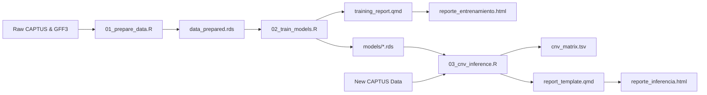

# TargetCNV-ML Execution Guide

[🇪🇸 Guía de Ejecución en Español](https://github.com/xyzdiego/TargetCNV-ML/blob/main/GUIA_EJECUCION.md) | [🇬🇧 English README](https://github.com/xyzdiego/TargetCNV-ML/blob/main/README.md) | [🇪🇸 README en Español](https://github.com/xyzdiego/TargetCNV-ML/blob/main/README_ES.md)

[](https://doi.org/10.5281/zenodo.23463987)
[](https://www.r-project.org/)
[](https://opensource.org/licenses/MIT)
[-brightgreen.svg)](#inicio-rápido-batería-de-pruebas)
[](https://rstudio.github.io/renv/)

**TargetCNV-ML** is a modular, reproducible, command-line (CLI) bioinformatics software package that detects **Copy Number Variations (CNV)** and resolves **homologous gene expansions** from target capture (*Hyb-Seq* / *Target Enrichment*) sequencing assemblies.

> [!IMPORTANT]
> **Language Availability Notice:** Currently, the internal workflow of the files, CLI console messages, output table column names, and interactive Quarto HTML reports (`reporte_entrenamiento.html` and `reporte_inferencia.html`) are built in **Spanish**. Full English localization of the internal workflow and interactive reports will be available in upcoming updates.

In this guide you will find:
1. System requirements, installation steps, and environment verification (`./targetcnv.sh doctor` and `./targetcnv.sh snapshot`).
2. Directory structure, file layout, and workflow diagram of the repository.
3. One-line execution with `./targetcnv.sh` and a complete reference of all options for the three CLI modules (`01_prepare_data.R`, `02_train_models.R`, `03_cnv_inference.R`) and the two interactive Quarto HTML reports (`training_report.qmd` and `report_template.qmd`).
4. **Workflow 1:** Running the quick test with the included synthetic dataset (*Minimal Working Example* / MWE).
5. **Workflow 2:** Downloading, running, and updating the pretrained models hosted on **Zenodo** ([DOI: 10.5281/zenodo.23463987](https://www.google.com/url?sa=E&source=gmail&q=https://doi.org/10.5281/zenodo.23463987)).
6. **Workflow 3:** Training models with new genomic data and testing **cross-species transferability** (on chromosome-level assemblies like *Solanum citrullifolium* and fragmented assemblies like *Solanum stellatiglandulosum*).
7. **Workflow 4:** Reproducing the ***Solanum torvum*** reference experiment step by step.
8. Citation and license.

---

## 1. System Requirements & Installation

### Software Requirements
- **Operating System:** Linux (Ubuntu 20.04+, Debian 11+, Arch/CachyOS, Fedora), macOS, or Windows (via WSL2).
- **R:** $\ge 4.0.0$ (R 4.3+ or 4.6 recommended).
- **Quarto CLI:** $\ge 1.3+$ (required to compile the interactive `.html` reports).
- **System tools:** `bash`, `curl` or `wget`, `unzip`, `md5sum`, `gcc`, `g++`, `make`.

### Installing & Restoring the R Environment (`renv`)

The project uses `renv` to isolate and reproduce the exact versions of all bioinformatics and machine learning libraries:

```bash
# 1. Clone the repository
git clone https://github.com/xyzdiego/TargetCNV-ML.git
cd TargetCNV-ML

# 2. Make scripts executable and restore R packages
chmod +x targetcnv.sh run_test_pipeline.sh scripts/*.R
Rscript -e "renv::restore()"

# (Fast alternative if packages are already installed in your system R library):
./targetcnv.sh snapshot

# 3. Check that all tools and R libraries are ready
./targetcnv.sh doctor
```

> [!NOTE]
> The main R libraries managed by `renv` are: `GenomicRanges`, `rtracklayer`, `caret`, `caretEnsemble`, `glmnet`, `klaR`, `kernlab`, `randomForest`, `gbm`, `xgboost`, `RSNNS`, `deepnet`, `ipred`, `pROC`, `optparse`, `readxl`, `kernelshap`, `shapviz`, `NeuralNetTools`, `plotly`, `DT`, `cowplot`, `knitr`, `rmarkdown`, `dplyr`, `tidyr`, and `stringr`.

---

## 2. Directory Structure & Workflow Diagram

```text
TargetCNV-ML/
├── .Rprofile                    # Automatic activation of the renv virtual environment
├── .gitignore                   # Excludes heavy binary files and raw data per Zenodo standards
├── renv.lock                    # Dependency lockfile recording exact R package versions
├── targetcnv.sh                 # Unified Bash CLI orchestrator for running 1-line workflows
├── run_test_pipeline.sh         # Bash runner for the end-to-end Minimal Working Example (MWE)
├── training_report.qmd          # Quarto template for the interactive HTML training report
├── report_template.qmd          # Quarto template for the interactive HTML CNV inference report
├── EXECUTION_GUIDE.md           # Step-by-step execution guide in English (this file)
├── GUIA_EJECUCION.md            # Step-by-step execution guide in Spanish
├── README.md                    # Main overview in English
├── README_es.md                 # Main overview in Spanish
│
├── R/                           # Pure, modular, roxygen2-documented R library functions
│   ├── model_specs.R            # Unified 18-model tournament specifications, XGBoost adapter & name normalizer
│   ├── data_processing.R        # GFF intersection, dictionary classification, redundancy resolution, CNV extraction
│   ├── model_evaluation.R       # Confusion matrices, Youden optimization, 7-model consensus, inference
│   └── plotting.R               # ggplot2/plotly wrappers for confusion tiles, densities, benchmarks, heatmaps
│
├── scripts/                     # Production CLI executables using optparse
│   ├── 01_prepare_data.R        # Step 1: Spatial GFF overlap and feature engineering
│   ├── 02_train_models.R        # Step 2: 24-method tournament, k-fold CV, KernelSHAP & HTML training report
│   └── 03_cnv_inference.R       # Step 3: Production CNV inference via 7-model consensus & HTML inference report
│
├── data/
│   ├── reference/               # Genomic reference GFF3 annotations and homology dictionaries
│   ├── CAPTUS_Muestras/         # Multi-sample CAPTUS assembly statistics
│   └── test_data/               # Lightweight mock dataset (<25 KB) for automated testing
│
├── models/                      # Pre-trained ML models, benchmark tables, SHAP objects & thresholds (.rds/.tsv)
└── results/                     # Output CNV matrices, classification tables, and diagnostic plots
```



---

## 3. CLI Command Reference

### 3.0 Quick Execution with `targetcnv.sh`

The `./targetcnv.sh` helper script groups the most common operations into single-line subcommands:

| Subcommand | Example | What it does |
| :--- | :--- | :--- |
| `doctor` | `./targetcnv.sh doctor` | Checks whether `Rscript`, `quarto`, `curl`, `unzip`, `md5sum`, and all R packages are installed. |
| `test` | `./targetcnv.sh test [--sync-root] [--no-report]` | Runs the synthetic test dataset (MWE) inside `data/test_data/`. |
| `zenodo` | `./targetcnv.sh zenodo [--out-dir .]` | Downloads `TargetCNV_Models.zip` from Zenodo, checks its MD5 hash, and extracts `models/`. |
| `infer` | `./targetcnv.sh infer -i stats.tsv --auto-zenodo` | Estimates the CNV matrix and HTML report on new samples; with `--auto-zenodo`, downloads the models first if `models/` is empty. |
| `reproduce-storvum` | `./targetcnv.sh reproduce-storvum --cores 4` | Runs Steps 01, 02, and 03 from start to finish on the *Solanum torvum* dataset. |
| `run-all` | `./targetcnv.sh run-all -g ref.gff3 -c cap.gff -s stats.tsv -d dict.xlsx -i new.tsv` | Runs `01_prepare_data.R` $\rightarrow$ `02_train_models.R` $\rightarrow$ `03_cnv_inference.R` in sequence. |
| `prepare` | `./targetcnv.sh prepare [01 options]` | Passes all arguments directly to `scripts/01_prepare_data.R`. |
| `train` | `./targetcnv.sh train [02 options]` | Passes all arguments directly to `scripts/02_train_models.R`. |
| `report` | `./targetcnv.sh report [--models-dir models]` | Compiles or rebuilds the interactive HTML training report (`reporte_entrenamiento.html`) with Quarto. |
| `snapshot` | `./targetcnv.sh snapshot` | Hydrates R packages from the system library into `renv/library` and updates `renv.lock`. |

---

### 3.1 Module 01: Data Preparation (`01_prepare_data.R`)

This module identifies which CAPTUS contigs correspond to real genes in the reference genome and which ones are noise or redundant fragments:
1. Matches the genomic coordinates of CAPTUS contigs (`protein_match:NUC`) against `gene` features in the reference `.gff3` file using `GenomicRanges` (or reads the reference gene ID directly from the GFF `Target` attribute when `--target_mode target_attr` is used for fragmented assemblies).
2. Compares each match against the reference homology dictionary to label true matches as `TRUE_POSITIVE` and cross-homolog or off-target alignments as `FALSE_POSITIVE`.
3. When multiple contigs map to the same reference gene as `TRUE_POSITIVE`, keeps the longest, highest-coverage contig as `TRUE_POSITIVE` and reclassifies secondary fragments as `FALSE_POSITIVE` (`5_TP_Redundante_Degradado`).
4. Computes the quality difference of each hit relative to the best hit in the same locus (`delta_wscore` and `delta_pct_identity`).

#### Example Usage
```bash
./scripts/01_prepare_data.R \
  --gff_ref data/reference/Storvum_genes.gff3 \
  --captus_gff data/reference/Storvum_hit_contigs.gff \
  --captus_stats data/reference/captus-extract_stats.tsv \
  --dict_ref data/reference/Genes_Capture_May_2026.xlsx \
  --sample Storvum \
  --target_mode overlap \
  --out_dir data/
```

#### Available Options

| Short | Long | Type | Required | Default | Description |
| :--- | :--- | :--- | :---: | :--- | :--- |
| `-g` | `--gff_ref` | File | **YES**\* | *None* | Reference genome GFF/GFF3 annotation file (must contain `gene` entries). \*Required in `overlap` mode. |
| `-c` | `--captus_gff` | File | **YES** | *None* | CAPTUS assembled contigs GFF file (`protein_match:NUC` entries). |
| `-s` | `--captus_stats` | File | **YES** | *None* | CAPTUS `captus-extract_stats.tsv` alignment metrics table. |
| `-d` | `--dict_ref` | File | No | `NULL` | Gene-to-orthogroup correspondence table (`.xlsx`, `.tsv`, or `.csv`). Supports the multi-sheet `Genes_Capture_May_2026.xlsx` file or simple tables. |
| `-p` | `--sample` | Text | No | `NULL` | Sample name to filter inside `captus_stats` (e.g., `Storvum`, `Scitrullifolium`, `S_stella`). |
| | `--target_mode` | Text | No | `overlap` | `'overlap'`: matches coordinates against `--gff_ref`. `'target_attr'`: extracts the reference gene ID from the `Target` attribute of the CAPTUS GFF (for fragmented assemblies). |
| `-o` | `--out_dir` | Folder | No | `data/` | Output directory where prepared files (`data_prepared.rds` and `data_prepared.tsv`) will be saved. |
| `-h` | `--help` | Flag | No | - | Shows the help menu. |

---

### 3.2 Module 02: Model Training & Evaluation (`02_train_models.R`)

Using the labeled dataset from Step 1, this module trains and compares **24 classification methods** to separate real homologs (`TP`) from noise (`FP`):
1. **Univariate Youden cutoffs (4 methods):** For each of the 4 continuous metrics (`pct_recovered`, `pct_identity`, `score`, `wscore`), finds the cutoff that maximizes Youden's $J$ statistic ($\text{Sensitivity} + \text{Specificity} - 1$).
2. **Weighted heuristic model (`Weighted_Heuristic`):** Tests integer weight combinations (0 to 3) across the 4 binary Youden votes to find the weighted sum that maximizes the area under the ROC curve (AUC).
3. **Full Machine Learning Tournament (`caret`, 18 classifiers + `Ensamble_Stacking`):** Trains by default all 18 supervised algorithms (`RandomForest`, `GBM`, `XGBoost`, `SVM_Radial`, `SVM_Lineal`, `SVM_Polinomial`, `Red_Neuronal`, `Red_Neuronal_Bag`, `ElasticNet`, `KNN`, `CART`, `NaiveBayes`, `LDA`, `MLP`, `MLP_Regularizado`, `QDA`, `Bagging_Arboles`, `Stacked Autoencoder - DNN`) plus the GLM `caretStack` meta-model (`Ensamble_Stacking`) under two cross-validation scenarios:
   - **Balanced:** Balances `TP` and `FP` counts inside each fold using down-sampling.
   - **Unbalanced:** Trains on the original class proportions without resampling.
4. **Explainability (KernelSHAP) & Interactive Report (`reporte_entrenamiento.html`):** Computes KernelSHAP values on `ElasticNet` and compiles the interactive HTML training report.

#### Example Usage
```bash
./scripts/02_train_models.R \
  --data data/data_prepared.rds \
  --out_models models/ \
  --cv_folds 5 \
  --sampling down \
  --cores 4 \
  --seed 1234 \
  --report_file reporte_entrenamiento.html
```

#### Available Options

| Short | Long | Type | Required | Default | Description |
| :--- | :--- | :--- | :---: | :--- | :--- |
| `-d` | `--data` | File | **YES** | `data/data_prepared.rds` | Prepared dataset file (`.rds` or `.tsv`) generated in Step 1. |
| `-m` | `--out_models` | Folder | No | `models/` | Folder where `.rds` models and `.tsv` benchmark tables will be saved. |
| `-k` | `--cv_folds` | Integer | No | `5` | Number of cross-validation folds ($\ge 2$). |
| `-s` | `--sampling` | Text | No | `down` | Class-balancing method for the balanced scenario: `'down'` (down-sampling), `'up'` (up-sampling), or `'none'`. |
| `-c` | `--cores` | Integer | No | `detectCores() - 1` | Number of CPU cores used for parallel training. |
| | `--seed` | Integer | No | `1234` | Random seed for reproducible results. |
| | `--extended_tournament` | Flag | No | `TRUE` | Trains all 18 supervised classifiers from the full tournament. |
| | `--fast_tournament` | Flag | No | - | Trains only the 5 fast core classifiers (`ElasticNet`, `NaiveBayes`, `SVM_Polinomial`, `Red_Neuronal`, `LDA`). |
| | `--train_stacking` | Flag | No | `TRUE` | Fits the GLM stacking meta-model (`Ensamble_Stacking` via `caretStack`). |
| | `--no_stacking` | Flag | No | - | Skips training the `Ensamble_Stacking` meta-model. |
| | `--clean_models` | Flag | No | `FALSE` | Removes previous `.rds`/`.tsv` files in `--out_models` before saving. |
| | `--include_hit` | Flag | No | `FALSE` | Adds the `hit` column as a predictor. *(Off by default to keep compatibility with `03_cnv_inference.R`).* |
| | `--render_report` | Flag | No | `TRUE` | Automatically compiles the HTML report when training finishes. |
| | `--no_render_report` | Flag | No | - | Skips HTML report generation (useful on servers without Quarto). |
| `-r` | `--report_file` | File | No | `reporte_entrenamiento.html` | Output path and filename for the HTML training report. |
| `-h` | `--help` | Flag | No | - | Shows the help menu. |

#### Metrics Included in the Benchmark Tables (16 Columns)

All benchmark tables (`benchmark_models_balanced.tsv`, `benchmark_models_unbalanced.tsv`, `youden_benchmark.tsv`, and `benchmark_models_all.tsv`) share the same 16 columns:
1. `Modelo`: Name of the classifier or cutoff rule.
2. `Exactitud` (*Accuracy*): $\frac{TP + TN}{TP + FP + FN + TN}$.
3. `Exactitud_Balanceada` (*Balanced Accuracy*): $\frac{\text{Sensitivity} + \text{Specificity}}{2}$.
4. `Sensibilidad` (*Recall*): $\frac{TP}{TP + FN}$.
5. `Especificidad`: $\frac{TN}{TN + FP}$.
6. `Precision` (*Positive Predictive Value*): $\frac{TP}{TP + FP}$.
7. `VPN` (*Negative Predictive Value*): $\frac{TN}{TN + FN}$.
8. `FDR` (*False Discovery Rate*): $1 - \text{Precision} = \frac{FP}{TP + FP}$.
9. `F1_Score`: $2 \times \frac{\text{Precision} \times \text{Sensitivity}}{\text{Precision} + \text{Sensitivity}}$.
10. `MCC` (*Matthews Correlation Coefficient*).
11. `Kappa`: Cohen's Kappa agreement score.
12. `ROC_AUC`: Area under the ROC curve.
13. `TP`, `FP`, `FN`, `TN`: Confusion matrix integer counts.

> [!TIP]
> **Cross-scenario asterisk (`*`) indicator in the HTML report:** In the collapsible interactive tables of `reporte_entrenamiento.html`, models marked with **`*`** in the `Modelo` column (and detailed in `Mejor_Version_FDR`) are those whose alternative version (*Balanced* vs. *Unbalanced*) achieves a superior global score with strong weighting on False Discovery Rate ($\text{FDR}$) control:
> $$\text{Global Index}_{\text{FDR}} = 0.45(1 - \text{FDR}) + 0.20\,\text{F1} + 0.15\,\text{MCC} + 0.10\,\text{Balanced Acc.} + 0.10\,\text{ROC-AUC}$$

---

### 3.3 Module 03: CNV Inference & Consensus (`03_cnv_inference.R`)

This module takes a CAPTUS statistics table from new samples, removes assembly noise by combining 7 models, and estimates gene copy numbers per locus and sample:

1. **7-Model consensus vote:** Each sequence is evaluated by 7 methods:
   - 4 Machine Learning classifiers (`ElasticNet`, `NaiveBayes`, `SVM_Polinomial`, `Red_Neuronal`).
   - 2 univariate Youden cutoffs (`pct_recovered` and `pct_identity`).
   - 1 weighted heuristic model (`Weighted_Heuristic`).
   If a sequence receives **4 or more positive votes** (`--min_votes 4`), it is accepted as `Homologo_Valido`; otherwise it is discarded as `Ruido_Descartado`.

2. **Single-threshold coverage rule for homolog determination:** To reduce the risk that a single gene split across multiple contigs is counted as multiple copies, sequences accepted as `Homologo_Valido` are sorted from highest to lowest coverage (`pct_recovered`) within each sample and locus, and classified with a single-threshold rule:
   - **`Copia_Principal`:** First sequence (highest coverage) of the locus in the sample. Always counted as evidence of locus presence, without a coverage threshold.
   - **`Homologo_Confirmado`:** Additional sequence with individual coverage $\ge 50\%$ (`--cov_threshold 50.0`). Counted as an additional gene copy in the CNV matrix.
   - **`No_Contado`:** Additional sequence with individual coverage $< 50\%$. Not counted, because a short fragment alone cannot distinguish between a portion of the primary copy split by the assembler and an incomplete additional copy.
   The estimated copy number per locus and sample in `cnv_matrix.tsv` is `Copia_Principal + Homologo_Confirmado`.

> [!NOTE]
> **Interpretation Note:** The 50% threshold is an empirically uncalibrated heuristic and directly determines the CNV matrix. The rule is conservative: it may underestimate copy number when an additional copy is only recovered in fragments shorter than 50%, and it may overestimate copy number if a single copy is split into two contigs that each exceed 50% coverage. CNV results should be interpreted keeping this assumption in mind.

#### Example Usage
```bash
./scripts/03_cnv_inference.R \
  --input data/CAPTUS_Muestras/captus-extract_stats.tsv \
  --models_dir models/ \
  --out_dir results/ \
  --cov_threshold 50.0 \
  --min_votes 4 \
  --top_loci 30
```

#### Available Options

| Short | Long | Type | Required | Default | Description |
| :--- | :--- | :--- | :---: | :--- | :--- |
| `-i` | `--input` | File | **YES** | *None* | Input `.tsv`, `.csv`, or `.rds` file with CAPTUS metrics for the samples to analyze. |
| `-m` | `--models_dir` | Folder | No | `models/` | Folder containing the `.rds` model and threshold files. |
| `-o` | `--out_dir` | Folder | No | `results/` | Output folder for CNV tables, plots, and the HTML inference report. |
| `-c` | `--cov_threshold` | Double | No | `50.0` | Minimum individual coverage (`pct_recovered` in %) required to confirm an additional copy (`Homologo_Confirmado`). |
| `-v` | `--min_votes` | Integer | No | `4` | Minimum positive votes (out of 7) required to accept a sequence as `Homologo_Valido`. |
| `-t` | `--top_loci` | Integer | No | `30` | Number of top loci with the highest copy counts to show in the heatmap. |
| | `--render_report` / `--no_render_report` | Flag | No | `TRUE` | Automatically compiles (default) or skips the interactive HTML inference report `reporte_inferencia.html`. |
| `-r` | `--report_file` | File | No | `reporte_inferencia.html` | Output filename for the HTML inference report inside `--out_dir`. |
| `-h` | `--help` | Flag | No | - | Shows the help menu. |

#### Output Files in `<out_dir>/`
- `cnv_matrix.tsv`: Gene copy number matrix (`Copia_Principal + Homologo_Confirmado`, rows: loci/orthogroups, columns: samples).
- `cnv_annotated_sequences.tsv`: Table of all valid sequences showing their copy category (`Copia_Principal`, `Homologo_Confirmado`, or `No_Contado`).
- `functional_genes_catalog.tsv`: Filtered list containing only confirmed functional copies (`Copia_Principal` and `Homologo_Confirmado`).
- `consensus_verdicts.tsv`: Full table showing the individual votes of all 7 models for every evaluated sequence.
- `transferability_benchmark.tsv`: *(Generated automatically when `--input` contains `Validacion_Espacial`)* Classification metrics when applying the models to another species.
- `plot_consensus_distribution.pdf` & `.png`: Bar plot showing accepted versus discarded sequences.
- `plot_cnv_heatmap.pdf` & `.png`: Heatmap of copy numbers across the most variable loci.
- `reporte_inferencia.html`: Interactive Quarto report displaying the consensus vote breakdown, interactive heatmap, and exportable CNV matrices.

---

### 3.4 Manual Compilation of the Quarto HTML Reports

- **Training Report (`training_report.qmd` $\rightarrow$ `reporte_entrenamiento.html`):**
  ```bash
  # In one line with targetcnv.sh:
  ./targetcnv.sh report

  # Or directly with Quarto:
  quarto render training_report.qmd \
    -P project_root:"." \
    -P models_dir:"models" \
    -P data_file:"data/data_prepared.rds" \
    --output "reporte_entrenamiento.html"
  ```
- **Inference Report (`report_template.qmd` $\rightarrow$ `results/reporte_inferencia.html`):**
  ```bash
  quarto render report_template.qmd \
    -P consensus_verdicts:"results/consensus_verdicts.tsv" \
    -P cnv_matrix:"results/cnv_matrix.tsv" \
    -P cnv_annotated:"results/cnv_annotated_sequences.tsv" \
    -P top_loci:30 \
    --output "reporte_inferencia.html"
  ```

---

## 4. Workflow 1: Quick Test with Synthetic Data (MWE)

The repository includes a lightweight synthetic dataset in `data/test_data/` so you can verify your installation in seconds:

```bash
./targetcnv.sh test
# Equivalent to: ./run_test_pipeline.sh
```

This command runs all three steps in isolation (without overwriting root `models/` or `results/`):
1. `01_prepare_data.R` on `data/test_data/mock_*.gff3`, saving to `data/test_data/prepared/`.
2. `02_train_models.R` using 3-fold cross-validation, saving to `data/test_data/models/` and generating `data/test_data/reporte_entrenamiento_test.html`.
3. `03_cnv_inference.R` on `data/test_data/mock_captus_extract.tsv`, saving the CNV matrix, plots, and `reporte_inferencia.html` in `data/test_data/results/`.

---

## 5. Workflow 2: Downloading, Using & Updating Models on Zenodo

The models trained on the *Solanum torvum* reference genome are archived on Zenodo:
- **DOI:** [10.5281/zenodo.23463987](https://www.google.com/url?sa=E&source=gmail&q=https://doi.org/10.5281/zenodo.23463987)
- **File:** `TargetCNV_Models.zip`

### 5.1 Automatic Download & Inference in 1 Line
```bash
# If models/ is empty, downloads the zip from Zenodo, checks the MD5 hash, and runs inference:
./targetcnv.sh infer -i data/CAPTUS_Muestras/captus-extract_stats.tsv --auto-zenodo
```

### 5.2 Step-by-Step Download & Inference
```bash
./targetcnv.sh zenodo
./scripts/03_cnv_inference.R \
  --input data/CAPTUS_Muestras/captus-extract_stats.tsv \
  --models_dir models \
  --out_dir results \
  --cov_threshold 50.0 \
  --min_votes 4 \
  --top_loci 30
```

### 5.3 How to Update `TargetCNV_Models.zip` on Zenodo

If you want to publish a new version of `TargetCNV_Models.zip` on Zenodo containing all 24 evaluated models (`models_balanced.rds`, `models_unbalanced.rds`, individual `.rds` models, and `benchmark_models_*.rds`/`.tsv`):

1. **Package the `models/` directory and compute its new MD5 hash:**
   ```bash
   zip -r TargetCNV_Models.zip models/
   md5sum TargetCNV_Models.zip
   ```
2. **Upload the new version on Zenodo:**
   - Open your Zenodo record ([https://zenodo.org/records/23463987](https://www.google.com/url?sa=E&source=gmail&q=https://doi.org/10.5281/zenodo.23463987)) and click **"New version"**.
   - Delete the old `TargetCNV_Models.zip` in the draft, upload the newly created `TargetCNV_Models.zip`, update the version tag (e.g., `v1.1.0`), and click **"Publish"**.
3. **Update `targetcnv.sh` with the new record ID and MD5 hash:**
   - Copy the new `record_id` assigned by Zenodo and the MD5 hash from `md5sum TargetCNV_Models.zip`, and update lines 22–24 in `targetcnv.sh`:
     ```bash
     ZENODO_URL="https://zenodo.org/api/records/<NEW_RECORD_ID>/files/TargetCNV_Models.zip/content"
     ZENODO_ZIP="TargetCNV_Models.zip"
     ZENODO_MD5="<NEW_MD5_HASH>"
     ```

---

## 6. Workflow 3: Training on New Data & Cross-Species Transferability

### 6.1 Train and Predict on a New Species in 1 Line
```bash
./targetcnv.sh run-all \
  -g path/to/new_genome.gff3 \
  -c path/to/new_captus_contigs.gff \
  -s path/to/captus-extract_stats.tsv \
  -d path/to/orthology_dictionary.xlsx \
  -p ReferenceSampleName \
  -i path/to/population_captus_stats.tsv \
  --out_data data/new_species \
  -m models/new_species \
  -o results/new_species \
  -r training_report_new_species.html
```

### 6.2 Cross-Species Transferability Tests (*S. citrullifolium* & *S. stellatiglandulosum*)

#### Case A: Chromosome-Level Assembly (*Solanum citrullifolium*)
```bash
./scripts/01_prepare_data.R \
  --gff_ref path/to/Scitrullifolium_genes.gff3 \
  --captus_gff path/to/Scitrullifolium_hit_contigs.gff \
  --captus_stats path/to/captus-extract_stats.tsv \
  --dict_ref data/reference/Genes_Capture_May_2026.xlsx \
  --sample Scitrullifolium \
  --out_dir data/citrullifolium/

./scripts/03_cnv_inference.R \
  --input data/citrullifolium/data_prepared.rds \
  --models_dir models/ \
  --out_dir results/citrullifolium/
```

#### Case B: Highly Fragmented Assembly (*Solanum stellatiglandulosum*, HOG $\leftrightarrow$ OG Bridge & `Target` Attribute)
```bash
./scripts/01_prepare_data.R \
  --captus_gff path/to/S_stella_hit_contigs.gff \
  --captus_stats path/to/captus-extract_stats.tsv \
  --dict_ref data/reference/Genes_Capture_May_2026.xlsx \
  --sample S_stella \
  --target_mode target_attr \
  --out_dir data/stellatiglandulosum/

./scripts/03_cnv_inference.R \
  --input data/stellatiglandulosum/data_prepared.rds \
  --models_dir models/ \
  --out_dir results/stellatiglandulosum/
```

---

## 7. Workflow 4: Reproducing the Reference Experiment (*Solanum torvum*)

### In 1 Single Line
```bash
./targetcnv.sh reproduce-storvum --cores 4
```

### Key Cross-Validation Results (K=5, Seed 1234)

#### Balanced Scenario (*Down-Sampling*)
| Model | Balanced Acc. (%) | Sensitivity (%) | Specificity (%) | Precision (%) | FDR (%) | F1 Score | MCC | Kappa | ROC-AUC |
| :--- | :---: | :---: | :---: | :---: | :---: | :---: | :---: | :---: | :---: |
| **Weighted_Heuristic** | 88.86 | 83.91 | 93.81 | 92.41 | 7.59 | **0.880** | 0.784 | 0.781 | 0.921 |
| **Red_Neuronal (`nnet`)** | 87.32 | 83.91 | 90.72 | 88.98 | 11.02 | **0.864** | 0.750 | 0.749 | 0.927 |
| **SVM_Polinomial (`svmPoly`)** | 87.14 | 80.46 | 93.81 | 92.11 | 7.89 | **0.859** | 0.753 | 0.748 | **0.934** |
| **LDA \*** | 86.74 | 82.76 | 90.72 | 88.89 | 11.11 | **0.857** | 0.739 | 0.737 | 0.922 |
| **NaiveBayes (`nb`)** | 86.56 | 79.31 | 93.81 | 92.00 | 8.00 | **0.852** | 0.743 | 0.736 | **0.934** |
| **ElasticNet (`glmnet`) \*** | 85.28 | 83.91 | 86.60 | 84.88 | 15.12 | **0.844** | 0.706 | 0.705 | 0.930 |

#### Unbalanced Scenario (Original Proportions: 87 TP vs. 97 FP)
| Model | Balanced Acc. (%) | Sensitivity (%) | Specificity (%) | Precision (%) | FDR (%) | F1 Score | MCC | Kappa | ROC-AUC |
| :--- | :---: | :---: | :---: | :---: | :---: | :---: | :---: | :---: | :---: |
| **Weighted_Heuristic** | 88.86 | 83.91 | 93.81 | 92.41 | 7.59 | **0.880** | 0.784 | 0.781 | 0.921 |
| **LDA** | 87.26 | 82.76 | 91.75 | 90.00 | 10.00 | **0.862** | 0.750 | 0.748 | 0.922 |
| **NaiveBayes (`nb`)** | 86.56 | 79.31 | 93.81 | 92.00 | 8.00 | **0.852** | 0.743 | 0.736 | **0.934** |
| **ElasticNet (`glmnet`)** | 85.76 | 83.91 | 87.63 | 85.88 | 14.12 | **0.849** | 0.716 | 0.716 | 0.930 |
| **Red_Neuronal (`nnet`) \*** | 84.60 | 80.46 | 88.66 | 86.42 | 13.58 | **0.833** | 0.695 | 0.694 | 0.921 |
| **SVM_Polinomial (`svmPoly`) \*** | 83.04 | 90.80 | 75.26 | 76.70 | 23.30 | **0.832** | 0.664 | 0.654 | 0.930 |

*(\* indicates that the model achieves a superior FDR-weighted global score in its alternative scenario: Balanced vs. Unbalanced).*

---

## 8. Citation & License

```bibtex
@software{targetcnv_ml_2026,
  author       = {Benítez Duarte, Diego Andrés},
  title        = {{TargetCNV-ML: Machine Learning & Spatial Inference for Copy Number Variations in Target Capture}},
  month        = jul,
  year         = 2026,
  publisher    = {Zenodo},
  version      = {v1.0.0},
  doi          = {10.5281/zenodo.23463987},
  url          = {https://doi.org/10.5281/zenodo.23463987}
}

@mastersthesis{benitez_duarte_thesis_2026,
  author       = {Benítez Duarte, Diego Andrés},
  title        = {{Desarrollo de un flujo de trabajo bioinformático para la Detección de Variación en el Número de Copias (CNV) de genes a partir de secuencias genómicas de lectura corta}},
  school       = {Universidad Nacional de Colombia},
  year         = 2026,
  address      = {Colombia},
  note         = {Master Thesis - Bioinformatics}
}
```

Released under the **MIT License** — see [LICENSE](https://www.google.com/search?q=LICENSE) for details. Datasets and pre-trained models on Zenodo are licensed under **CC BY 4.0**.
