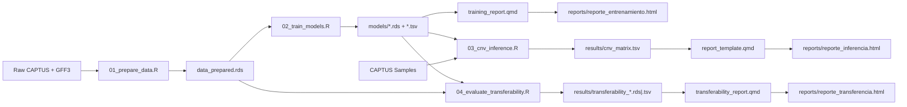

# TargetCNV-ML Execution Guide

[Guía de Ejecución en Español](GUIA_EJECUCION.md) | [English README](README.md) | [README en Español](README_ES.md)

[](https://doi.org/10.5281/zenodo.23463987)
[](https://www.r-project.org/)
[](https://opensource.org/licenses/MIT)
[](#4-running-the-test-suite-and-minimal-working-example)
[](https://rstudio.github.io/renv/)

This manual provides the command-line reference and operational workflows for **TargetCNV-ML**, an R toolkit for estimating gene Copy Number Variations (CNV) and filtering assembly artifacts in **Target Capture** (*Hyb-Seq*) sequencing data.

> [!NOTE]
> Console logs, TSV column names, and the Quarto HTML reports compiled under `reports/` (`reporte_entrenamiento.html`, `reporte_inferencia.html`, and `reporte_transferencia.html`) are written in Spanish to match the accompanying Master's thesis.

---

## 1. Environment Setup and Installation

### Prerequisites
- **Operating System:** Linux (Ubuntu 22.04/24.04, Debian 12+, Arch/CachyOS, Fedora), macOS, or WSL2 on Windows.
- **R:** `4.6.2` with Bioconductor `3.23` is recommended for exact alignment with `renv.lock` (compatible with R $\ge 4.3$).
- **Quarto CLI:** `1.10.20` (or $\ge 1.4$) for rendering `.qmd` report templates.
- **System build/CLI tools:** `bash`, `curl` or `wget`, `unzip`, `md5sum`, `gcc`, `g++`, `gfortran`, `cmake`, and `make`.

### 1.1 Restoring the R Library via `renv`

```bash
git clone https://github.com/xyzdiego/TargetCNV-ML.git
cd TargetCNV-ML

chmod +x targetcnv.sh run_test_pipeline.sh scripts/*.R
./targetcnv.sh restore
./targetcnv.sh doctor
```

**Important note on `renv` lockfile integrity:** Do not run `renv::hydrate()` or `renv::snapshot()` when installing the project. Hydrating pulls unpinned packages from the host system library and `snapshot` overwrites `renv.lock`. Always use `./targetcnv.sh restore` (or `./targetcnv.sh setup`), which runs `renv::restore(prompt = FALSE)` strictly against `renv.lock`.

### 1.2 Containerized and Conda-Based Execution (Pixi / Apptainer)

If you want to pin the R interpreter, system libraries, and Quarto CLI together:

```bash
# Option 1: Pixi (uses conda-forge and bioconda from pixi.toml)
pixi install
pixi run doctor
pixi run test

# Option 2: Apptainer / Singularity (builds from Apptainer.def)
apptainer build targetcnv-ml.sif Apptainer.def
apptainer exec targetcnv-ml.sif ./targetcnv.sh doctor
```

Because the repository includes standard `DESCRIPTION` and `NAMESPACE` files, the 60 exported functions in `R/` can be loaded either by the CLI scripts (`source()`) or via `pkgload::load_all(".")` / `R CMD INSTALL`.

---

## 2. Architecture and Read-Only Reporting

All model fitting, cross-validation, consensus voting, and cross-species transferability metrics are computed by the four R scripts in `scripts/`. The three Quarto templates (`training_report.qmd`, `report_template.qmd`, and `transferability_report.qmd`) are strictly **read-only**: they read precomputed `.rds` and `.tsv` files from `models/` and `results/` and compile self-contained HTML reports into `reports/` using shared styles (`assets/report.css`) and the interactive SHAP Waterfall script (`assets/waterfall.js`).



---

## 3. Command-Line Reference

### 3.0 Wrapper Subcommands (`./targetcnv.sh`)

| Subcommand | Example | Description |
| :--- | :--- | :--- |
| `restore` / `setup` | `./targetcnv.sh restore` | Restores R packages strictly from `renv.lock`. |
| `doctor` | `./targetcnv.sh doctor` | Checks `Rscript`, `quarto`, `curl`/`wget`, `unzip`, `md5sum`, and R package availability. |
| `test` | `./targetcnv.sh test [--no-report]` | Runs the MWE on synthetic data inside `data/test_data/`. |
| `zenodo` | `./targetcnv.sh zenodo [--out-dir .]` | Downloads `TargetCNV_Models.zip` from Zenodo, verifies MD5, and checks extracted models. |
| `prepare` | `./targetcnv.sh prepare [01 options]` | Forwards arguments to `scripts/01_prepare_data.R`. |
| `train` | `./targetcnv.sh train [02 options]` | Forwards arguments to `scripts/02_train_models.R`. |
| `infer` | `./targetcnv.sh infer -i stats.tsv --auto-zenodo` | Runs `scripts/03_cnv_inference.R` (downloads Zenodo models if `models/` is empty). |
| `transfer` | `./targetcnv.sh transfer [--sources ...]` | Runs `scripts/04_evaluate_transferability.R` and renders `reports/reporte_transferencia.html`. |
| `report` | `./targetcnv.sh report [--models-dir models]` | Re-renders `reports/reporte_entrenamiento.html` from existing artifacts. |
| `reproduce-storvum` | `./targetcnv.sh reproduce-storvum --cores 4` | Runs `01` $\rightarrow$ `02` $\rightarrow$ `03` on the *Solanum torvum* reference dataset. |
| `run-all` | `./targetcnv.sh run-all -g ref.gff3 -c cap.gff -s stats.tsv -d dict.xlsx -i new.tsv` | Runs `01` $\rightarrow$ `02` $\rightarrow$ `03` on a new dataset with separate training and inference HTML reports. |

> [!WARNING]
> **Destructive Flags (When to Use and When to Avoid):**
> - `--clean_models` (in `02_train_models.R`): deletes all existing `.rds` and `.tsv` files in `--out_models` before saving new training outputs. This flag is disabled by default and is **not** passed by `./targetcnv.sh reproduce-storvum`. Use it only when you explicitly want to wipe `--out_models` prior to a full re-train; avoid it when running `--fast_tournament` if you want to keep previously trained 18-model artifacts.
> - `--sync-root` (in `./targetcnv.sh test` or `./run_test_pipeline.sh`): overwrites the root `models/` and `results/` directories with synthetic MWE artifacts. Never use it when `models/` contains real trained models or Zenodo downloads.

---

### 3.1 Module 01: Data Preparation and Spatial Labeling (`01_prepare_data.R`)

Labels each nuclear CAPTUS contig (`protein_match:NUC`) as `TRUE_POSITIVE` or `FALSE_POSITIVE`:
- **Chromosome scale (`--genome_scale chromosome` / `--target_mode overlap`):** harmonizes sequence prefixes and intersects coordinates and strand (`GenomicRanges::findOverlaps`, `ignore.strand = FALSE`) against `gene` features in `--gff_ref`.
- **Contig scale (`--genome_scale contig` / `--target_mode target_attr`):** extracts target gene IDs from the CAPTUS GFF `Target` attribute and maps hierarchical `HOG_ID` groups to pan-genomic `OG_ID` groups via the probe-design bridge table.
- **Intra-locus redundancy resolution:** within each sample and reference gene locus, only the positive contig with greatest matched length (`ref_len_matched`) and coverage (`pct_recovered`) is retained as `TRUE_POSITIVE`; secondary fragments on that same locus are reclassified as `FALSE_POSITIVE` (`5_TP_Redundante_Degradado`).

```bash
Rscript scripts/01_prepare_data.R \
  --gff_ref data/reference/Storvum_genes.gff3 \
  --captus_gff data/reference/Storvum_hit_contigs.gff \
  --captus_stats data/reference/captus-extract_stats.tsv \
  --dict_ref data/reference/Genes_Capture_May_2026.xlsx \
  --sample Storvum \
  --genome_scale chromosome \
  --out_dir data/
```

| Short | Long | Type | Required | Default | Description |
| :--- | :--- | :--- | :---: | :--- | :--- |
| `-g` | `--gff_ref` | File | Yes\* | `NULL` | Reference genome GFF/GFF3 `gene` annotation (\*required when `--genome_scale chromosome`). |
| `-c` | `--captus_gff` | File | **Yes** | `NULL` | CAPTUS assembled contigs GFF file (`protein_match:NUC`). |
| `-s` | `--captus_stats` | File | **Yes** | `NULL` | CAPTUS `captus-extract_stats.tsv` alignment metrics table. |
| `-d` | `--dict_ref` | File | No | `NULL` | Homology dictionary (`.xlsx`, `.tsv`, or `.csv`) mapping reference loci to orthogroups. |
| `-p` | `--sample` | String | No | `NULL` | Sample name to filter inside `captus-extract_stats.tsv` (e.g., `Storvum`, `Scitrullifolium`, `S_stella`). |
| | `--genome_scale` | String | No | `chromosome` | `'chromosome'` (GFF3 coordinate overlap) or `'contig'` (`Target` attribute + `OG_ID`/`HOG_ID` bridge). |
| | `--target_mode` | String | No | `overlap` | Mode alias: `'overlap'` or `'target_attr'`. |
| | `--allow_multi_sample` | Flag | No | `FALSE` | Permits processing multi-sample tables without `--sample` filtering (synthetic MWE data). |
| `-o` | `--out_dir` | Dir | No | `data/` | Output directory for `data_prepared.rds` and `data_prepared.tsv`. |

---

### 3.2 Module 02: Collinearity, Deterministic CV Training, and SHAP (`02_train_models.R`)

Evaluates predictor collinearity and benchmarks **24 classification methods** across `pct_recovered`, `pct_identity`, `score`, and `wscore`:
1. **Spearman rank collinearity:** exports `models/spearman_collinearity.tsv` and `.rds` (on *S. torvum*, `score` vs. `wscore` $\rho = 0.9977$; `pct_recovered` vs. `pct_identity` $\rho = 0.7776$).
2. **Youden cutoffs (4 methods) and `Weighted_Heuristic`:** maximizes Youden's $J = \text{Sensitivity} + \text{Specificity} - 1$ per metric and searches integer weights ($0\text{ to }3$) for the highest-AUC heuristic rule.
3. **Deterministic cross-validation (18 ML classifiers + `Ensamble_Stacking`):** passes explicit per-resample `seeds` to `caret::trainControl()` derived from `--seed` (bit-for-bit reproducible across `--cores`) under **Balanced** (`down`-sampling) and **Unbalanced** regimes, followed by KernelSHAP calculation and rendering of `reports/reporte_entrenamiento.html`.

```bash
Rscript scripts/02_train_models.R \
  --data data/data_prepared.rds \
  --out_models models/ \
  --cv_folds 5 \
  --sampling down \
  --cores 4 \
  --seed 1234 \
  --sources data/reference/sources_citations.tsv \
  --report_file reports/reporte_entrenamiento.html
```

| Short | Long | Type | Required | Default | Description |
| :--- | :--- | :--- | :---: | :--- | :--- |
| `-d` | `--data` | File | **Yes** | `data/data_prepared.rds` | Labeled dataset (`.rds` or `.tsv`) from Module 01. |
| `-m` | `--out_models` | Dir | No | `models/` | Output folder for `.rds` models, `.tsv` benchmarks, and SHAP objects. |
| `-k` | `--cv_folds` | Integer | No | `5` | Number of stratified cross-validation folds ($\ge 2$). |
| `-s` | `--sampling` | String | No | `down` | Class balancing scheme for the balanced scenario: `'down'`, `'up'`, or `'none'`. |
| `-c` | `--cores` | Integer | No | `detectCores() - 1` | Number of parallel PSOCK worker processes. |
| | `--seed` | Integer | No | `1234` | Master random seed governing CV folds, tuning grids, and per-fold `seeds`. |
| | `--extended_tournament` / `--fast_tournament` | Flag | No | `TRUE` | Train all 18 ML algorithms (default) or the 5-model fast subset. |
| | `--train_stacking` / `--no_stacking` | Flag | No | `TRUE` | Fit (default) or skip the GLM `Ensamble_Stacking` meta-learner. |
| | `--clean_models` | Flag | No | `FALSE` | **Destructive:** deletes existing `.rds` and `.tsv` files in `--out_models` before saving. |
| | `--include_hit` | Flag | No | `FALSE` | Adds CAPTUS hit rank `hit` as a fifth predictor (`consensus_spec.rds` records active predictors for Module 03; keeping it `FALSE` is recommended across datasets). |
| | `--render_report` / `--no_render_report` | Flag | No | `TRUE` | Compile (default) or skip `reports/reporte_entrenamiento.html`. |
| `-r` | `--report_file` | File | No | `reports/reporte_entrenamiento.html` | Output HTML report path. |
| | `--sources` | File | No | `""` | Optional TSV with genome and literature citations (`data/reference/sources_citations.tsv`). |

All benchmark tables export 16 columns (`Modelo`, `Exactitud`, `Exactitud_Balanceada`, `Sensibilidad`, `Especificidad`, `Precision`, `VPN`, `FDR`, `F1_Score`, `MCC`, `Kappa`, `ROC_AUC`, `TP`, `FP`, `FN`, `TN`). Models marked with `*` in HTML tables achieve a higher FDR-weighted composite score in the alternative regime:
$$\text{Composite Score}_{\text{FDR}} = 0.45(1 - \text{FDR}) + 0.20\,\text{F1} + 0.15\,\text{MCC} + 0.10\,\text{Balanced Acc.} + 0.10\,\text{ROC-AUC}$$

---

### 3.3 Module 03: CNV Inference and Coverage Threshold Sensitivity (`03_cnv_inference.R`)

Applies 7-model consensus voting ($\ge 4/7$ votes: `ElasticNet`, `NaiveBayes`, `SVM_Polinomial`, `Red_Neuronal`, `Youden_pct_recovered`, `Youden_pct_identity`, and `Weighted_Heuristic`) and assigns copy categories within each sample and orthogroup sorted by descending `pct_recovered`:
- `Copia_Principal`: highest-coverage valid sequence in that orthogroup and sample.
- `Homologo_Confirmado`: secondary valid sequence with `pct_recovered >= --cov_threshold` (default `50.0%`), counted as an additional copy.
- `No_Contado`: secondary valid sequence below `--cov_threshold`, excluded from copy totals.

The script also sweeps `--cov_threshold` from `30%` to `80%` (`cnv_threshold_sensitivity.tsv`). Because `captus-extract_stats.tsv` provides scalar recovery percentages rather than per-fragment coordinates along the target probe, this threshold is a pragmatic filter that can under-count true copies recovered below `50%` or count two non-overlapping fragments if both exceed `50%`.

```bash
Rscript scripts/03_cnv_inference.R \
  --input data/CAPTUS_Muestras/captus-extract_stats.tsv \
  --models_dir models/ \
  --out_dir results/ \
  --cov_threshold 50.0 \
  --min_votes 4 \
  --top_loci 30 \
  --sources data/reference/sources_citations.tsv
```

| Short | Long | Type | Required | Default | Description |
| :--- | :--- | :--- | :---: | :--- | :--- |
| `-i` | `--input` | File | **Yes** | `NULL` | `.tsv`, `.csv`, or `.rds` table of CAPTUS extraction statistics. |
| `-m` | `--models_dir` | Dir | No | `models/` | Folder holding trained `.rds` artifacts. |
| `-o` | `--out_dir` | Dir | No | `results/` | Destination folder for CNV matrices, sensitivity tables, and plots. |
| `-c` | `--cov_threshold` | Float | No | `50.0` | Minimum `pct_recovered` (%) required to count secondary hits as `Homologo_Confirmado`. |
| `-v` | `--min_votes` | Integer | No | `4` | Minimum positive votes (out of 7) required for `Homologo_Valido`. |
| `-t` | `--top_loci` | Integer | No | `30` | Number of highest-copy orthogroups displayed in the CNV heatmap. |
| | `--true_cnv` | File | No | `""` | Optional reference copy-number table ($\text{CNV}^{\text{real}}_{\text{OG}}$) for concordance metrics. |
| | `--render_report` / `--no_render_report` | Flag | No | `TRUE` | Compile (default) or skip `reports/reporte_inferencia.html`. |
| `-r` | `--report_file` | File | No | `reports/reporte_inferencia.html` | Output HTML report path. |
| | `--sources` | File | No | `""` | Optional TSV with genome citations (`data/reference/sources_citations.tsv`). |

Outputs written to `<out_dir>/`: `cnv_matrix.tsv`, `cnv_annotated_sequences.tsv`, `functional_genes_catalog.tsv`, `consensus_verdicts.tsv`, `cnv_threshold_sensitivity.tsv`, `cnv_concordance_summary.tsv` (when reference labels or `--true_cnv` are available), PDF/PNG plots, and `reports/reporte_inferencia.html`.

---

### 3.4 Module 04: Cross-Species Transferability (`04_evaluate_transferability.R`)

Evaluates all 24 pre-trained *S. torvum* methods and the 7-model consensus without re-training on recipient species (*S. citrullifolium* at chromosome scale and *S. stellatiglandulosum* at contig scale), computes orthogroup copy-number concordance ($\widehat{\text{CNV}}_{\text{OG}}$ vs. $\text{CNV}^{\text{real}}_{\text{OG}}$), sweeps `--cov_threshold` across `30%–80%`, writes `results/transferability_*.tsv|.rds`, and renders `reports/reporte_transferencia.html`.

```bash
./targetcnv.sh transfer --sources data/reference/sources_citations.tsv
```

---

## 4. Running the Test Suite and Minimal Working Example

```bash
# Run unit and integration tests (testthat)
Rscript tests/testthat.R

# Run the full synthetic MWE pipeline and compile test reports under reports/
./targetcnv.sh test
```

---

## 5. Managing Pre-Trained Models on Zenodo

Pre-trained *Solanum torvum* artifacts are archived at [https://doi.org/10.5281/zenodo.23463987](https://doi.org/10.5281/zenodo.23463987) (`TargetCNV_Models.zip`).

```bash
# Download and verify MD5 + 18 ML models + consensus_spec.rds:
./targetcnv.sh zenodo

# Run inference, automatically downloading from Zenodo if models/ is empty:
./targetcnv.sh infer -i data/CAPTUS_Muestras/captus-extract_stats.tsv --auto-zenodo
```

To publish an updated model archive on Zenodo after re-training:
1. Run `zip -r TargetCNV_Models.zip models/ && md5sum TargetCNV_Models.zip`.
2. Create a **"New version"** on Zenodo ([10.5281/zenodo.23463987](https://doi.org/10.5281/zenodo.23463987)) and upload `TargetCNV_Models.zip`.
3. Update `ZENODO_URL` and `ZENODO_MD5` at the top of `targetcnv.sh`.

---

## 6. Cross-Species Transferability and New Species Workflows

### 6.1 Running `run-all` on a New Species
`./targetcnv.sh run-all` executes Modules `01`, `02`, and `03` sequentially and writes separate training and inference HTML reports (using `--infer_report_file` or automatically deriving the inference report path from `-r` / `-p` so `reports/reporte_inferencia.html` is not overwritten):

```bash
./targetcnv.sh run-all \
  -g path/to/new_genome.gff3 \
  -c path/to/new_captus_contigs.gff \
  -s path/to/captus-extract_stats.tsv \
  -d path/to/homology_dictionary.xlsx \
  -p ReferenceSample \
  -i path/to/population_captus_stats.tsv \
  --out_data data/new_species \
  -m models/new_species \
  -o results/new_species \
  -r reports/training_report_new_species.html \
  --infer_report_file reports/inference_report_new_species.html
```

### 6.2 Preparing and Evaluating *S. citrullifolium* and *S. stellatiglandulosum*

```bash
Rscript scripts/01_prepare_data.R \
  --gff_ref data/reference/Scitrullifolium_genes.gff3 \
  --captus_gff data/reference/Scitrullifolium_hit_contigs.gff \
  --captus_stats data/reference/captus-extract_stats.tsv \
  --dict_ref data/reference/Genes_Capture_May_2026.xlsx \
  --sample Scitrullifolium \
  --genome_scale chromosome \
  --out_dir data/citrullifolium/

Rscript scripts/01_prepare_data.R \
  --captus_gff data/reference/S_stella_hit_contigs.gff \
  --captus_stats data/reference/captus-extract_stats.tsv \
  --dict_ref data/reference/Genes_Capture_May_2026.xlsx \
  --sample S_stella \
  --genome_scale contig \
  --out_dir data/stellatiglandulosum/

./targetcnv.sh transfer --sources data/reference/sources_citations.tsv
```

#### Orthogroup Copy-Number Concordance (`--cov_threshold 50.0%`, 7-Model Consensus)

| Species | Genome Scale | Orthogroups ($N$) | Reference Copies | Estimated Copies | Exact Concordance (%) | Spearman's $\rho$ | Quadratic $\kappa_w$ | RMSE |
| :--- | :--- | :---: | :---: | :---: | :---: | :---: | :---: | :---: |
| ***S. torvum*** (Donor) | Chromosome Scale | 58 | 87 | 79 | **79.31** | **0.5983** ($p = 7.0 \times 10^{-7}$) | **0.5269** | 0.8710 |
| ***S. citrullifolium*** | Chromosome Scale | 55 | 56 | 66 | **70.91** | **0.4653** ($p = 3.4 \times 10^{-4}$) | **0.5506** | 0.5394 |
| ***S. stellatiglandulosum*** | Contig Scale | 58 | 19 | 78 | 24.14 | 0.0831 ($p = 0.535$) | 0.0742 | 1.3834 |

---

## 7. Reproducing the *Solanum torvum* Reference Experiment

```bash
./targetcnv.sh reproduce-storvum --cores 4
```

### Representative Cross-Validation Results ($K = 5$, `--seed 1234`, $N = 184$: $87\text{ TP}$ vs. $97\text{ FP}$)

#### Balanced Scenario (*Down-Sampling*)
| Model | Balanced Acc. (%) | Sensitivity (%) | Specificity (%) | Precision (%) | FDR (%) | F1 Score | MCC | Kappa | ROC-AUC |
| :--- | :---: | :---: | :---: | :---: | :---: | :---: | :---: | :---: | :---: |
| **Weighted_Heuristic** | 88.86 | 83.91 | 93.81 | 92.41 | 7.59 | **0.880** | 0.784 | 0.781 | 0.921 |
| **Ensamble_Stacking** | 88.29 | 82.76 | 93.81 | 92.31 | 7.69 | **0.873** | 0.774 | 0.770 | **0.932** |
| **Red_Neuronal (`nnet`)** | 87.31 | 83.91 | 90.72 | 89.02 | 10.98 | **0.864** | 0.750 | 0.749 | 0.927 |
| **SVM_Polinomial (`svmPoly`)** | 87.14 | 80.46 | 93.81 | 92.11 | 7.89 | **0.859** | 0.753 | 0.748 | **0.934** |
| **LDA \*** | 86.74 | 82.76 | 90.72 | 88.89 | 11.11 | **0.857** | 0.739 | 0.737 | 0.922 |
| **NaiveBayes (`nb`)** | 86.56 | 79.31 | 93.81 | 92.00 | 8.00 | **0.852** | 0.743 | 0.736 | **0.934** |
| **ElasticNet (`glmnet`) \*** | 85.25 | 83.91 | 86.60 | 84.88 | 15.12 | **0.844** | 0.706 | 0.705 | 0.930 |
| **XGBoost \*** | 84.50 | 79.31 | 89.69 | 87.34 | 12.66 | **0.831** | 0.696 | 0.693 | 0.920 |

#### Unbalanced Scenario (Original Proportions: $87\text{ TP}$ vs. $97\text{ FP}$)
| Model | Balanced Acc. (%) | Sensitivity (%) | Specificity (%) | Precision (%) | FDR (%) | F1 Score | MCC | Kappa | ROC-AUC |
| :--- | :---: | :---: | :---: | :---: | :---: | :---: | :---: | :---: | :---: |
| **Weighted_Heuristic** | 88.86 | 83.91 | 93.81 | 92.41 | 7.59 | **0.880** | 0.784 | 0.781 | 0.921 |
| **Ensamble_Stacking** | 88.35 | 83.91 | 92.78 | 91.25 | 8.75 | **0.874** | 0.772 | 0.770 | **0.935** |
| **LDA** | 87.26 | 82.76 | 91.75 | 90.00 | 10.00 | **0.862** | 0.750 | 0.748 | 0.922 |
| **NaiveBayes (`nb`)** | 86.56 | 79.31 | 93.81 | 92.00 | 8.00 | **0.852** | 0.743 | 0.736 | **0.934** |
| **ElasticNet (`glmnet`)** | 85.77 | 83.91 | 87.63 | 85.88 | 14.12 | **0.849** | 0.716 | 0.716 | 0.930 |
| **Red_Neuronal (`nnet`) \*** | 84.56 | 80.46 | 88.66 | 86.42 | 13.58 | **0.833** | 0.695 | 0.694 | 0.921 |
| **XGBoost** | 84.56 | 80.46 | 88.66 | 86.42 | 13.58 | **0.833** | 0.695 | 0.694 | 0.918 |
| **SVM_Polinomial (`svmPoly`) \*** | 83.03 | 90.80 | 75.26 | 76.70 | 23.30 | **0.832** | 0.664 | 0.654 | 0.930 |

---

## 8. Citations and License

- **Chromosome-scale genomes (*S. torvum* and *S. citrullifolium*):** Solanum Pan-Genomics (https://solpangenomics.com/dist/pages/downloads/index.php), SGN (https://solgenomics.net/ftp/genomes/Solanum_pangenomics/), and NCBI BioProject `PRJNA1073673` (https://www.ncbi.nlm.nih.gov/bioproject/PRJNA1073673); **Benoit, M. *et al.*** (2025), *Nature*, 640(8057): 135-145, [doi:10.1038/s41586-025-08619-6](https://doi.org/10.1038/s41586-025-08619-6).
- **Contig-scale genome (*S. stellatiglandulosum*):** NCBI BioProject `PRJNA1070281` (https://www.ncbi.nlm.nih.gov/bioproject/?term=txid3132602%5BOrganism:noexp%5D); **Pérez-Mesa, P. A. & Roda, F.** (2025), *Current Opinion in Plant Biology*, 85: 102727, [doi:10.1016/j.pbi.2025.102727](https://doi.org/10.1016/j.pbi.2025.102727); **Pérez-Mesa, P. A., Pardo, R. A., Alseekh, S. *et al.*** (2026), *Plant Molecular Biology*, 116: 67, [doi:10.1007/s11103-026-01718-6](https://doi.org/10.1007/s11103-026-01718-6).

Source code is licensed under the **MIT License** (see [LICENSE](LICENSE)). Derived datasets and pre-trained models on Zenodo are licensed under **CC BY 4.0**.
