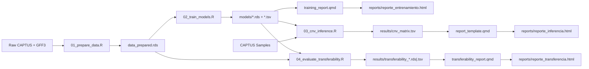

# TargetCNV-ML Execution Guide

[Guía de Ejecución en Español](GUIA_EJECUCION.md) | [English README](README.md) | [README en Español](README_ES.md)

[](https://doi.org/10.5281/zenodo.23463987)
[](https://www.r-project.org/)
[](https://opensource.org/licenses/MIT)
[](#4-workflow-1-quick-test-with-synthetic-data-mwe)
[](https://rstudio.github.io/renv/)

**TargetCNV-ML** is an R package and command-line workflow designed to estimate **gene Copy Number Variations (CNV)** and distinguish **functional gene homologs** from technical assembly artifacts in **Target Capture** (*Hyb-Seq* / *Target Enrichment*) sequencing datasets.

> [!IMPORTANT]
> **Internal Workflow Language Notice:** Console log messages, output table column names, and the Quarto HTML reports compiled inside `reports/` (`reporte_entrenamiento.html`, `reporte_inferencia.html`, and `reporte_transferencia.html`) are currently written in **Spanish**.

Contents of this guide:
1. System requirements, reproducible installation (`./targetcnv.sh restore`, `pixi.toml`, `Apptainer.def`), and environment checks (`./targetcnv.sh doctor`).
2. Repository file layout and read-only Quarto reporting architecture.
3. Full CLI reference for `./targetcnv.sh` and the four modules (`01_prepare_data.R`, `02_train_models.R`, `03_cnv_inference.R`, `04_evaluate_transferability.R`), including warnings on destructive flags.
4. **Workflow 1:** Automated verification via `tests/testthat` and the Minimal Working Example (MWE).
5. **Workflow 2:** Downloading, MD5 verification, and updating the pre-trained model archive on **Zenodo** ([DOI: 10.5281/zenodo.23463987](https://doi.org/10.5281/zenodo.23463987)).
6. **Workflow 3:** Training on new species and running **cross-species transferability and orthogroup copy-number concordance** (*Solanum citrullifolium* and *Solanum stellatiglandulosum*).
7. **Workflow 4:** Reproducing the ***Solanum torvum*** reference experiment.
8. Citation and license.

---

## 1. System Requirements and Installation

### Software Requirements
- **Operating System:** Linux (Ubuntu 22.04/24.04, Debian 12+, Arch/CachyOS, Fedora), macOS, or Windows via WSL2.
- **R:** `4.6.2` recommended for exact lockfile alignment with `renv.lock` and Bioconductor `3.23` (compatible with R $\ge 4.3$).
- **Quarto CLI:** `1.10.20` (or $\ge 1.4$) to render `.html` reports.
- **System tools:** `bash`, `curl` or `wget`, `unzip`, `md5sum`, `gcc`, `g++`, `gfortran`, `make`.

### 1.1 Strict Lockfile Restoration via `renv` (Recommended)

```bash
# 1. Clone the repository
git clone https://github.com/xyzdiego/TargetCNV-ML.git
cd TargetCNV-ML

# 2. Set executable permissions and restore exact package versions from renv.lock
chmod +x targetcnv.sh run_test_pipeline.sh scripts/*.R
./targetcnv.sh restore

# 3. Verify system utilities, Quarto, and all R dependencies
./targetcnv.sh doctor
```

> [!CAUTION]
> **Environment Reproducibility Warning:** Never use `renv::hydrate()` or `renv::snapshot()` as a user installation command. Hydrating links unpinned package versions from the host system R library and overwrites `renv.lock`. Always run `./targetcnv.sh restore` (or `./targetcnv.sh setup`), which executes `renv::restore(prompt = FALSE)` strictly following `renv.lock`.

### 1.2 Frozen Environments via Pixi or Apptainer

To freeze R, compiled system libraries, R packages, and Quarto (`1.10.20`) together:

```bash
# Pixi environment (conda-forge + bioconda defined in pixi.toml)
pixi install
pixi run doctor
pixi run test

# Apptainer / Singularity container (defined in Apptainer.def)
apptainer build targetcnv-ml.sif Apptainer.def
apptainer exec targetcnv-ml.sif ./targetcnv.sh doctor
```

> [!NOTE]
> `TargetCNVML` includes formal `DESCRIPTION` and `NAMESPACE` files, so its 60 exported functions in `R/` can be loaded either via `source()` from the CLI scripts or as a standard R package via `pkgload::load_all(".")` / `devtools::install(".")`.

---

## 2. Directory Structure and Workflow Architecture

```text
TargetCNV-ML/
├── DESCRIPTION                  # Formal R package metadata and dependencies (TargetCNVML)
├── NAMESPACE                    # Exported package functions
├── .Rprofile                    # Automatic activation of the isolated renv library
├── .gitignore                   # Excludes heavy binary artifacts and local outputs
├── renv.lock                    # Exact package lockfile validated on R 4.6.2 and Bioconductor 3.23
├── pixi.toml                    # Reproducible Pixi manifest (R 4.6 + packages + Quarto 1.10.20)
├── Apptainer.def                # Apptainer container definition (R 4.6.2 + Quarto 1.10.20)
├── targetcnv.sh                 # Pipeline wrapper script in Bash for CLI execution
├── run_test_pipeline.sh         # Automated runner for the Minimal Working Example (MWE)
├── assets/
│   └── report.css               # Shared CSS stylesheet for Quarto HTML reports
├── training_report.qmd          # Read-only Quarto template for the training HTML report
├── report_template.qmd          # Read-only Quarto template for the CNV inference HTML report
├── transferability_report.qmd   # Read-only Quarto template for the cross-species transfer report
├── EXECUTION_GUIDE.md           # Detailed execution guide in English (this document)
├── GUIA_EJECUCION.md            # Detailed execution guide in Spanish
├── README.md                    # General overview in English
├── README_ES.md                 # General overview in Spanish
│
├── R/                           # Modular R functions documented with roxygen2
│   ├── model_specs.R            # 18-model specifications, XGBoost adapter, and deterministic CV seeds
│   ├── data_processing.R        # GFF overlap, OG/HOG reconciliation, deduplication, and CNV matrix
│   ├── model_evaluation.R       # Youden, Spearman, 7-model consensus, CNV concordance, and transfer
│   ├── plotting.R               # ggplot2 functions for densities, Spearman, sensitivity, and heatmaps
│   └── report_helpers.R         # Read-only artifact loaders, DT tables, Plotly builders, and SHAP
│
├── scripts/                     # Command-line interface scripts (optparse)
│   ├── 01_prepare_data.R        # Module 01: Spatial GFF overlap and dataset preparation
│   ├── 02_train_models.R        # Module 02: Spearman collinearity, 24-method CV, and SHAP
│   ├── 03_cnv_inference.R       # Module 03: CNV inference, 7-model consensus, and 30-80% sensitivity
│   └── 04_evaluate_transferability.R # Module 04: Cross-species transferability and CNV concordance
│
├── tests/                       # Automated unit and integration test suite (testthat)
│   ├── testthat.R
│   └── testthat/
│       ├── test-models-and-seeds.R
│       ├── test-spatial-and-cnv.R
│       └── test-mwe-pipeline.R
│
├── .github/workflows/ci.yml     # GitHub Actions Continuous Integration workflow
├── data/
│   ├── reference/               # Reference GFF3 annotations, probe dictionary, and sources_citations.tsv
│   ├── CAPTUS_Muestras/         # Multi-sample CAPTUS extraction statistics
│   └── test_data/               # Lightweight synthetic dataset for MWE and unit tests
│
├── models/                      # Serialized models (.rds), benchmarks (.tsv), Spearman, and SHAP
├── results/                     # CNV matrices, 30-80% sensitivity curves, concordance, and transfer
└── reports/                     # Unified output directory for compiled Quarto HTML reports
```



---

## 3. CLI Command Reference and Safety Warnings

### 3.0 Subcommands of `./targetcnv.sh`

| Subcommand | Example | Purpose |
| :--- | :--- | :--- |
| `restore` / `setup` | `./targetcnv.sh restore` | Restores the project library strictly from `renv.lock` (`renv::restore(prompt = FALSE)`). |
| `doctor` | `./targetcnv.sh doctor` | Verifies `Rscript`, `quarto`, `curl`/`wget`, `unzip`, `md5sum`, and all R packages. |
| `test` | `./targetcnv.sh test [--no-report]` | Runs the MWE test workflow on synthetic data isolated inside `data/test_data/`. |
| `zenodo` | `./targetcnv.sh zenodo [--out-dir .]` | Downloads `TargetCNV_Models.zip` from Zenodo, verifies MD5, and validates extracted models. |
| `prepare` | `./targetcnv.sh prepare [01 options]` | Forwards arguments to `scripts/01_prepare_data.R`. |
| `train` | `./targetcnv.sh train [02 options]` | Forwards arguments to `scripts/02_train_models.R`. |
| `infer` | `./targetcnv.sh infer -i stats.tsv --auto-zenodo` | Runs `scripts/03_cnv_inference.R`; with `--auto-zenodo`, fetches Zenodo models if `models/` is empty. |
| `transfer` | `./targetcnv.sh transfer [--sources ...]` | Runs `scripts/04_evaluate_transferability.R` and compiles `reports/reporte_transferencia.html`. |
| `report` | `./targetcnv.sh report [--models-dir models]` | Re-renders `reports/reporte_entrenamiento.html` strictly from existing precomputed artifacts. |
| `reproduce-storvum` | `./targetcnv.sh reproduce-storvum --cores 4` | Runs Steps `01` $\rightarrow$ `02` $\rightarrow$ `03` on the *Solanum torvum* reference dataset. |
| `run-all` | `./targetcnv.sh run-all -g ref.gff3 -c cap.gff -s stats.tsv -d dict.xlsx -i new.tsv` | Runs `01` $\rightarrow$ `02` $\rightarrow$ `03` end-to-end on a new species dataset. |

> [!WARNING]
> **Risky or Destructive Flags and When to Use Them:**
> 1. `--clean_models` in `02_train_models.R` (also invoked inside `./targetcnv.sh reproduce-storvum`): **permanently deletes** all existing `.rds` and `.tsv` files in `--out_models` prior to writing newly trained artifacts.
>    - *When to use:* during a clean full re-train so stale model artifacts from earlier experiments do not remain in `models/`.
>    - *When to avoid:* when running `--fast_tournament` or partial tests if you want to preserve previously trained 18-model artifacts in `models/`.
> 2. `--sync-root` in `./targetcnv.sh test` or `./run_test_pipeline.sh`: **overwrites** the root `models/` and `results/` folders with synthetic MWE artifacts.
>    - *When to use:* only in disposable container sandboxes where no real models exist.
>    - *When to avoid:* whenever `models/` holds real trained models or Zenodo downloads.

---

### 3.1 Module 01: Data Preparation and Spatial Labeling (`01_prepare_data.R`)

Builds the spatially labeled reference dataset assigning each nuclear CAPTUS contig (`protein_match:NUC`) to `TRUE_POSITIVE` or `FALSE_POSITIVE`:
1. **Chromosome scale (`--genome_scale chromosome` / `--target_mode overlap`):** harmonizes sequence prefixes and intersects coordinates and strand (`GenomicRanges::findOverlaps`, `ignore.strand = FALSE`) between CAPTUS contigs and `gene` records in `--gff_ref`.
2. **Contig scale (`--genome_scale contig` / `--target_mode target_attr`):** for fragmented assemblies lacking chromosome-scale GFF3 gene models, extracts target gene IDs from the CAPTUS GFF `Target` attribute and reconciles hierarchical `HOG_ID` groups with pan-genomic `OG_ID` groups via the probe-design bridge sheet.
3. **Dictionary verification and intra-locus deduplication:** verifies locus-to-orthogroup concordance and, whenever multiple contigs overlap the same reference gene locus as positives, retains only the contig with greatest matched reference length (`ref_len_matched`) and coverage (`pct_recovered`) as `TRUE_POSITIVE`, reclassifying secondary fragments on that same locus as `FALSE_POSITIVE` (`5_TP_Redundante_Degradado`).

#### Example Usage
```bash
Rscript scripts/01_prepare_data.R \
  --gff_ref data/reference/Storvum_genes.gff3 \
  --captus_gff data/reference/Storvum_hit_contigs.gff \
  --captus_stats data/reference/captus-extract_stats.tsv \
  --dict_ref data/reference/Genes_Capture_May_2026.xlsx \
  --sample Storvum \
  --genome_scale chromosome \
  --out_dir data/
```

#### Available Parameters

| Short | Long | Type | Required | Default | Description |
| :--- | :--- | :--- | :---: | :--- | :--- |
| `-g` | `--gff_ref` | File | Yes\* | `NULL` | Reference genome GFF/GFF3 `gene` annotation (\*required when `--genome_scale chromosome`). |
| `-c` | `--captus_gff` | File | **Yes** | `NULL` | CAPTUS assembled contigs GFF file (`protein_match:NUC`). |
| `-s` | `--captus_stats` | File | **Yes** | `NULL` | CAPTUS `captus-extract_stats.tsv` alignment metrics table. |
| `-d` | `--dict_ref` | File | No | `NULL` | Homology dictionary (`.xlsx`, `.tsv`, or `.csv`) mapping reference loci to orthogroups. |
| `-p` | `--sample` | String | No | `NULL` | Sample name to filter inside `captus-extract_stats.tsv` (e.g., `Storvum`, `Scitrullifolium`, `S_stella`). |
| | `--genome_scale` | String | No | `chromosome` | `'chromosome'` (GFF3 coordinate overlap) or `'contig'` (`Target` attribute + `OG_ID`/`HOG_ID` bridge). |
| | `--target_mode` | String | No | `overlap` | Technical mode alias: `'overlap'` or `'target_attr'`. |
| | `--allow_multi_sample` | Flag | No | `FALSE` | Permits processing multi-sample tables without `--sample` filtering (used in synthetic MWE data). |
| `-o` | `--out_dir` | Dir | No | `data/` | Output directory for `data_prepared.rds` and `data_prepared.tsv`. |

---

### 3.2 Module 02: Collinearity, Deterministic CV Training, and SHAP (`02_train_models.R`)

Starting from `data_prepared.rds`, evaluates predictor dependencies and benchmarks **24 classification methods** across the four continuous CAPTUS metrics (`pct_recovered`, `pct_identity`, `score`, `wscore`):
1. **Spearman rank collinearity test:** computes pairwise $\rho$ correlations and $p$-values, exporting `models/spearman_collinearity.tsv` and `models/spearman_collinearity.rds` (rendered as a heatmap in `reporte_entrenamiento.html`). On *S. torvum*, this confirms near-collinearity between `score` and `wscore` ($\rho = 0.9977$) versus moderate coupling between `pct_recovered` and `pct_identity` ($\rho = 0.7776$).
2. **Univariate Youden cutoffs (4 methods) and weighted heuristic ensemble (`Weighted_Heuristic`):** finds the threshold maximizing Youden's $J = \text{Sensitivity} + \text{Specificity} - 1$ for each variable and performs an integer grid search ($0\text{--}3$) for the highest-AUC weighted vote combination.
3. **Deterministic cross-validation across 18 supervised classifiers and `Ensamble_Stacking`:** builds stratified folds and passes an explicit `seeds` list to `caret::trainControl()` derived from `--seed`, guaranteeing **bit-for-bit identical models regardless of `--cores`**. Includes a native adapter compatible with `xgboost >= 3.x` and out-of-fold probability extraction for `Ensamble_Stacking`. Evaluates two regimes:
   - **Balanced:** stratified within-fold down-sampling (`down`).
   - **Unbalanced:** natural class proportions.
4. **KernelSHAP attributions and read-only Quarto rendering:** saves `shap_values_balanced.rds`, `shap_values_unbalanced.rds`, and `consensus_spec.rds`, then renders `reports/reporte_entrenamiento.html`.

#### Example Usage
```bash
Rscript scripts/02_train_models.R \
  --data data/data_prepared.rds \
  --out_models models/ \
  --cv_folds 5 \
  --sampling down \
  --cores 4 \
  --seed 1234 \
  --sources data/reference/sources_citations.tsv \
  --report_file reports/reporte_entrenamiento.html
```

#### Available Parameters

| Short | Long | Type | Required | Default | Description |
| :--- | :--- | :--- | :---: | :--- | :--- |
| `-d` | `--data` | File | **Yes** | `data/data_prepared.rds` | Labeled dataset (`.rds` or `.tsv`) generated by Module 01. |
| `-m` | `--out_models` | Dir | No | `models/` | Output folder for `.rds` models, `.tsv` benchmarks, and SHAP objects. |
| `-k` | `--cv_folds` | Integer | No | `5` | Number of stratified cross-validation folds ($\ge 2$). |
| `-s` | `--sampling` | String | No | `down` | Class balancing scheme for the balanced scenario: `'down'`, `'up'`, or `'none'`. |
| `-c` | `--cores` | Integer | No | `detectCores() - 1` | Number of parallel PSOCK worker processes. |
| | `--seed` | Integer | No | `1234` | Master random seed governing CV folds, tuning grids, and per-fold `seeds`. |
| | `--extended_tournament` / `--fast_tournament` | Flag | No | `TRUE` | Train all 18 ML algorithms (default) or the 5-model fast subset (`ElasticNet`, `NaiveBayes`, `SVM_Polinomial`, `Red_Neuronal`, `LDA`). |
| | `--train_stacking` / `--no_stacking` | Flag | No | `TRUE` | Fit (default) or skip the GLM `Ensamble_Stacking` meta-learner. |
| | `--clean_models` | Flag | No | `FALSE` | **Destructive:** deletes existing `.rds` and `.tsv` files in `--out_models` before saving. |
| | `--include_hit` | Flag | No | `FALSE` | Adds CAPTUS integer hit rank `hit` as a predictor. `consensus_spec.rds` automatically records active predictors for `03_cnv_inference.R`, though leaving this `FALSE` is recommended when inferring across datasets with varying assembly depth. |
| | `--render_report` / `--no_render_report` | Flag | No | `TRUE` | Compile (default) or skip `reports/reporte_entrenamiento.html`. |
| `-r` | `--report_file` | File | No | `reports/reporte_entrenamiento.html` | Output HTML report path. |
| | `--sources` | File | No | `""` | Optional TSV containing genome and publication citations (`data/reference/sources_citations.tsv`). |

#### Benchmark Output Columns (16 Columns)
`benchmark_models_balanced.tsv`, `benchmark_models_unbalanced.tsv`, `youden_benchmark.tsv`, and transferability tables share 16 columns:
`Modelo`, `Exactitud`, `Exactitud_Balanceada`, `Sensibilidad`, `Especificidad`, `Precision`, `VPN`, `FDR`, `F1_Score`, `MCC`, `Kappa`, `ROC_AUC`, `TP`, `FP`, `FN`, `TN`.

In HTML tables, an asterisk (`*`) next to `Modelo` indicates that the classifier achieves a stronger FDR-weighted composite score under its alternative regime (*Balanced* vs. *Unbalanced*):
$$\text{Composite Score}_{\text{FDR}} = 0.45(1 - \text{FDR}) + 0.20\,\text{F1} + 0.15\,\text{MCC} + 0.10\,\text{Balanced Acc.} + 0.10\,\text{ROC-AUC}$$

---

### 3.3 Module 03: CNV Inference and Coverage Threshold Sensitivity (`03_cnv_inference.R`)

Estimates the orthogroup-by-sample copy-number matrix on target-capture assemblies:
1. **7-model consensus voting:** combines 4 supervised classifiers (`ElasticNet`, `NaiveBayes`, `SVM_Polinomial`, `Red_Neuronal`, or those recorded in `consensus_spec.rds`), 2 Youden cutoffs (`pct_recovered`, `pct_identity`), and `Weighted_Heuristic`. Sequences accumulating $\ge 4/7$ votes (`--min_votes 4`) are accepted as `Homologo_Valido`; all others are filtered out as `Ruido_Descartado`.
2. **Single-threshold coverage counting (`--cov_threshold`):** within each sample and orthogroup, `Homologo_Valido` sequences are ordered by descending `pct_recovered`:
   - `Copia_Principal`: highest-coverage sequence in that orthogroup and sample (always counted as locus presence).
   - `Homologo_Confirmado`: secondary sequence with `pct_recovered >= --cov_threshold` (default `50.0%`), counted as an additional gene copy.
   - `No_Contado`: secondary sequence with `pct_recovered < --cov_threshold`, excluded to prevent split fragments from inflating copy counts.
3. **Empirical threshold sensitivity curve (`30%` to `80%`) and orthogroup concordance:** sweeps `--cov_threshold` from `30%` to `80%` (comparing against $\text{CNV}^{\text{real}}_{\text{OG}}$ whenever `Validacion_Espacial` or `--true_cnv` is supplied) and writes `cnv_threshold_sensitivity.tsv`.

> [!NOTE]
> **Methodological Scope of the Coverage Rule:** The `30%–80%` sensitivity sweep provides empirical calibration of the `50%` threshold against known reference copy counts. Because `captus-extract_stats.tsv` summarizes percentage target recovery without per-fragment alignment coordinates across the probe, the rule remains conservative for genuine secondary copies recovered below `50%` and could still over-count if two non-overlapping fragments of a single gene each exceed `50%` of the reference length.

#### Example Usage
```bash
Rscript scripts/03_cnv_inference.R \
  --input data/CAPTUS_Muestras/captus-extract_stats.tsv \
  --models_dir models/ \
  --out_dir results/ \
  --cov_threshold 50.0 \
  --min_votes 4 \
  --top_loci 30 \
  --sources data/reference/sources_citations.tsv
```

#### Available Parameters

| Short | Long | Type | Required | Default | Description |
| :--- | :--- | :--- | :---: | :--- | :--- |
| `-i` | `--input` | File | **Yes** | `NULL` | `.tsv`, `.csv`, or `.rds` table of CAPTUS extraction statistics. |
| `-m` | `--models_dir` | Dir | No | `models/` | Folder holding trained `.rds` artifacts. |
| `-o` | `--out_dir` | Dir | No | `results/` | Destination folder for CNV matrices, sensitivity tables, and plots. |
| `-c` | `--cov_threshold` | Float | No | `50.0` | Minimum `pct_recovered` (%) required to count secondary hits as `Homologo_Confirmado`. |
| `-v` | `--min_votes` | Integer | No | `4` | Minimum positive votes (out of 7) required for `Homologo_Valido`. |
| `-t` | `--top_loci` | Integer | No | `30` | Number of highest-copy orthogroups displayed in the CNV heatmap. |
| | `--true_cnv` | File | No | `""` | Optional reference copy-number matrix/table ($\text{CNV}^{\text{real}}_{\text{OG}}$) for concordance metrics. |
| | `--render_report` / `--no_render_report` | Flag | No | `TRUE` | Compile (default) or skip `reports/reporte_inferencia.html`. |
| `-r` | `--report_file` | File | No | `reports/reporte_inferencia.html` | Output HTML report path. |
| | `--sources` | File | No | `""` | Optional TSV with genome and literature citations (`data/reference/sources_citations.tsv`). |

#### Output Files in `<out_dir>/` and `reports/`
- `cnv_matrix.tsv`: `Locus_Ortogrupo x Sample` matrix reporting `Copia_Principal + Homologo_Confirmado`.
- `cnv_annotated_sequences.tsv`: all validated homologs labeled with copy category.
- `functional_genes_catalog.tsv`: filtered catalog of counted copies (`Copia_Principal` and `Homologo_Confirmado`).
- `consensus_verdicts.tsv`: per-sequence vote breakdown across all 7 voters.
- `cnv_threshold_sensitivity.tsv` and `plot_cnv_threshold_sensitivity.pdf`/`.png`: `30%–80%` threshold sensitivity curve.
- `cnv_concordance_summary.tsv` and `cnv_concordance_pairs.tsv`: *(when spatial labels or `--true_cnv` are present)* orthogroup copy-number concordance (Spearman's $\rho$, quadratic weighted Kappa, RMSE, and exact concordance).
- `plot_consensus_distribution.pdf`/`.png`, `plot_cnv_heatmap.pdf`/`.png` (in `<out_dir>/`), and `reports/reporte_inferencia.html`.

---

### 3.4 Module 04: Cross-Species Transferability Evaluation (`04_evaluate_transferability.R`)

Executes all cross-species transferability and copy-number concordance calculations outside Quarto:
1. Applies all 24 pre-trained donor methods (*S. torvum*) plus the 7-model consensus without re-training onto recipient species (*S. citrullifolium* at chromosome scale and *S. stellatiglandulosum* at contig scale).
2. Evaluates orthogroup-level copy-number concordance ($\widehat{\text{CNV}}_{\text{OG}}$ vs. $\text{CNV}^{\text{real}}_{\text{OG}}$) using Spearman's $\rho$, quadratic weighted Kappa ($\kappa_w$), RMSE, MAE, and exact copy-number agreement rate.
3. Sweeps `--cov_threshold` across `30%–80%` per species, writes `results/transferability_*.tsv` and `results/transferability_results.rds`, and compiles `transferability_report.qmd` in read-only mode.

```bash
# Recommended wrapper command:
./targetcnv.sh transfer --sources data/reference/sources_citations.tsv

# Direct Rscript invocation:
Rscript scripts/04_evaluate_transferability.R \
  --models_dir models/ \
  --donor_data data/data_prepared.rds \
  --cit_data data/citrullifolium/data_prepared.rds \
  --ste_data data/stellatiglandulosum/data_prepared.rds \
  --dict_ref data/reference/Genes_Capture_May_2026.xlsx \
  --cov_threshold 50.0 \
  --min_votes 4 \
  --out_dir results/ \
  --sources data/reference/sources_citations.tsv \
  --report_file reports/reporte_transferencia.html
```

---

### 3.5 Manual Re-rendering of Read-Only Quarto Reports

All three `.qmd` templates strictly read precomputed `.rds` and `.tsv` files; if `models/` is missing trained artifacts, they display an instruction to run `./targetcnv.sh train`. All compiled HTML reports are grouped under `reports/`.

```bash
# 1. Training report (reports/reporte_entrenamiento.html)
./targetcnv.sh report

# 2. CNV inference report (reports/reporte_inferencia.html)
quarto render report_template.qmd \
  -P consensus_verdicts:"results/consensus_verdicts.tsv" \
  -P cnv_matrix:"results/cnv_matrix.tsv" \
  -P cnv_annotated:"results/cnv_annotated_sequences.tsv" \
  -P cnv_sensitivity:"results/cnv_threshold_sensitivity.tsv" \
  -P sources_file:"data/reference/sources_citations.tsv" \
  -P top_loci:30 \
  --output "reporte_inferencia.html" && mv -f reporte_inferencia.html reports/

# 3. Cross-species transferability report (reports/reporte_transferencia.html)
./targetcnv.sh transfer --sources data/reference/sources_citations.tsv
```

---

## 4. Workflow 1: Quick Test with Synthetic Data (MWE)

To verify both unit-level mathematical invariants and full CLI script execution:

```bash
# Formal unit and integration test suite (testthat)
Rscript tests/testthat.R

# End-to-end MWE execution including Quarto HTML report rendering inside reports/
./targetcnv.sh test
```

`tests/testthat.R` automatically verifies:
- Spatial GFF overlap respecting harmonized sequence names, strand, and intra-locus redundancy resolution without legacy columns.
- Bit-for-bit identical CV training via `build_deterministic_cv_control()` between sequential (`1` core) and parallel (`2` PSOCK cores) execution.
- Valid `XGBoost` training/probability prediction and `ROC_AUC > 0.5` in `Ensamble_Stacking`.
- Exact boundary copy counting in `extract_cnv_matrix()` (0 valid sequences, primary copy $< 50\%$, exact `50.0%` vs. `49.99%` boundary, and `0`-copy sample padding).
- Isolated end-to-end execution of `01` $\rightarrow$ `02` $\rightarrow$ `03` in a temporary directory.

---

## 5. Workflow 2: Downloading, Using, and Updating Models on Zenodo

Pre-trained *Solanum torvum* artifacts are archived on Zenodo ([DOI: 10.5281/zenodo.23463987](https://doi.org/10.5281/zenodo.23463987), archive `TargetCNV_Models.zip`).

### 5.1 Verified Download and Inference
```bash
# Downloads with retry/timeout guards, checks MD5 (removes .zip on mismatch), and verifies 18 ML models + consensus_spec.rds:
./targetcnv.sh zenodo

# Automatic inference fetching Zenodo models if models/ is empty:
./targetcnv.sh infer -i data/CAPTUS_Muestras/captus-extract_stats.tsv --auto-zenodo
```

### 5.2 Publishing an Updated `TargetCNV_Models.zip` Release on Zenodo

After training all 24 methods (including `XGBoost`, `Ensamble_Stacking`, `spearman_collinearity.*`, and `consensus_spec.rds`):

1. **Verify required artifacts in `models/` and build the archive:**
   ```bash
   ls -1 models/consensus_spec.rds models/models_balanced.rds models/models_unbalanced.rds
   zip -r TargetCNV_Models.zip models/
   md5sum TargetCNV_Models.zip
   ```
2. **Create a new Zenodo version:**
   - Open [https://doi.org/10.5281/zenodo.23463987](https://doi.org/10.5281/zenodo.23463987) and click **"New version"**.
   - Replace `TargetCNV_Models.zip`, update the version tag to `v1.1.0`, and publish.
3. **Update `ZENODO_URL` and `ZENODO_MD5` in `targetcnv.sh`:**
   ```bash
   ZENODO_URL="https://zenodo.org/api/records/<NEW_RECORD_ID>/files/TargetCNV_Models.zip/content"
   ZENODO_ZIP="TargetCNV_Models.zip"
   ZENODO_MD5="<NEW_MD5_HASH>"
   ```

---

## 6. Workflow 3: New Data and Cross-Species Transferability

### 6.1 End-to-End Training and Inference on a New Species
```bash
./targetcnv.sh run-all \
  -g path/to/new_genome.gff3 \
  -c path/to/new_captus_contigs.gff \
  -s path/to/captus-extract_stats.tsv \
  -d path/to/homology_dictionary.xlsx \
  -p ReferenceSample \
  -i path/to/population_captus_stats.tsv \
  --out_data data/new_species \
  -m models/new_species \
  -o results/new_species \
  -r reports/training_report_new_species.html
```

### 6.2 Cross-Species Transferability Evaluation (*S. citrullifolium* and *S. stellatiglandulosum*)

```bash
# 1. Prepare chromosome-scale recipient species (S. citrullifolium: 171 NUC sequences, 56 TP / 115 FP)
Rscript scripts/01_prepare_data.R \
  --gff_ref data/reference/Scitrullifolium_genes.gff3 \
  --captus_gff data/reference/Scitrullifolium_hit_contigs.gff \
  --captus_stats data/reference/captus-extract_stats.tsv \
  --dict_ref data/reference/Genes_Capture_May_2026.xlsx \
  --sample Scitrullifolium \
  --genome_scale chromosome \
  --out_dir data/citrullifolium/

# 2. Prepare contig-scale recipient species (S. stellatiglandulosum: 200 NUC sequences, 19 TP / 181 FP)
Rscript scripts/01_prepare_data.R \
  --captus_gff data/reference/S_stella_hit_contigs.gff \
  --captus_stats data/reference/captus-extract_stats.tsv \
  --dict_ref data/reference/Genes_Capture_May_2026.xlsx \
  --sample S_stella \
  --genome_scale contig \
  --out_dir data/stellatiglandulosum/

# 3. Evaluate all 24 methods, orthogroup CNV concordance, 30%-80% calibration curve, and HTML report
./targetcnv.sh transfer --sources data/reference/sources_citations.tsv
```

#### Orthogroup-Level Copy-Number Concordance Summary (`--cov_threshold 50.0%`, 7-Model Consensus)

| Species | Genome Scale | Orthogroups ($N$) | Reference Copies | Estimated Copies | Exact Concordance (%) | Spearman's $\rho$ | Quadratic $\kappa_w$ | RMSE |
| :--- | :--- | :---: | :---: | :---: | :---: | :---: | :---: | :---: |
| ***S. torvum*** (Donor) | Chromosome Scale | 58 | 87 | 79 | **79.31** | **0.5983** ($p = 7.0 \times 10^{-7}$) | **0.5269** | 0.8710 |
| ***S. citrullifolium*** | Chromosome Scale | 55 | 56 | 66 | **70.91** | **0.4653** ($p = 3.4 \times 10^{-4}$) | **0.5506** | 0.5394 |
| ***S. stellatiglandulosum*** | Contig Scale | 58 | 19 | 78 | 24.14 | 0.0831 ($p = 0.535$) | 0.0742 | 1.3834 |

---

## 7. Workflow 4: Reproducing the Reference Experiment (*Solanum torvum*)

```bash
./targetcnv.sh reproduce-storvum --cores 4
```

### Deterministic Cross-Validation Results ($K = 5$, `--seed 1234`, $N = 184$: $87\text{ TP}$ vs. $97\text{ FP}$)

#### Balanced Scenario (*Down-Sampling*) — Representative Classifiers
| Model | Balanced Acc. (%) | Sensitivity (%) | Specificity (%) | Precision (%) | FDR (%) | F1 Score | MCC | Kappa | ROC-AUC |
| :--- | :---: | :---: | :---: | :---: | :---: | :---: | :---: | :---: | :---: |
| **Weighted_Heuristic** | 88.86 | 83.91 | 93.81 | 92.41 | 7.59 | **0.880** | 0.784 | 0.781 | 0.921 |
| **Ensamble_Stacking** | 88.29 | 82.76 | 93.81 | 92.31 | 7.69 | **0.873** | 0.774 | 0.770 | **0.932** |
| **Red_Neuronal (`nnet`)** | 87.31 | 83.91 | 90.72 | 89.02 | 10.98 | **0.864** | 0.750 | 0.749 | 0.927 |
| **SVM_Polinomial (`svmPoly`)** | 87.14 | 80.46 | 93.81 | 92.11 | 7.89 | **0.859** | 0.753 | 0.748 | **0.934** |
| **LDA \*** | 86.74 | 82.76 | 90.72 | 88.89 | 11.11 | **0.857** | 0.739 | 0.737 | 0.922 |
| **NaiveBayes (`nb`)** | 86.56 | 79.31 | 93.81 | 92.00 | 8.00 | **0.852** | 0.743 | 0.736 | **0.934** |
| **ElasticNet (`glmnet`) \*** | 85.25 | 83.91 | 86.60 | 84.88 | 15.12 | **0.844** | 0.706 | 0.705 | 0.930 |
| **XGBoost \*** | 84.50 | 79.31 | 89.69 | 87.34 | 12.66 | **0.831** | 0.696 | 0.693 | 0.920 |

#### Unbalanced Scenario (Original Proportions: $87\text{ TP}$ vs. $97\text{ FP}$) — Representative Classifiers
| Model | Balanced Acc. (%) | Sensitivity (%) | Specificity (%) | Precision (%) | FDR (%) | F1 Score | MCC | Kappa | ROC-AUC |
| :--- | :---: | :---: | :---: | :---: | :---: | :---: | :---: | :---: | :---: |
| **Weighted_Heuristic** | 88.86 | 83.91 | 93.81 | 92.41 | 7.59 | **0.880** | 0.784 | 0.781 | 0.921 |
| **Ensamble_Stacking** | 88.35 | 83.91 | 92.78 | 91.25 | 8.75 | **0.874** | 0.772 | 0.770 | **0.935** |
| **LDA** | 87.26 | 82.76 | 91.75 | 90.00 | 10.00 | **0.862** | 0.750 | 0.748 | 0.922 |
| **NaiveBayes (`nb`)** | 86.56 | 79.31 | 93.81 | 92.00 | 8.00 | **0.852** | 0.743 | 0.736 | **0.934** |
| **ElasticNet (`glmnet`)** | 85.77 | 83.91 | 87.63 | 85.88 | 14.12 | **0.849** | 0.716 | 0.716 | 0.930 |
| **Red_Neuronal (`nnet`) \*** | 84.56 | 80.46 | 88.66 | 86.42 | 13.58 | **0.833** | 0.695 | 0.694 | 0.921 |
| **XGBoost** | 84.56 | 80.46 | 88.66 | 86.42 | 13.58 | **0.833** | 0.695 | 0.694 | 0.918 |
| **SVM_Polinomial (`svmPoly`) \*** | 83.03 | 90.80 | 75.26 | 76.70 | 23.30 | **0.832** | 0.664 | 0.654 | 0.930 |

*(\* indicates that the classifier achieves a higher FDR-weighted composite score in the alternative scenario; full 24-method tables are exported in `models/benchmark_models_balanced.tsv` and `models/benchmark_models_unbalanced.tsv`).*

---

## 8. Citation and License

- **Chromosome-scale genomes (*S. torvum* and *S. citrullifolium*):** Solanum Pan-Genomics (https://solpangenomics.com/dist/pages/downloads/index.php), SGN (https://solgenomics.net/ftp/genomes/Solanum_pangenomics/), and NCBI BioProject `PRJNA1073673` (https://www.ncbi.nlm.nih.gov/bioproject/PRJNA1073673); **Benoit, M. *et al.*** (2025), *Nature*, 640(8057): 135–145, [doi:10.1038/s41586-025-08619-6](https://doi.org/10.1038/s41586-025-08619-6).
- **Contig-scale genome (*S. stellatiglandulosum*):** NCBI BioProject `PRJNA1070281` (https://www.ncbi.nlm.nih.gov/bioproject/?term=txid3132602%5BOrganism:noexp%5D); **Pérez-Mesa, P. A. & Roda, F.** (2025), *Current Opinion in Plant Biology*, 85: 102727, [doi:10.1016/j.pbi.2025.102727](https://doi.org/10.1016/j.pbi.2025.102727); **Pérez-Mesa, P. A., Pardo, R. A., Alseekh, S. *et al.*** (2026), *Plant Molecular Biology*, 116: 67, [doi:10.1007/s11103-026-01718-6](https://doi.org/10.1007/s11103-026-01718-6).

```bibtex
@software{targetcnv_ml_2026,
  author       = {Benítez Duarte, Diego Andrés},
  title        = {{TargetCNV-ML: Machine Learning and Spatial Inference for Copy Number Variations in Target Capture}},
  month        = jul,
  year         = 2026,
  publisher    = {Zenodo},
  version      = {v1.1.0},
  doi          = {10.5281/zenodo.23463987},
  url          = {https://doi.org/10.5281/zenodo.23463987}
}

@mastersthesis{benitez_duarte_thesis_2026,
  author       = {Benítez Duarte, Diego Andrés},
  title        = {{Desarrollo de un flujo de trabajo bioinformático para la Detección de Variación en el Número de Copias (CNV) de genes a partir de secuencias genómicas de lectura corta}},
  school       = {Universidad Nacional de Colombia},
  year         = 2026,
  address      = {Colombia},
  note         = {Master's Thesis in Bioinformatics}
}
```

Released under the **MIT License** — see [LICENSE](LICENSE) for details. Derived datasets and pre-trained models on Zenodo are licensed under **CC BY 4.0**.
