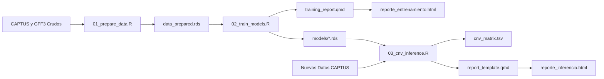

# Guía de Ejecución de TargetCNV-ML

[🇬🇧 English Execution Guide](https://www.google.com/search?q=https://github.com/xyzdiego/TargetCNV-ML/blob/main/EXECUTION_GUIDE.md) | [🇪🇸 README en Español](https://www.google.com/search?q=https://github.com/xyzdiego/TargetCNV-ML/blob/main/README_ES.md) | [🇬🇧 English README](https://www.google.com/search?q=https://github.com/xyzdiego/TargetCNV-ML/blob/main/README.md)

[DOI](https://www.google.com/url?sa=E&source=gmail&q=https://doi.org/10.5281/zenodo.23463987)
[](https://www.r-project.org/)
[](https://opensource.org/licenses/MIT)
[](#inicio-rápido-batería-de-pruebas)
[](https://rstudio.github.io/renv/)

**TargetCNV-ML** es un paquete bioinformático modular, reproducible y ejecutable por línea de comandos (CLI) que detecta **Variaciones en el Número de Copias (CNV)** y resuelve **expansiones de genes homólogos** a partir de secuencias obtenidas mediante captura de genes (*Target Capture*).

> [!IMPORTANT]
> **Aviso sobre el idioma del flujo de trabajo:** De momento, el flujo de trabajo interno de los archivos, los mensajes por consola, los nombres de las columnas en las tablas de salida y los reportes interactivos en Quarto (`reporte_entrenamiento.html` y `reporte_inferencia.html`) están construidos en **español**. En próximas actualizaciones el flujo de trabajo interno y los reportes estarán disponibles también en **inglés**.

En esta guía encontrarás:
1. Requisitos del sistema, instalación y verificación del entorno (`./targetcnv.sh doctor` y `./targetcnv.sh snapshot`).
2. Estructura de carpetas, archivos y diagrama de flujo del repositorio.
3. Uso del orquestador principal en una línea (`./targetcnv.sh`) y descripción detallada de todos los parámetros de los tres módulos (`01_prepare_data.R`, `02_train_models.R`, `03_cnv_inference.R`) y de los dos reportes HTML en Quarto (`training_report.qmd` y `report_template.qmd`).
4. **Flujo 1:** Prueba rápida con los datos simulados incluidos en el repositorio (*Minimal Working Example* / MWE).
5. **Flujo 2:** Descarga, uso y actualización de los modelos preentrenados publicados en **Zenodo** ([DOI: 10.5281/zenodo.23463987](https://www.google.com/search?q=https://www.google.com/url%3Fsa%3DE%26source%3Dgmail%26q%3Dhttps://doi.org/10.5281/zenodo.23463987)).
6. **Flujo 3:** Entrenamiento con nuevos datos genómicos y pruebas de **transferibilidad entre especies** (tanto en genomas ensamblados a nivel de cromosoma como *Solanum citrullifolium*, como en genomas fragmentados como *Solanum stellatiglandulosum*).
7. **Flujo 4:** Reproducción paso a paso del experimento de referencia con ***Solanum torvum***.
8. Citación y licencia.

---

## 1. Requisitos del Sistema e Instalación

### Requisitos de Software
- **Sistema Operativo:** Linux (Ubuntu 20.04+, Debian 11+, Arch/CachyOS, Fedora), macOS o Windows (mediante WSL2).
- **R:** $\ge 4.0.0$ (recomendado R 4.3+ o 4.6).
- **Quarto CLI:** $\ge 1.3+$ (necesario para compilar los reportes interactivos `.html`).
- **Herramientas del sistema:** `bash`, `curl` o `wget`, `unzip`, `md5sum`, `gcc`, `g++`, `make`.

### Instalación y Restauración del Entorno de R (`renv`)

El proyecto utiliza `renv` para aislar y reproducir las versiones exactas de los paquetes bioinformáticos y de aprendizaje automático:

```bash
# 1. Clonar el repositorio
git clone https://github.com/xyzdiego/TargetCNV-ML.git
cd TargetCNV-ML

# 2. Dar permisos de ejecución a los scripts y restaurar las librerías de R
chmod +x targetcnv.sh run_test_pipeline.sh scripts/*.R
Rscript -e "renv::restore()"

# (Alternativa rápida si los paquetes ya están instalados en la librería de R del sistema):
./targetcnv.sh snapshot

# 3. Comprobar que todas las herramientas y paquetes estén listos
./targetcnv.sh doctor
```

> [!NOTE]
> Los paquetes principales gestionados por `renv` son: `GenomicRanges`, `rtracklayer`, `caret`, `caretEnsemble`, `glmnet`, `klaR`, `kernlab`, `randomForest`, `gbm`, `xgboost`, `RSNNS`, `deepnet`, `ipred`, `pROC`, `optparse`, `readxl`, `kernelshap`, `shapviz`, `NeuralNetTools`, `plotly`, `DT`, `cowplot`, `knitr`, `rmarkdown`, `dplyr`, `tidyr` y `stringr`.

---

## 2. Estructura de Directorios y Flujo de Trabajo

```text
TargetCNV-ML/
├── .Rprofile                    # Activación automática del entorno virtual renv
├── .gitignore                   # Exclusión de archivos binarios pesados y datos crudos (estándar Zenodo)
├── renv.lock                    # Archivo de bloqueo que registra las versiones exactas de paquetes de R
├── targetcnv.sh                 # Orquestador CLI unificado en Bash para ejecutar flujos en 1 línea
├── run_test_pipeline.sh         # Script bash para ejecutar el Ejemplo Mínimo Funcional (MWE) de punta a punta
├── training_report.qmd          # Plantilla interactiva en Quarto para el reporte HTML de entrenamiento
├── report_template.qmd          # Plantilla interactiva en Quarto para el reporte HTML de inferencia de CNV
├── GUIA_EJECUCION.md            # Guía detallada paso a paso en español (este archivo)
├── EXECUTION_GUIDE.md           # Guía detallada paso a paso en inglés
├── README.md                    # Resumen general en inglés
├── README_es.md                 # Resumen general en español
│
├── R/                           # Funciones modulares puras de R documentadas con roxygen2
│   ├── model_specs.R            # Especificaciones unificadas del torneo de 18 modelos, adaptador XGBoost y nombres
│   ├── data_processing.R        # Cruce de GFF, clasificación con diccionario, resolución de redundancias, matriz CNV
│   ├── model_evaluation.R       # Matrices de confusión, optimización Youden, consenso de 7 modelos, inferencia
│   └── plotting.R               # Funciones ggplot2/plotly para densidades, benchmarks, curvas ROC y heatmaps
│
├── scripts/                     # Scripts ejecutables por CLI utilizando optparse
│   ├── 01_prepare_data.R        # Paso 1: Cruce espacial con GFF e ingeniería de características
│   ├── 02_train_models.R        # Paso 2: Torneo de 24 métodos, validación cruzada, SHAP y reporte de entrenamiento
│   └── 03_cnv_inference.R       # Paso 3: Inferencia de CNV mediante consenso de 7 modelos y reporte de inferencia
│
├── data/
│   ├── reference/               # Anotaciones GFF3 de referencia, diccionarios de homología y sources_citations.tsv
│   ├── CAPTUS_Muestras/         # Estadísticas de ensamblaje CAPTUS multimuestra
│   └── test_data/               # Conjunto de datos simulado y liviano (<25 KB) para pruebas automáticas
│
├── models/                      # Modelos de ML preentrenados, tablas de benchmark, objetos SHAP y umbrales (.rds/.tsv)
└── results/                     # Matrices CNV generadas, tablas de clasificación y gráficos diagnósticos
```



---

## 3. Referencia de Comandos CLI

### 3.0 Ejecución Rápida con `targetcnv.sh`

El script `./targetcnv.sh` reúne las tareas más comunes en subcomandos de una sola línea:

| Subcomando | Ejemplo | Qué hace |
| :--- | :--- | :--- |
| `doctor` | `./targetcnv.sh doctor` | Revisa si están instalados `Rscript`, `quarto`, `curl`, `unzip`, `md5sum` y todos los paquetes de R. |
| `test` | `./targetcnv.sh test [--sync-root] [--no-report]` | Corre el ejemplo de prueba (MWE) con datos simulados dentro de `data/test_data/`. |
| `zenodo` | `./targetcnv.sh zenodo [--out-dir .]` | Descarga `TargetCNV_Models.zip` desde Zenodo, comprueba su hash MD5 y extrae la carpeta `models/`. |
| `infer` | `./targetcnv.sh infer -i stats.tsv --auto-zenodo` | Calcula la matriz de CNV y el reporte HTML en muestras nuevas; con `--auto-zenodo` descarga los modelos si `models/` está vacío. |
| `reproduce-storvum` | `./targetcnv.sh reproduce-storvum --cores 4` | Corre de principio a fin los pasos 01, 02 y 03 con los datos reales de *Solanum torvum*. |
| `run-all` | `./targetcnv.sh run-all -g ref.gff3 -c cap.gff -s stats.tsv -d dict.xlsx -i nuevos.tsv` | Ejecuta en secuencia `01_prepare_data.R` $\rightarrow$ `02_train_models.R` $\rightarrow$ `03_cnv_inference.R`. |
| `prepare` | `./targetcnv.sh prepare [opciones de 01]` | Envía los argumentos directamente a `scripts/01_prepare_data.R`. |
| `train` | `./targetcnv.sh train [opciones de 02]` | Envía los argumentos directamente a `scripts/02_train_models.R`. |
| `report` | `./targetcnv.sh report [--models-dir models]` | Compila o recompila el reporte interactivo `reporte_entrenamiento.html` con Quarto. |
| `snapshot` | `./targetcnv.sh snapshot` | Vincula paquetes desde la librería del sistema hacia `renv/library` y actualiza `renv.lock`. |

---

### 3.1 Módulo 01: Preparación de Datos (`01_prepare_data.R`)

Este módulo identifica qué cóntigos ensamblados por CAPTUS corresponden a genes reales del genoma de referencia y cuáles son ruido o copias redundantes:
1. Cruza las coordenadas genómicas de los cóntigos de CAPTUS (`protein_match:NUC`) con los genes del archivo `.gff3` de referencia usando `GenomicRanges` (o lee el gen directamente del atributo `Target` si se usa `--target_mode target_attr` en genomas altamente fragmentados).
2. Compara cada cruce con el diccionario de homología para etiquetar los aciertos como `TRUE_POSITIVE` y los alineamientos en otros genes o fuera de objetivo como `FALSE_POSITIVE`.
3. Si varios cóntigos caen sobre el mismo gen de referencia, conserva el cóntigo de mayor longitud y cobertura como `TRUE_POSITIVE` y reclasifica los restantes como `FALSE_POSITIVE` (`5_TP_Redundante_Degradado`).
4. Calcula la diferencia de calidad de cada hit con respecto al mejor hit de su mismo locus (`delta_wscore` y `delta_pct_identity`).

#### Ejemplo de Uso
```bash
./scripts/01_prepare_data.R \
  --gff_ref data/reference/Storvum_genes.gff3 \
  --captus_gff data/reference/Storvum_hit_contigs.gff \
  --captus_stats data/reference/captus-extract_stats.tsv \
  --dict_ref data/reference/Genes_Capture_May_2026.xlsx \
  --sample Storvum \
  --target_mode overlap \
  --out_dir data/
```

#### Parámetros Disponibles

| Corto | Largo | Tipo | Requerido | Valor por Defecto | Descripción |
| :--- | :--- | :--- | :---: | :--- | :--- |
| `-g` | `--gff_ref` | Archivo | **SÍ**\* | *Ninguno* | Archivo GFF/GFF3 con la anotación de genes del genoma de referencia (registros `gene`). \*Requerido en modo `overlap`. |
| `-c` | `--captus_gff` | Archivo | **SÍ** | *Ninguno* | Archivo GFF de cóntigos ensamblados por CAPTUS (registros `protein_match:NUC`). |
| `-s` | `--captus_stats` | Archivo | **SÍ** | *Ninguno* | Archivo `captus-extract_stats.tsv` con las métricas numéricas de alineamiento de CAPTUS. |
| `-d` | `--dict_ref` | Archivo | No | `NULL` | Tabla de correspondencia entre genes y ortogrupos (`.xlsx`, `.tsv` o `.csv`) suministrada por el usuario (catálogo directo `OG_ID` o jerárquico `HOG_ID` con tabla puente `OG_ID <-> HOG_ID`). |
| `-p` | `--sample` | Texto | No | `NULL` | Nombre de la muestra a filtrar dentro de `captus_stats` (ej. `Storvum`, `Scitrullifolium`, `S_stella`). |
| | `--target_mode` | Texto | No | `overlap` | `'overlap'`: cruza coordenadas con `--gff_ref`. `'target_attr'`: extrae el gen de referencia desde el atributo `Target` del GFF de CAPTUS (útil en genomas fragmentados). |
| `-o` | `--out_dir` | Carpeta | No | `data/` | Carpeta donde se guardarán los archivos preparados (`data_prepared.rds` y `data_prepared.tsv`). |
| `-h` | `--help` | Bandera | No | - | Muestra la ayuda en pantalla. |

---

### 3.2 Módulo 02: Entrenamiento y Evaluación de Modelos (`02_train_models.R`)

Con los datos etiquetados del Paso 1, este módulo entrena y compara **24 métodos de clasificación** para separar homólogos reales (`TP`) de ruido (`FP`):
1. **Cortes individuales de Youden (4 métodos):** Calcula para cada una de las 4 métricas (`pct_recovered`, `pct_identity`, `score`, `wscore`) el umbral que maximiza el estadístico $J$ de Youden ($\text{Sensibilidad} + \text{Especificidad} - 1$).
2. **Modelo heurístico ponderado (`Weighted_Heuristic`):** Prueba combinaciones de pesos enteros (de 0 a 3) sobre los votos binarios de las 4 métricas para encontrar la suma ponderada con mayor área bajo la curva ROC (AUC).
3. **Torneo completo de Machine Learning (`caret`, 18 algoritmos + `Ensamble_Stacking`):** Entrena por defecto los 18 algoritmos supervisados (`RandomForest`, `GBM`, `XGBoost`, `SVM_Radial`, `SVM_Lineal`, `SVM_Polinomial`, `Red_Neuronal`, `Red_Neuronal_Bag`, `ElasticNet`, `KNN`, `CART`, `NaiveBayes`, `LDA`, `MLP`, `MLP_Regularizado`, `QDA`, `Bagging_Arboles`, `Stacked Autoencoder - DNN`) y el meta-modelo GLM (`Ensamble_Stacking`) mediante validación cruzada en dos escenarios:
   - **Balanceado:** Iguala el número de `TP` y `FP` en cada partición mediante submuestreo (*down-sampling*).
   - **Desbalanceado:** Entrena con la proporción original de los datos.
4. **Explicabilidad (KernelSHAP) y Reporte Interactivo (`reporte_entrenamiento.html`):** Calcula la contribución de cada variable sobre las predicciones de `ElasticNet` y compila el reporte HTML interactivo.

#### Ejemplo de Uso
```bash
./scripts/02_train_models.R \
  --data data/data_prepared.rds \
  --out_models models/ \
  --cv_folds 5 \
  --sampling down \
  --cores 4 \
  --seed 1234 \
  --report_file reporte_entrenamiento.html
```

#### Parámetros Disponibles

| Corto | Largo | Tipo | Requerido | Valor por Defecto | Descripción |
| :--- | :--- | :--- | :---: | :--- | :--- |
| `-d` | `--data` | Archivo | **SÍ** | `data/data_prepared.rds` | Archivo de datos preparados (`.rds` o `.tsv`) generado en el Paso 1. |
| `-m` | `--out_models` | Carpeta | No | `models/` | Carpeta donde se guardarán los modelos `.rds` y las tablas de resultados `.tsv`. |
| `-k` | `--cv_folds` | Entero | No | `5` | Número de particiones para la validación cruzada ($\ge 2$). |
| `-s` | `--sampling` | Texto | No | `down` | Método de balanceo para el escenario balanceado: `'down'` (submuestreo), `'up'` (sobremuestreo) o `'none'`. |
| `-c` | `--cores` | Entero | No | `detectCores() - 1` | Número de núcleos de procesador para entrenar en paralelo. |
| | `--seed` | Entero | No | `1234` | Semilla aleatoria para obtener resultados exactamente reproducibles. |
| | `--extended_tournament` | Bandera | No | `TRUE` | Entrena el torneo completo de 18 algoritmos de ML. |
| | `--fast_tournament` | Bandera | No | - | Entrena únicamente los 5 modelos base rápidos (`ElasticNet`, `NaiveBayes`, `SVM_Polinomial`, `Red_Neuronal`, `LDA`). |
| | `--train_stacking` | Bandera | No | `TRUE` | Entrena el meta-modelo GLM (`Ensamble_Stacking` con `caretStack`). |
| | `--no_stacking` | Bandera | No | - | Omite el entrenamiento del meta-modelo `Ensamble_Stacking`. |
| | `--clean_models` | Bandera | No | `FALSE` | Elimina los archivos `.rds`/`.tsv` previos en `--out_models` antes de guardar la nueva corrida. |
| | `--include_hit` | Bandera | No | `FALSE` | Añade la columna `hit` como variable predictora. *(Desactivado por defecto para mantener compatibilidad con `03_cnv_inference.R`).* |
| | `--render_report` | Bandera | No | `TRUE` | Genera automáticamente el reporte HTML al terminar el entrenamiento. |
| | `--no_render_report` | Bandera | No | - | No genera el reporte HTML (útil en servidores sin Quarto). |
| `-r` | `--report_file` | Archivo | No | `reporte_entrenamiento.html` | Nombre y ruta del archivo HTML del reporte de entrenamiento. |
| | `--sources` | Archivo | No | `""` | Archivo TSV opcional (`data/reference/sources_citations.tsv`) con las citas de las fuentes genómicas y publicaciones para insertar en el reporte HTML (si se omite, solo se muestra el archivo de origen). |
| `-h` | `--help` | Bandera | No | - | Muestra la ayuda en pantalla. |

#### Métricas Incluidas en las Tablas de Resultados (16 Columnas)

Todas las tablas de comparación (`benchmark_models_balanced.tsv`, `benchmark_models_unbalanced.tsv`, `youden_benchmark.tsv` y `benchmark_models_all.tsv`) incluyen las mismas 16 columnas:
1. `Modelo`: Nombre del clasificador o regla de corte.
2. `Exactitud` (*Accuracy*): $\frac{TP + TN}{TP + FP + FN + TN}$.
3. `Exactitud_Balanceada`: $\frac{\text{Sensibilidad} + \text{Especificidad}}{2}$.
4. `Sensibilidad` (*Recall*): $\frac{TP}{TP + FN}$.
5. `Especificidad`: $\frac{TN}{TN + FP}$.
6. `Precision` (*Valor Predictivo Positivo*): $\frac{TP}{TP + FP}$.
7. `VPN` (*Valor Predictivo Negativo*): $\frac{TN}{TN + FN}$.
8. `FDR` (*Tasa de Falsos Descubrimientos*): $1 - \text{Precisión} = \frac{FP}{TP + FP}$.
9. `F1_Score`: $2 \times \frac{\text{Precisión} \times \text{Sensibilidad}}{\text{Precisión} + \text{Sensibilidad}}$.
10. `MCC` (*Coeficiente de Correlación de Matthews*).
11. `Kappa`: Índice Kappa de Cohen.
12. `ROC_AUC`: Área bajo la curva ROC.
13. `TP`, `FP`, `FN`, `TN`: Conteos enteros de la matriz de confusión.

> [!TIP]
> **Comparación entre escenarios con asterisco (`*`) en el reporte HTML:** En las tablas interactivas desplegables de `reporte_entrenamiento.html`, los modelos marcados con **`*`** en la columna `Modelo` (y explicados en `Mejor_Version_FDR`) son aquellos cuya versión alternativa (*Balanceado* vs. *Desbalanceado*) alcanza un mayor desempeño global con fuerte ponderación sobre el control del $\text{FDR}$:
> $$\text{Índice Global}_{\text{FDR}} = 0.45(1 - \text{FDR}) + 0.20\,\text{F1} + 0.15\,\text{MCC} + 0.10\,\text{Exactitud Bal.} + 0.10\,\text{ROC-AUC}$$

---

### 3.3 Módulo 03: Inferencia de CNV y Consenso (`03_cnv_inference.R`)

Este módulo toma la tabla de estadísticas de CAPTUS de muestras nuevas, filtra el ruido mediante votación de modelos y estima el número de copias por locus y muestra:

1. **Sistema de consenso de 7 modelos:** Cada secuencia recibe 7 evaluaciones independientes:
   - 4 votos de modelos de Machine Learning (`ElasticNet`, `NaiveBayes`, `SVM_Polinomial`, `Red_Neuronal`).
   - 2 votos de cortes univariados de Youden (`pct_recovered` y `pct_identity`).
   - 1 voto del modelo heurístico ponderado (`Weighted_Heuristic`).
   Si la secuencia suma **4 o más votos positivos** (`--min_votes 4`), se clasifica como `Homologo_Valido`; de lo contrario, se descarta como `Ruido_Descartado`.

2. **Regla de un solo umbral de cobertura para la determinación de homólogos:** Para reducir el riesgo de que un gen partido en varios cóntigos se cuente como varias copias, las secuencias aceptadas como `Homologo_Valido` se ordenan de mayor a menor cobertura (`pct_recovered`) dentro de cada muestra y locus, y se clasifican con una regla de un solo umbral:
   - **`Copia_Principal`:** Primera secuencia (mayor cobertura) del locus en la muestra. Se cuenta siempre, como evidencia de presencia del locus, sin umbral de cobertura.
   - **`Homologo_Confirmado`:** Secuencia adicional con cobertura individual $\ge 50\%$ (`--cov_threshold 50.0`). Se cuenta como una copia adicional en la matriz de CNV.
   - **`No_Contado`:** Secuencia adicional con cobertura $< 50\%$. No se cuenta, porque un fragmento corto por sí solo no permite distinguir entre una porción de la copia principal partida por el ensamblador y una copia adicional incompleta.
   El número de copias estimado por locus y muestra en `cnv_matrix.tsv` es `Copia_Principal + Homologo_Confirmado`.

> [!NOTE]
> **Nota de interpretación:** El umbral de 50% es una heurística no calibrada empíricamente y determina directamente la matriz de CNV. La regla es conservadora: puede subestimar el número de copias cuando una copia adicional solo se recupera en fragmentos menores al 50%, y puede sobreestimarlo si una misma copia queda partida en dos cóntigos que superan cada uno el 50% de cobertura. Los resultados de CNV deben interpretarse teniendo en cuenta este supuesto.

#### Ejemplo de Uso
```bash
./scripts/03_cnv_inference.R \
  --input data/CAPTUS_Muestras/captus-extract_stats.tsv \
  --models_dir models/ \
  --out_dir results/ \
  --cov_threshold 50.0 \
  --min_votes 4 \
  --top_loci 30
```

#### Parámetros Disponibles

| Corto | Largo | Tipo | Requerido | Valor por Defecto | Descripción |
| :--- | :--- | :--- | :---: | :--- | :--- |
| `-i` | `--input` | Archivo | **SÍ** | *Ninguno* | Archivo `.tsv`, `.csv` o `.rds` con las métricas de CAPTUS de las muestras a analizar. |
| `-m` | `--models_dir` | Carpeta | No | `models/` | Carpeta donde se encuentran los archivos `.rds` de los modelos y umbrales. |
| `-o` | `--out_dir` | Carpeta | No | `results/` | Carpeta donde se guardarán las tablas de CNV, gráficos y el reporte de inferencia. |
| `-c` | `--cov_threshold` | Decimal | No | `50.0` | Cobertura mínima individual (`pct_recovered` en %) para confirmar una copia adicional (`Homologo_Confirmado`). |
| `-v` | `--min_votes` | Entero | No | `4` | Mínimo de votos positivos (de 7) para aceptar una secuencia como `Homologo_Valido`. |
| `-t` | `--top_loci` | Entero | No | `30` | Cantidad de loci con más copias que se mostrarán en el mapa de calor. |
| | `--render_report` / `--no_render_report` | Bandera | No | `TRUE` | Compila automáticamente (por defecto) u omite el reporte HTML interactivo `reporte_inferencia.html`. |
| `-r` | `--report_file` | Archivo | No | `reporte_inferencia.html` | Nombre del archivo HTML del reporte de inferencia dentro de `--out_dir`. |
| | `--sources` | Archivo | No | `""` | Archivo TSV opcional (`data/reference/sources_citations.tsv`) con las citas de las fuentes genómicas y publicaciones para insertar en el reporte HTML (si se omite, solo se muestra el archivo de origen). |
| `-h` | `--help` | Bandera | No | - | Muestra la ayuda en pantalla. |

#### Archivos Generados en `<out_dir>/`
- `cnv_matrix.tsv`: Matriz de copias por gen (`Copia_Principal + Homologo_Confirmado`, filas: loci/ortogrupos, columnas: muestras).
- `cnv_annotated_sequences.tsv`: Detalle de todas las secuencias válidas con su categoría (`Copia_Principal`, `Homologo_Confirmado` o `No_Contado`).
- `functional_genes_catalog.tsv`: Lista filtrada únicamente con las copias funcionales contadas (`Copia_Principal` y `Homologo_Confirmado`).
- `consensus_verdicts.tsv`: Tabla con los votos individuales de cada uno de los 7 modelos para todas las secuencias evaluadas.
- `transferability_benchmark.tsv`: *(Se genera automáticamente si el archivo de entrada tiene la columna `Validacion_Espacial`)* Métricas de rendimiento al evaluar los modelos sobre otra especie.
- `plot_consensus_distribution.pdf` y `.png`: Gráfico de barras con el conteo de secuencias aceptadas y descartadas.
- `plot_cnv_heatmap.pdf` y `.png`: Mapa de calor con el número de copias en los loci más variables.
- `reporte_inferencia.html`: Reporte interactivo en Quarto con el desglose del consenso, mapa de calor interactivo y tablas descargables.

---

### 3.4 Compilación Manual de los Reportes HTML en Quarto

- **Reporte de Entrenamiento (`training_report.qmd` $\rightarrow$ `reporte_entrenamiento.html`):**
  ```bash
  # En una línea con targetcnv.sh:
  ./targetcnv.sh report

  # O directamente con Quarto:
  quarto render training_report.qmd \
    -P project_root:"." \
    -P models_dir:"models" \
    -P data_file:"data/data_prepared.rds" \
    --output "reporte_entrenamiento.html"
  ```
- **Reporte de Inferencia (`report_template.qmd` $\rightarrow$ `results/reporte_inferencia.html`):**
  ```bash
  quarto render report_template.qmd \
    -P consensus_verdicts:"results/consensus_verdicts.tsv" \
    -P cnv_matrix:"results/cnv_matrix.tsv" \
    -P cnv_annotated:"results/cnv_annotated_sequences.tsv" \
    -P sources_file:"data/reference/sources_citations.tsv" \
    -P top_loci:30 \
    --output "reporte_inferencia.html"
  ```
- **Reporte de Transferencia Filogenética (`transferability_report.qmd` $\rightarrow$ `reporte_transferencia.html`):**
  ```bash
  ./targetcnv.sh transfer --sources data/reference/sources_citations.tsv
  ```
  *(Nota: En todos los reportes, si se suministra `--sources` / `-P sources_file`, se insertan las citas del repositorio genómico y de las publicaciones desde `sources_citations.tsv`; de lo contrario, no se muestra información externa y únicamente se indica el archivo de origen).*

---

## 4. Flujo 1: Prueba Rápida con Datos Simulados (MWE)

El repositorio incluye un conjunto ligero de datos sintéticos en `data/test_data/` para comprobar en pocos segundos que la instalación funciona de punta a punta:

```bash
./targetcnv.sh test
# Equivalente a: ./run_test_pipeline.sh
```

Este comando ejecuta de manera aislada (sin sobrescribir `models/` ni `results/` en la raíz):
1. `01_prepare_data.R` sobre `data/test_data/mock_*.gff3`, guardando en `data/test_data/prepared/`.
2. `02_train_models.R` con validación cruzada de 3 pliegues, guardando en `data/test_data/models/` y generando `data/test_data/reporte_entrenamiento_test.html`.
3. `03_cnv_inference.R` sobre `data/test_data/mock_captus_extract.tsv`, guardando la matriz de CNV, gráficos y `reporte_inferencia.html` en `data/test_data/results/`.

---

## 5. Flujo 2: Descarga, Uso y Actualización de Modelos en Zenodo

Los modelos entrenados con el genoma de referencia de *Solanum torvum* están depositados en Zenodo:
- **DOI:** [10.5281/zenodo.23463987](https://www.google.com/search?q=https://www.google.com/url%3Fsa%3DE%26source%3Dgmail%26q%3Dhttps://doi.org/10.5281/zenodo.23463987)
- **Archivo:** `TargetCNV_Models.zip`

### 5.1 Descarga e Inferencia Automática en 1 Línea
```bash
# Si la carpeta models/ está vacía, descarga el zip de Zenodo, verifica el MD5 y corre la inferencia:
./targetcnv.sh infer -i data/CAPTUS_Muestras/captus-extract_stats.tsv --auto-zenodo
```

### 5.2 Descarga Manual Paso a Paso
```bash
./targetcnv.sh zenodo
./scripts/03_cnv_inference.R \
  --input data/CAPTUS_Muestras/captus-extract_stats.tsv \
  --models_dir models \
  --out_dir results \
  --cov_threshold 50.0 \
  --min_votes 4 \
  --top_loci 30
```

### 5.3 Cómo Actualizar el Paquete de Modelos (`TargetCNV_Models.zip`) en Zenodo

Si deseas publicar en Zenodo una nueva versión de `TargetCNV_Models.zip` que incluya los 24 modelos evaluados (`models_balanced.rds`, `models_unbalanced.rds`, los `.rds` individuales y las tablas `benchmark_models_*.rds`/`.tsv`):

1. **Empaquetar la carpeta `models/` y calcular su nuevo hash MD5:**
   ```bash
   zip -r TargetCNV_Models.zip models/
   md5sum TargetCNV_Models.zip
   ```
2. **Subir la nueva versión en Zenodo:**
   - Ingresa a tu registro en Zenodo ([https://zenodo.org/records/23463987](https://www.google.com/search?q=https://www.google.com/url%3Fsa%3DE%26source%3Dgmail%26q%3Dhttps://doi.org/10.5281/zenodo.23463987)) y haz clic en el botón **"New version"** (Nueva versión).
   - Elimina el archivo `TargetCNV_Models.zip` anterior dentro del borrador, sube el nuevo `TargetCNV_Models.zip`, actualiza el número de versión (por ejemplo, `v1.1.0`) y haz clic en **"Publish"**.
3. **Actualizar `targetcnv.sh` con el nuevo enlace y hash MD5:**
   - Copia el nuevo `record_id` que Zenodo asigna a la versión recién publicada y el nuevo hash MD5 obtenido con `md5sum TargetCNV_Models.zip`, y actualízalos en las líneas 22–24 de `targetcnv.sh`:
     ```bash
     ZENODO_URL="https://zenodo.org/api/records/<NUEVO_RECORD_ID>/files/TargetCNV_Models.zip/content"
     ZENODO_ZIP="TargetCNV_Models.zip"
     ZENODO_MD5="<NUEVO_HASH_MD5>"
     ```

---

## 6. Flujo 3: Entrenamiento con Nuevos Datos y Transferibilidad entre Especies

### 6.1 Entrenar y Analizar una Nueva Especie en 1 Línea
```bash
./targetcnv.sh run-all \
  -g ruta/a/nuevo_genoma.gff3 \
  -c ruta/a/nuevos_contigs_captus.gff \
  -s ruta/a/captus-extract_stats.tsv \
  -d ruta/a/diccionario_homologia.xlsx \
  -p NombreMuestraReferencia \
  -i ruta/a/captus_muestras_poblacion.tsv \
  --out_data data/nueva_especie \
  -m models/nueva_especie \
  -o results/nueva_especie \
  -r reporte_entrenamiento_nueva_especie.html
```

### 6.2 Pruebas de Transferibilidad en Otras Especies (*S. citrullifolium* y *S. stellatiglandulosum*)

- **Genomas a escala cromosómica (*S. torvum* y *S. citrullifolium*):** Los ensamblajes y anotaciones `.gff3` se encuentran reportados y publicados en el portal **Solanum Pan-Genomics** ([https://solpangenomics.com/dist/pages/downloads/index.php](https://solpangenomics.com/dist/pages/downloads/index.php)), en **Solanaceae Genomics Network (SGN)** ([https://solgenomics.net/ftp/genomes/Solanum_pangenomics/](https://solgenomics.net/ftp/genomes/Solanum_pangenomics/)) y en **NCBI BioProject `PRJNA1073673`** ([https://www.ncbi.nlm.nih.gov/bioproject/PRJNA1073673](https://www.google.com/search?q=https://www.ncbi.nlm.nih.gov/bioproject/PRJNA1073673)). Los datos de genes y ortogrupos (`OG_ID`) provienen de la publicación: **Benoit, M. *et al.*:**, 2025; *Solanum pan-genetics reveals paralogues as contingencies in crop engineering*; **Nature**; 640 (8057): 135--145; [doi:10.1038/s41586-025-08619-6](https://doi.org/10.1038/s41586-025-08619-6).
- **Genoma a escala de cóntigos (*S. stellatiglandulosum*):** El genoma fue reportado en **NCBI BioProject** ([https://www.ncbi.nlm.nih.gov/bioproject/?term=txid3132602%5BOrganism:noexp%5D](https://www.ncbi.nlm.nih.gov/bioproject/?term=txid3132602%5BOrganism:noexp%5D)) con **Accession: `PRJNA1070281` (ID: `1070281`)** por el **Grupo de Genómica evolutiva del metabolismo especializado de la Universidad Nacional de Colombia**. Los datos de genes y grupos jerárquicos de homología (`HOG_ID`) provienen de: **Pérez-Mesa, P. A. & Roda, F.:**, 2025; *Alkaloid evolution in the solanaceae*; **Current Opinion in Plant Biology**; 85: 102727; [doi:10.1016/j.pbi.2025.102727](https://www.google.com/search?q=https://doi.org/10.1016/j.pbi.2025.102727); y **Pérez-Mesa, P. A.; Pardo, R. A.; Alseekh, S. *et al.*:**, 2026; *Genetic basis of alkaloid divergence in the solanaceae*; **Plant Molecular Biology**; 116: 67; [doi:10.1007/s11103-026-01718-6](https://www.google.com/search?q=https://doi.org/10.1007/s11103-026-01718-6).

#### Caso A: Genoma ensamblado a nivel de cromosomas (*Solanum citrullifolium*)
```bash
./scripts/01_prepare_data.R \
  --gff_ref ruta/a/Scitrullifolium_genes.gff3 \
  --captus_gff ruta/a/Scitrullifolium_hit_contigs.gff \
  --captus_stats ruta/a/captus-extract_stats.tsv \
  --dict_ref data/reference/Genes_Capture_May_2026.xlsx \
  --sample Scitrullifolium \
  --out_dir data/citrullifolium/

./scripts/03_cnv_inference.R \
  --input data/citrullifolium/data_prepared.rds \
  --models_dir models/ \
  --out_dir results/citrullifolium/
```

#### Caso B: Genoma altamente fragmentado (*Solanum stellatiglandulosum*, puente HOG $\leftrightarrow$ OG y atributo `Target`)
```bash
./scripts/01_prepare_data.R \
  --captus_gff ruta/a/S_stella_hit_contigs.gff \
  --captus_stats ruta/a/captus-extract_stats.tsv \
  --dict_ref data/reference/Genes_Capture_May_2026.xlsx \
  --sample S_stella \
  --target_mode target_attr \
  --out_dir data/stellatiglandulosum/

./scripts/03_cnv_inference.R \
  --input data/stellatiglandulosum/data_prepared.rds \
  --models_dir models/ \
  --out_dir results/stellatiglandulosum/
```

---

## 7. Flujo 4: Reproducción del Experimento de Referencia (*Solanum torvum*)

### En 1 Sola Línea
```bash
./targetcnv.sh reproduce-storvum --cores 4
```

### Resultados Principales en Validación Cruzada (K=5, Semilla 1234)

#### Escenario Balanceado (*Down-Sampling*)
| Modelo | Exactitud Bal. (%) | Sensibilidad (%) | Especificidad (%) | Precisión (%) | FDR (%) | F1 Score | MCC | Kappa | ROC-AUC |
| :--- | :---: | :---: | :---: | :---: | :---: | :---: | :---: | :---: | :---: |
| **Weighted_Heuristic** | 88.86 | 83.91 | 93.81 | 92.41 | 7.59 | **0.880** | 0.784 | 0.781 | 0.921 |
| **Red_Neuronal (`nnet`)** | 87.32 | 83.91 | 90.72 | 88.98 | 11.02 | **0.864** | 0.750 | 0.749 | 0.927 |
| **SVM_Polinomial (`svmPoly`)** | 87.14 | 80.46 | 93.81 | 92.11 | 7.89 | **0.859** | 0.753 | 0.748 | **0.934** |
| **LDA \*** | 86.74 | 82.76 | 90.72 | 88.89 | 11.11 | **0.857** | 0.739 | 0.737 | 0.922 |
| **NaiveBayes (`nb`)** | 86.56 | 79.31 | 93.81 | 92.00 | 8.00 | **0.852** | 0.743 | 0.736 | **0.934** |
| **ElasticNet (`glmnet`) \*** | 85.28 | 83.91 | 86.60 | 84.88 | 15.12 | **0.844** | 0.706 | 0.705 | 0.930 |

#### Escenario Desbalanceado (Proporción Original: 87 TP vs. 97 FP)
| Modelo | Exactitud Bal. (%) | Sensibilidad (%) | Especificidad (%) | Precisión (%) | FDR (%) | F1 Score | MCC | Kappa | ROC-AUC |
| :--- | :---: | :---: | :---: | :---: | :---: | :---: | :---: | :---: | :---: |
| **Weighted_Heuristic** | 88.86 | 83.91 | 93.81 | 92.41 | 7.59 | **0.880** | 0.784 | 0.781 | 0.921 |
| **LDA** | 87.26 | 82.76 | 91.75 | 90.00 | 10.00 | **0.862** | 0.750 | 0.748 | 0.922 |
| **NaiveBayes (`nb`)** | 86.56 | 79.31 | 93.81 | 92.00 | 8.00 | **0.852** | 0.743 | 0.736 | **0.934** |
| **ElasticNet (`glmnet`)** | 85.76 | 83.91 | 87.63 | 85.88 | 14.12 | **0.849** | 0.716 | 0.716 | 0.930 |
| **Red_Neuronal (`nnet`) \*** | 84.60 | 80.46 | 88.66 | 86.42 | 13.58 | **0.833** | 0.695 | 0.694 | 0.921 |
| **SVM_Polinomial (`svmPoly`) \*** | 83.04 | 90.80 | 75.26 | 76.70 | 23.30 | **0.832** | 0.664 | 0.654 | 0.930 |

*(\* indica que el modelo alcanza un mejor desempeño global ponderado por FDR en su otra versión: Balanceado vs. Desbalanceado).*

---

## 8. Citación y Licencia

```bibtex
@software{targetcnv_ml_2026,
  author       = {Benítez Duarte, Diego Andrés},
  title        = {{TargetCNV-ML: Machine Learning & Spatial Inference for Copy Number Variations in Target Capture}},
  month        = jul,
  year         = 2026,
  publisher    = {Zenodo},
  version      = {v1.0.0},
  doi          = {10.5281/zenodo.23463987},
  url          = {https://doi.org/10.5281/zenodo.23463987}
}

@mastersthesis{benitez_duarte_thesis_2026,
  author       = {Benítez Duarte, Diego Andrés},
  title        = {{Desarrollo de un flujo de trabajo bioinformático para la Detección de Variación en el Número de Copias (CNV) de genes a partir de secuencias genómicas de lectura corta}},
  school       = {Universidad Nacional de Colombia},
  year         = 2026,
  address      = {Colombia},
  note         = {Tesis de Maestría - Bioinformática}
}
```

Distribuido bajo la **Licencia MIT** — consulte [LICENSE](https://www.google.com/search?q=LICENSE). Los conjuntos de datos y modelos preentrenados en Zenodo se distribuyen bajo **CC BY 4.0**.
