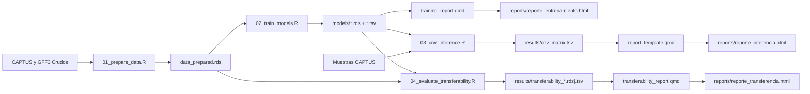

# Guía de Ejecución de TargetCNV-ML

[English Execution Guide](EXECUTION_GUIDE.md) | [README en Español](README_ES.md) | [English README](README.md)

[](https://doi.org/10.5281/zenodo.23463987)
[](https://www.r-project.org/)
[](https://opensource.org/licenses/MIT)
[](#4-flujo-1-prueba-rápida-con-datos-simulados-mwe)
[](https://rstudio.github.io/renv/)

Esta guía describe paso a paso la instalación, los argumentos de línea de comandos y los flujos experimentales de **TargetCNV-ML** desarrollados en el marco de la tesis de Maestría en Bioinformática para estimar **variaciones en el número de copias (CNV)** y separar **genes homólogos funcionales** de artefactos técnicos en datos de captura dirigida de genes (*Target Capture* / *Hyb-Seq*).

Los mensajes de seguimiento en consola, los nombres de columnas en las tablas `.tsv` y los reportes HTML generados con Quarto dentro de la carpeta `reports/` (`reporte_entrenamiento.html`, `reporte_inferencia.html` y `reporte_transferencia.html`) se producen en español.

### Contenido del documento
1. Requisitos del sistema, restauración del entorno (`./targetcnv.sh restore`, `pixi.toml`, `Apptainer.def`) y diagnóstico (`./targetcnv.sh doctor`).
2. Organización de archivos del repositorio y separación entre cómputo en R y visualización en Quarto.
3. Referencia detallada de `./targetcnv.sh`, de los cuatro scripts CLI (`01_prepare_data.R` a `04_evaluate_transferability.R`) y precauciones sobre opciones destructivas.
4. **Flujo 1:** Verificación mediante pruebas `testthat` y el Ejemplo Mínimo Funcional (MWE).
5. **Flujo 2:** Descarga verificada por MD5 y actualización de modelos preentrenados en **Zenodo** ([DOI: 10.5281/zenodo.23463987](https://doi.org/10.5281/zenodo.23463987)).
6. **Flujo 3:** Aplicación sobre una especie nueva y evaluación de **transferibilidad filogenética y concordancia de copias por ortogrupo** (*Solanum citrullifolium* y *Solanum stellatiglandulosum*).
7. **Flujo 4:** Reproducción del experimento de referencia en ***Solanum torvum***.
8. Fuentes de datos y citación.

---

## 1. Requisitos del Sistema e Instalación

### Software requerido
- **Sistema operativo:** Linux (probado en Ubuntu 22.04/24.04, Debian 12+, Arch/CachyOS y Fedora), macOS o Windows mediante WSL2.
- **R:** se recomienda la versión `4.6.2` con Bioconductor `3.23` para coincidencia exacta con `renv.lock` (el código es compatible con R $\ge 4.3$).
- **Quarto CLI:** versión `1.10.20` (o superior a `1.4`) para compilar las plantillas `.qmd` a HTML.
- **Utilidades del sistema:** `bash`, `curl` o `wget`, `unzip`, `md5sum`, `gcc`, `g++`, `gfortran`, `cmake` y `make`.

### 1.1 Restauración de paquetes con `renv` (opción recomendada)

```bash
# 1. Clonar el repositorio
git clone https://github.com/xyzdiego/TargetCNV-ML.git
cd TargetCNV-ML

# 2. Dar permisos de ejecución y restaurar las versiones exactas desde renv.lock
chmod +x targetcnv.sh run_test_pipeline.sh scripts/*.R
./targetcnv.sh restore

# 3. Comprobar que R, Quarto y todos los paquetes estén operativos
./targetcnv.sh doctor
```

> [!CAUTION]
> **Por qué no debe usar `renv::hydrate()` ni `renv::snapshot()` al instalar:** La función `renv::hydrate()` enlaza paquetes desde la librería global del sistema operativo sin verificar sus versiones exactas, y ejecutar `renv::snapshot()` sobrescribe el archivo `renv.lock`. Para preservar la reproducibilidad utilice siempre `./targetcnv.sh restore` (o `./targetcnv.sh setup`), que llama internamente a `renv::restore(prompt = FALSE)`.

### 1.2 Ejecución reproducible mediante Pixi o Apptainer

Cuando se requiere fijar tanto el intérprete de R como las librerías compiladas del sistema y Quarto CLI:

```bash
# Opción Pixi (usa conda-forge y bioconda según pixi.toml)
pixi install
pixi run doctor
pixi run test

# Opción Contenedor Apptainer / Singularity (construido desde Apptainer.def)
apptainer build targetcnv-ml.sif Apptainer.def
apptainer exec targetcnv-ml.sif ./targetcnv.sh doctor
```

El repositorio cuenta además con archivos [`DESCRIPTION`](DESCRIPTION) y [`NAMESPACE`](NAMESPACE) válidos (con correo de mantenedor registrado), de modo que las 60 funciones de `R/` pueden cargarse desde los scripts mediante `source()` o como paquete mediante `pkgload::load_all(".")`.

---

## 2. Estructura de Directorios y Arquitectura del Flujo

```text
TargetCNV-ML/
├── DESCRIPTION                  # Metadatos y dependencias del paquete R TargetCNVML
├── NAMESPACE                    # Funciones exportadas del paquete TargetCNVML
├── .Rprofile                    # Activación automática del entorno aislado renv
├── .gitignore                   # Exclusión de binarios pesados y resultados locales
├── renv.lock                    # Versiones exactas fijadas sobre R 4.6.2 y Bioconductor 3.23
├── pixi.toml                    # Entorno reproducible Pixi (R 4.6 + paquetes + Quarto 1.10.20)
├── Apptainer.def                # Definición de contenedor Apptainer (R 4.6.2 + Quarto 1.10.20)
├── targetcnv.sh                 # Script envoltorio en Bash para ejecutar los subcomandos del flujo
├── run_test_pipeline.sh         # Ejecutor del Ejemplo Mínimo Funcional (MWE)
├── assets/
│   ├── report.css               # Hoja de estilos CSS compartida por los reportes Quarto
│   └── waterfall.js             # Script JavaScript del explorador interactivo SHAP Waterfall
├── training_report.qmd          # Plantilla Quarto (solo lectura) para el reporte de entrenamiento
├── report_template.qmd          # Plantilla Quarto (solo lectura) para el reporte de inferencia CNV
├── transferability_report.qmd   # Plantilla Quarto (solo lectura) para el reporte de transferencia
├── GUIA_EJECUCION.md            # Guía detallada de ejecución en español (este documento)
├── EXECUTION_GUIDE.md           # Guía de ejecución en inglés
├── README_ES.md                 # Descripción general en español
├── README.md                    # Descripción general en inglés
│
├── R/                           # Módulos R documentados con roxygen2
│   ├── model_specs.R            # Especificación de 18 modelos ML, adaptador XGBoost y semillas CV
│   ├── data_processing.R        # Cruce espacial GFF, puente OG/HOG, deduplicación y matriz CNV
│   ├── model_evaluation.R       # Youden, Spearman, consenso 7 modelos, concordancia CNV y transferencia
│   ├── plotting.R               # Gráficos ggplot2 de densidades, Spearman, sensibilidad y heatmaps
│   └── report_helpers.R         # Cargadores de solo lectura, tablas DT, Plotly y cascadas SHAP
│
├── scripts/                     # Scripts de línea de comandos (optparse)
│   ├── 01_prepare_data.R        # Módulo 01: Etiquetado espacial GFF y preparación de datos
│   ├── 02_train_models.R        # Módulo 02: Colinealidad Spearman, CV de 24 métodos y SHAP
│   ├── 03_cnv_inference.R       # Módulo 03: Inferencia de CNV, consenso 7 modelos y sensibilidad 30-80%
│   └── 04_evaluate_transferability.R # Módulo 04: Evaluación de transferencia inter-especie y concordancia CNV
│
├── tests/                       # Pruebas unitarias e integrales automatizadas (testthat)
│   ├── testthat.R
│   └── testthat/
│       ├── test-models-and-seeds.R
│       ├── test-spatial-and-cnv.R
│       └── test-mwe-pipeline.R
│
├── .github/workflows/ci.yml     # Flujo de integración continua en GitHub Actions
├── data/
│   ├── reference/               # GFF3 de referencia, diccionario de sondas y sources_citations.tsv
│   ├── CAPTUS_Muestras/         # Estadísticas de extracción CAPTUS multimuestra
│   └── test_data/               # Datos sintéticos livianos para el MWE y pruebas unitarias
│
├── models/                      # Modelos serializados (.rds), tablas benchmark (.tsv), Spearman y SHAP
├── results/                     # Matrices CNV, sensibilidad 30-80%, concordancia y transferencia
└── reports/                     # Carpeta unificada para todos los reportes HTML compilados
```



---

## 3. Referencia de Comandos CLI y Advertencias de Uso

### 3.0 Subcomandos del envoltorio `./targetcnv.sh`

| Subcomando | Ejemplo | Descripción |
| :--- | :--- | :--- |
| `restore` / `setup` | `./targetcnv.sh restore` | Restaura la biblioteca local desde `renv.lock` (`renv::restore(prompt = FALSE)`). |
| `doctor` | `./targetcnv.sh doctor` | Comprueba `Rscript`, `quarto`, `curl`/`wget`, `unzip`, `md5sum` y los paquetes de R. |
| `test` | `./targetcnv.sh test [--no-report]` | Ejecuta el MWE sobre datos sintéticos aislados dentro de `data/test_data/`. |
| `zenodo` | `./targetcnv.sh zenodo [--out-dir .]` | Descarga `TargetCNV_Models.zip` desde Zenodo, valida su MD5 y verifica los modelos extraídos. |
| `prepare` | `./targetcnv.sh prepare [opciones de 01]` | Pasa los argumentos directamente a `scripts/01_prepare_data.R`. |
| `train` | `./targetcnv.sh train [opciones de 02]` | Pasa los argumentos directamente a `scripts/02_train_models.R`. |
| `infer` | `./targetcnv.sh infer -i stats.tsv --auto-zenodo` | Ejecuta `scripts/03_cnv_inference.R`; con `--auto-zenodo` descarga modelos si `models/` está vacío. |
| `transfer` | `./targetcnv.sh transfer [--sources ...]` | Ejecuta `scripts/04_evaluate_transferability.R` y compila `reports/reporte_transferencia.html`. |
| `report` | `./targetcnv.sh report [--models-dir models]` | Recompila `reports/reporte_entrenamiento.html` leyendo únicamente artefactos existentes. |
| `reproduce-storvum` | `./targetcnv.sh reproduce-storvum --cores 4` | Reproduce los pasos `01` $\rightarrow$ `02` $\rightarrow$ `03` sobre el conjunto de *Solanum torvum*. |
| `run-all` | `./targetcnv.sh run-all -g ref.gff3 -c cap.gff -s stats.tsv -d dict.xlsx -i nuevos.tsv` | Ejecuta `01` $\rightarrow$ `02` $\rightarrow$ `03` sobre una especie nueva generando reportes de entrenamiento e inferencia separados. |

> [!WARNING]
> **Instrucciones que eliminan o sobrescriben archivos previos:**
> 1. `--clean_models` en `02_train_models.R`: **elimina permanentemente** todos los archivos `.rds` y `.tsv` existentes en el directorio `--out_models` antes de escribir los resultados nuevos. Esta opción **no** se activa por defecto ni es invocada por `./targetcnv.sh reproduce-storvum`.
>    - *Cuándo usarla:* cuando ejecute manualmente un entrenamiento completo desde cero y desee limpiar por completo la carpeta de modelos para evitar que permanezcan artefactos de corridas anteriores.
>    - *Cuándo evitarla:* si está ejecutando `--fast_tournament` o pruebas parciales y desea conservar los 18 modelos previamente entrenados en `models/`.
> 2. `--sync-root` en `./targetcnv.sh test` o `./run_test_pipeline.sh`: **sobrescribe** las carpetas `models/` y `results/` de la raíz del proyecto con los modelos entrenados sobre datos sintéticos del MWE.
>    - *Cuándo usarla:* únicamente en entornos temporales de prueba donde no existan modelos reales.
>    - *Cuándo evitarla:* siempre que tenga modelos reales entrenados o descargados desde Zenodo en `models/`.

---

### 3.1 Módulo 01: Preparación de Datos y Etiquetado Espacial (`01_prepare_data.R`)

Este módulo construye la tabla etiquetada de referencia asociando cada contig nuclear ensamblado por CAPTUS (`protein_match:NUC`) con una categoría espacial (`TRUE_POSITIVE` o `FALSE_POSITIVE`). Opera bajo dos modalidades según la continuidad del genoma de referencia disponible:

- **Escala cromosómica (`--genome_scale chromosome` / `--target_mode overlap`):** armoniza los prefijos de secuencia entre archivos y cruza coordenadas genómicas y hebra (`GenomicRanges::findOverlaps`, `ignore.strand = FALSE`) entre los contigs de CAPTUS y las anotaciones `gene` de `--gff_ref`.
- **Escala de contigs (`--genome_scale contig` / `--target_mode target_attr`):** diseñada para ensamblajes fragmentados que carecen de GFF3 génico a nivel cromosómico. Extrae el locus de referencia desde el atributo `Target` del GFF de CAPTUS y reconcilia los grupos jerárquicos `HOG_ID` con los ortogrupos pangenómicos `OG_ID` usando la hoja de diseño de sondas del diccionario.

Una vez verificada la correspondencia locus-ortogrupo en el diccionario, la función `resolve_redundancies()` agrupa por muestra y locus de referencia: cuando dos o más contigs solapan el mismo gen como positivos, retiene únicamente el contig de mayor longitud emparejada (`ref_len_matched`) y cobertura (`pct_recovered`) como `TRUE_POSITIVE`, reclasificando los fragmentos adicionales del mismo locus como `FALSE_POSITIVE` (`5_TP_Redundante_Degradado`).

```bash
Rscript scripts/01_prepare_data.R \
  --gff_ref data/reference/Storvum_genes.gff3 \
  --captus_gff data/reference/Storvum_hit_contigs.gff \
  --captus_stats data/reference/captus-extract_stats.tsv \
  --dict_ref data/reference/Genes_Capture_May_2026.xlsx \
  --sample Storvum \
  --genome_scale chromosome \
  --out_dir data/
```

| Corto | Largo | Tipo | Requerido | Por Defecto | Descripción |
| :--- | :--- | :--- | :---: | :--- | :--- |
| `-g` | `--gff_ref` | Archivo | Sí\* | `NULL` | Archivo GFF/GFF3 de genes del genoma de referencia (\*obligatorio cuando `--genome_scale chromosome`). |
| `-c` | `--captus_gff` | Archivo | **Sí** | `NULL` | Archivo GFF de contigs ensamblados por CAPTUS (`protein_match:NUC`). |
| `-s` | `--captus_stats` | Archivo | **Sí** | `NULL` | Tabla `captus-extract_stats.tsv` con las métricas continuas de CAPTUS. |
| `-d` | `--dict_ref` | Archivo | No | `NULL` | Diccionario de homología (`.xlsx`, `.tsv` o `.csv`) con correspondencia locus-ortogrupo. |
| `-p` | `--sample` | Texto | No | `NULL` | Muestra específica a filtrar dentro de `captus-extract_stats.tsv` (ej. `Storvum`, `Scitrullifolium`, `S_stella`). |
| | `--genome_scale` | Texto | No | `chromosome` | `'chromosome'` (cruce de coordenadas GFF3) o `'contig'` (atributo `Target` + puente `OG_ID`/`HOG_ID`). |
| | `--target_mode` | Texto | No | `overlap` | Alias técnico del método: `'overlap'` o `'target_attr'`. |
| | `--allow_multi_sample` | Bandera | No | `FALSE` | Autoriza procesar tablas multimuestra sin filtrar `--sample` (usado en datos sintéticos MWE). |
| `-o` | `--out_dir` | Carpeta | No | `data/` | Carpeta de destino para `data_prepared.rds` y `data_prepared.tsv`. |

---

### 3.2 Módulo 02: Colinealidad, Entrenamiento Determinista y SHAP (`02_train_models.R`)

A partir de `data_prepared.rds`, este script ejecuta el diagnóstico estadístico de los predictores y evalúa los **24 métodos de clasificación** sobre las cuatro variables continuas de CAPTUS (`pct_recovered`, `pct_identity`, `score` y `wscore`):

1. **Prueba de colinealidad por rangos de Spearman:** calcula la matriz de correlaciones $\rho$ y sus valores $p$ por pares, guardando `models/spearman_collinearity.tsv` y `models/spearman_collinearity.rds`. En *S. torvum*, este análisis documenta el fuerte acoplamiento entre `score` y `wscore` ($\rho = 0.9977$) frente a la asociación moderada entre `pct_recovered` y `pct_identity` ($\rho = 0.7776$).
2. **Puntos de corte univariados de Youden (4 métodos) y ensamble heurístico (`Weighted_Heuristic`):** determina el umbral que maximiza $J = \text{Sensibilidad} + \text{Especificidad} - 1$ para cada variable y busca en una rejilla de pesos enteros ($0\text{ a }3$) la combinación lineal binaria de mayor ROC-AUC.
3. **Validación cruzada determinista sobre 18 clasificadores supervisados y `Ensamble_Stacking`:** construye particiones estratificadas y una lista explícita `seeds` dentro de `caret::trainControl()` derivada de `--seed`, lo que garantiza **resultados idénticos bit a bit independientemente del número de núcleos (`--cores`)**. Incluye el adaptador compatible con `xgboost >= 3.x` y el meta-modelo GLM `Ensamble_Stacking`, evaluados bajo dos regímenes:
   - **Balanceado:** submuestreo estratificado (`down`) dentro de cada pliegue de validación.
   - **Desbalanceado:** proporción original de clases del conjunto de referencia.
4. **Explicabilidad KernelSHAP y reporte Quarto:** guarda `shap_values_balanced.rds`, `shap_values_unbalanced.rds` y `consensus_spec.rds`, y compila `reports/reporte_entrenamiento.html`.

```bash
Rscript scripts/02_train_models.R \
  --data data/data_prepared.rds \
  --out_models models/ \
  --cv_folds 5 \
  --sampling down \
  --cores 4 \
  --seed 1234 \
  --sources data/reference/sources_citations.tsv \
  --report_file reports/reporte_entrenamiento.html
```

| Corto | Largo | Tipo | Requerido | Por Defecto | Descripción |
| :--- | :--- | :--- | :---: | :--- | :--- |
| `-d` | `--data` | Archivo | **Sí** | `data/data_prepared.rds` | Datos etiquetados (`.rds` o `.tsv`) producidos por el Módulo 01. |
| `-m` | `--out_models` | Carpeta | No | `models/` | Directorio de salida para modelos `.rds`, tablas `.tsv` y valores SHAP. |
| `-k` | `--cv_folds` | Entero | No | `5` | Número de pliegues de validación cruzada ($\ge 2$). |
| `-s` | `--sampling` | Texto | No | `down` | Estrategia de balanceo para el escenario balanceado: `'down'`, `'up'` o `'none'`. |
| `-c` | `--cores` | Entero | No | `detectCores() - 1` | Número de procesos paralelos PSOCK. |
| | `--seed` | Entero | No | `1234` | Semilla maestra para particiones, rejillas e inicialización determinista por pliegue. |
| | `--extended_tournament` / `--fast_tournament` | Bandera | No | `TRUE` | Entrena los 18 clasificadores ML (por defecto) o los 5 modelos rápidos (`ElasticNet`, `NaiveBayes`, `SVM_Polinomial`, `Red_Neuronal`, `LDA`). |
| | `--train_stacking` / `--no_stacking` | Bandera | No | `TRUE` | Ajusta (por defecto) u omite el meta-modelo GLM `Ensamble_Stacking`. |
| | `--clean_models` | Bandera | No | `FALSE` | **Destructivo:** elimina `.rds` y `.tsv` previos en `--out_models` antes de guardar. |
| | `--include_hit` | Bandera | No | `FALSE` | Incorpora el rango ordinal `hit` de CAPTUS como predictor. `consensus_spec.rds` registra automáticamente los predictores activos para que `03_cnv_inference.R` los detecte, aunque se recomienda dejarlo en `FALSE` para generalizar entre lotes con distinta profundidad. |
| | `--render_report` / `--no_render_report` | Bandera | No | `TRUE` | Compila (por defecto) u omite `reports/reporte_entrenamiento.html`. |
| `-r` | `--report_file` | Archivo | No | `reports/reporte_entrenamiento.html` | Ruta del archivo HTML de salida. |
| | `--sources` | Archivo | No | `""` | Tabla TSV con citas genómicas y bibliográficas (`data/reference/sources_citations.tsv`). |

#### Estructura de las tablas de benchmark (16 columnas)
Los archivos `benchmark_models_balanced.tsv`, `benchmark_models_unbalanced.tsv`, `youden_benchmark.tsv` y las tablas de transferencia comparten las mismas 16 columnas:
`Modelo`, `Exactitud`, `Exactitud_Balanceada`, `Sensibilidad`, `Especificidad`, `Precision`, `VPN`, `FDR`, `F1_Score`, `MCC`, `Kappa`, `ROC_AUC`, `TP`, `FP`, `FN`, `TN`.

En las tablas interactivas del reporte HTML, un asterisco (`*`) junto al nombre del modelo indica que dicho clasificador obtiene un mejor puntaje en el índice compuesto con penalización reforzada de falsos positivos dentro del escenario alternativo (*Balanceado* frente a *Desbalanceado*):
$$\text{Índice Global}_{\text{FDR}} = 0.45(1 - \text{FDR}) + 0.20\,\text{F1} + 0.15\,\text{MCC} + 0.10\,\text{Exactitud Bal.} + 0.10\,\text{ROC-AUC}$$

---

### 3.3 Módulo 03: Inferencia de CNV y Sensibilidad del Umbral (`03_cnv_inference.R`)

Estima la matriz de número de copias por ortogrupo y muestra sobre datos de captura empleando el comité de consenso y el filtro de cobertura:

1. **Consenso de 7 modelos:** integra las predicciones de 4 clasificadores supervisados (`ElasticNet`, `NaiveBayes`, `SVM_Polinomial`, `Red_Neuronal`, o los especificados en `consensus_spec.rds`), 2 cortes de Youden (`pct_recovered`, `pct_identity`) y el modelo `Weighted_Heuristic`. Toda secuencia que acumule al menos 4 votos positivos (`--min_votes 4`) se acepta como `Homologo_Valido`; las demás se descartan como `Ruido_Descartado`.
2. **Asignación de copias por cobertura (`--cov_threshold`):** dentro de cada muestra y ortogrupo, las secuencias `Homologo_Valido` se ordenan de mayor a menor `pct_recovered`:
   - `Copia_Principal`: la secuencia de mayor cobertura del ortogrupo en esa muestra (contada siempre como evidencia de presencia del locus).
   - `Homologo_Confirmado`: toda secuencia adicional con `pct_recovered >= --cov_threshold` (por defecto `50.0%`), que se suma como una copia adicional.
   - `No_Contado`: toda secuencia adicional con `pct_recovered < --cov_threshold`, retenida en el catálogo anotado pero excluida del conteo de copias para no inflar el resultado con exones partidos.
3. **Curva de sensibilidad (`30%` a `80%`) y concordancia por ortogrupo:** evalúa la estabilidad del conteo de copias (y su concordancia frente a $\text{CNV}^{\text{real}}_{\text{OG}}$ cuando el archivo de entrada incluye `Validacion_Espacial` o se pasa `--true_cnv`) a lo largo del rango `30%–80%`, exportando `cnv_threshold_sensitivity.tsv`.

*Consideración metodológica sobre el umbral de cobertura:* La curva de sensibilidad entre `30%` y `80%` permite calibrar empíricamente el punto de corte del `50%` sobre especies con genoma de referencia. Sin embargo, dado que `captus-extract_stats.tsv` reporta el porcentaje global recuperado de la proteína objetivo sin detallar en qué intervalo exacto de la sonda cae cada fragmento, esta regla escalar puede subestimar copias secundarias genuinas con recuperación menor al `50%` o contabilizar por separado dos fragmentos no solapantes de un mismo gen si ambos superan individualmente el `50%`.

```bash
Rscript scripts/03_cnv_inference.R \
  --input data/CAPTUS_Muestras/captus-extract_stats.tsv \
  --models_dir models/ \
  --out_dir results/ \
  --cov_threshold 50.0 \
  --min_votes 4 \
  --top_loci 30 \
  --sources data/reference/sources_citations.tsv
```

| Corto | Largo | Tipo | Requerido | Por Defecto | Descripción |
| :--- | :--- | :--- | :---: | :--- | :--- |
| `-i` | `--input` | Archivo | **Sí** | `NULL` | Tabla `.tsv`, `.csv` o `.rds` con estadísticas de extracción CAPTUS. |
| `-m` | `--models_dir` | Carpeta | No | `models/` | Directorio con los archivos `.rds` entrenados. |
| `-o` | `--out_dir` | Carpeta | No | `results/` | Directorio de salida para matrices, tablas de sensibilidad y gráficos. |
| `-c` | `--cov_threshold` | Decimal | No | `50.0` | Cobertura individual mínima (`pct_recovered` en %) para contar copias adicionales. |
| `-v` | `--min_votes` | Entero | No | `4` | Votos mínimos (sobre 7) para clasificar una secuencia como `Homologo_Valido`. |
| `-t` | `--top_loci` | Entero | No | `30` | Número de ortogrupos más abundantes representados en el mapa de calor. |
| | `--true_cnv` | Archivo | No | `""` | Matriz o tabla opcional de copias reales ($\text{CNV}^{\text{real}}_{\text{OG}}$) para evaluar concordancia. |
| | `--render_report` / `--no_render_report` | Bandera | No | `TRUE` | Compila (por defecto) u omite `reports/reporte_inferencia.html`. |
| `-r` | `--report_file` | Archivo | No | `reports/reporte_inferencia.html` | Ruta del reporte HTML de inferencia. |
| | `--sources` | Archivo | No | `""` | Tabla TSV opcional con citas de las fuentes genómicas (`data/reference/sources_citations.tsv`). |

#### Archivos generados en `<out_dir>/` y `reports/`
- `cnv_matrix.tsv`: matriz `Locus_Ortogrupo x Muestra` con el conteo total (`Copia_Principal + Homologo_Confirmado`).
- `cnv_annotated_sequences.tsv`: catálogo de secuencias válidas con su categoría de copia asignada.
- `functional_genes_catalog.tsv`: subconjunto depurado que incluye únicamente `Copia_Principal` y `Homologo_Confirmado`.
- `consensus_verdicts.tsv`: tabla con la decisión individual de cada uno de los 7 modelos por secuencia.
- `cnv_threshold_sensitivity.tsv` y `plot_cnv_threshold_sensitivity.pdf`/`.png`: curva de sensibilidad entre `30%` y `80%`.
- `cnv_concordance_summary.tsv` y `cnv_concordance_pairs.tsv`: *(cuando existen etiquetas espaciales o `--true_cnv`)* métricas de concordancia por ortogrupo ($\rho$ de Spearman, Kappa cuadrático ponderado, RMSE y concordancia exacta).
- `plot_consensus_distribution.pdf`/`.png`, `plot_cnv_heatmap.pdf`/`.png` y el reporte interactivo `reports/reporte_inferencia.html`.

---

### 3.4 Módulo 04: Evaluación de Transferibilidad Filogenética (`04_evaluate_transferability.R`)

Ejecuta fuera de Quarto todos los cálculos de validación inter-especie y concordancia de copias:
1. Aplica sin reentrenamiento los 24 métodos ajustados en *S. torvum* y el consenso de 7 modelos sobre las especies receptoras preparadas (*S. citrullifolium* a escala cromosómica y *S. stellatiglandulosum* a escala de contigs).
2. Evalúa la concordancia del número de copias por ortogrupo ($\widehat{\text{CNV}}_{\text{OG}}$ frente a $\text{CNV}^{\text{real}}_{\text{OG}}$) mediante correlación de Spearman ($\rho$), Kappa cuadrático ponderado ($\kappa_w$), RMSE, MAE y tasa de concordancia exacta.
3. Calcula la curva de sensibilidad de `--cov_threshold` (`30%` a `80%`) en cada especie, guarda `results/transferability_*.tsv` y `results/transferability_results.rds`, y compila `transferability_report.qmd` en modo de solo lectura.

```bash
# Mediante el envoltorio:
./targetcnv.sh transfer --sources data/reference/sources_citations.tsv

# O invocando directamente el script en R:
Rscript scripts/04_evaluate_transferability.R \
  --models_dir models/ \
  --donor_data data/data_prepared.rds \
  --cit_data data/citrullifolium/data_prepared.rds \
  --ste_data data/stellatiglandulosum/data_prepared.rds \
  --dict_ref data/reference/Genes_Capture_May_2026.xlsx \
  --cov_threshold 50.0 \
  --min_votes 4 \
  --out_dir results/ \
  --sources data/reference/sources_citations.tsv \
  --report_file reports/reporte_transferencia.html
```

---

### 3.5 Recompilación Manual de Reportes Quarto (Solo Lectura)

Las tres plantillas `.qmd` leen únicamente archivos `.rds` y `.tsv` precomputados; si `models/` carece de modelos entrenados, muestran un aviso indicando ejecutar `./targetcnv.sh train`. Todos los HTML se guardan en `reports/`.

```bash
# 1. Reporte de entrenamiento (reports/reporte_entrenamiento.html)
./targetcnv.sh report

# 2. Reporte de inferencia (reports/reporte_inferencia.html)
quarto render report_template.qmd \
  -P consensus_verdicts:"results/consensus_verdicts.tsv" \
  -P cnv_matrix:"results/cnv_matrix.tsv" \
  -P cnv_annotated:"results/cnv_annotated_sequences.tsv" \
  -P cnv_sensitivity:"results/cnv_threshold_sensitivity.tsv" \
  -P sources_file:"data/reference/sources_citations.tsv" \
  -P top_loci:30 \
  --output "reporte_inferencia.html" && mv -f reporte_inferencia.html reports/

# 3. Reporte de transferencia filogenética (reports/reporte_transferencia.html)
./targetcnv.sh transfer --sources data/reference/sources_citations.tsv
```

---

## 4. Flujo 1: Prueba Rápida con Datos Simulados (MWE)

Para comprobar tanto las invariantes unitarias de las funciones como la ejecución completa de los scripts CLI sin depender de los datos genómicos completos:

```bash
# Suite de pruebas unitarias e integrales (testthat)
Rscript tests/testthat.R

# Ejecución completa del MWE generando reportes HTML de prueba en reports/
./targetcnv.sh test
```

La suite `tests/testthat.R` comprueba automáticamente:
- La intersección espacial GFF respetando nombres de secuencia armonizados, hebra y deduplicación intra-locus.
- La igualdad bit a bit del entrenamiento CV mediante `build_deterministic_cv_control()` entre ejecución en `1` núcleo y en `2` núcleos paralelos PSOCK.
- El ajuste y predicción de probabilidades en `XGBoost` y el invariante `ROC_AUC > 0.5` en `Ensamble_Stacking`.
- Los casos borde de `extract_cnv_matrix()` (0 secuencias válidas, copia primaria $< 50\%$, frontera exacta `50.0%` frente a `49.99%` y relleno de muestras con `0` copias).
- La corrida aislada de los módulos `01` $\rightarrow$ `02` $\rightarrow$ `03` en un directorio temporal.

---

## 5. Flujo 2: Descarga, Uso y Actualización de Modelos en Zenodo

Los artefactos entrenados sobre *Solanum torvum* están depositados en Zenodo ([DOI: 10.5281/zenodo.23463987](https://doi.org/10.5281/zenodo.23463987), archivo `TargetCNV_Models.zip`).

### 5.1 Descarga verificada e inferencia directa
```bash
# Descarga con reintentos, verifica la suma MD5 (borra el .zip si falla) y comprueba los 18 modelos + consensus_spec.rds:
./targetcnv.sh zenodo

# Inferencia sobre muestras descargando automáticamente de Zenodo si models/ está vacío:
./targetcnv.sh infer -i data/CAPTUS_Muestras/captus-extract_stats.tsv --auto-zenodo
```

### 5.2 Publicación de una nueva versión de `TargetCNV_Models.zip` en Zenodo

Cuando se reentrenan los 24 métodos (incluyendo `XGBoost`, `Ensamble_Stacking`, `spearman_collinearity.*` y `consensus_spec.rds`):

1. **Comprobar artefactos en `models/` y generar el archivo comprimido:**
   ```bash
   ls -1 models/consensus_spec.rds models/models_balanced.rds models/models_unbalanced.rds
   zip -r TargetCNV_Models.zip models/
   md5sum TargetCNV_Models.zip
   ```
2. **Subir la nueva versión a Zenodo:**
   - Ingresar a [https://doi.org/10.5281/zenodo.23463987](https://doi.org/10.5281/zenodo.23463987) y usar la opción **"New version"**.
   - Reemplazar `TargetCNV_Models.zip`, asignar la etiqueta de versión `v1.1.0` y publicar.
3. **Actualizar `ZENODO_URL` y `ZENODO_MD5` en `targetcnv.sh`:**
   ```bash
   ZENODO_URL="https://zenodo.org/api/records/<NUEVO_RECORD_ID>/files/TargetCNV_Models.zip/content"
   ZENODO_ZIP="TargetCNV_Models.zip"
   ZENODO_MD5="<NUEVO_HASH_MD5>"
   ```

---

## 6. Flujo 3: Nuevos Datos y Transferibilidad Filogenética

### 6.1 Entrenamiento e inferencia de extremo a extremo sobre una especie nueva
El subcomando `run-all` ejecuta secuencialmente los módulos `01`, `02` y `03`, generando reportes HTML separados para entrenamiento e inferencia (derivando automáticamente el nombre del reporte de inferencia a partir de `-r` o de `--infer_report_file` para no sobrescribir `reports/reporte_inferencia.html`):

```bash
./targetcnv.sh run-all \
  -g ruta/a/nuevo_genoma.gff3 \
  -c ruta/a/nuevos_contigs_captus.gff \
  -s ruta/a/captus-extract_stats.tsv \
  -d ruta/a/diccionario_homologia.xlsx \
  -p MuestraReferencia \
  -i ruta/a/captus_poblacion.tsv \
  --out_data data/nueva_especie \
  -m models/nueva_especie \
  -o results/nueva_especie \
  -r reports/reporte_entrenamiento_nueva_especie.html \
  --infer_report_file reports/reporte_inferencia_nueva_especie.html
```

### 6.2 Preparación y evaluación de transferibilidad inter-especie (*S. citrullifolium* y *S. stellatiglandulosum*)

```bash
# 1. Preparar especie receptora a escala cromosómica (S. citrullifolium: 171 secuencias NUC, 56 TP / 115 FP)
Rscript scripts/01_prepare_data.R \
  --gff_ref data/reference/Scitrullifolium_genes.gff3 \
  --captus_gff data/reference/Scitrullifolium_hit_contigs.gff \
  --captus_stats data/reference/captus-extract_stats.tsv \
  --dict_ref data/reference/Genes_Capture_May_2026.xlsx \
  --sample Scitrullifolium \
  --genome_scale chromosome \
  --out_dir data/citrullifolium/

# 2. Preparar especie receptora a escala de contigs (S. stellatiglandulosum: 200 secuencias NUC, 19 TP / 181 FP)
Rscript scripts/01_prepare_data.R \
  --captus_gff data/reference/S_stella_hit_contigs.gff \
  --captus_stats data/reference/captus-extract_stats.tsv \
  --dict_ref data/reference/Genes_Capture_May_2026.xlsx \
  --sample S_stella \
  --genome_scale contig \
  --out_dir data/stellatiglandulosum/

# 3. Evaluar transferibilidad de los 24 métodos, concordancia CNV por ortogrupo, curva 30%-80% y reporte HTML
./targetcnv.sh transfer --sources data/reference/sources_citations.tsv
```

#### Concordancia de número de copias por ortogrupo (`--cov_threshold 50.0%`, Consenso de 7 Modelos)

| Especie | Escala del Genoma | Ortogrupos ($N$) | Copias Reales | Copias Estimadas | Concordancia Exacta (%) | $\rho$ de Spearman | $\kappa_w$ Cuadrático | RMSE |
| :--- | :--- | :---: | :---: | :---: | :---: | :---: | :---: | :---: |
| ***S. torvum*** (Donante) | Escala Cromosómica | 58 | 87 | 79 | **79.31** | **0.5983** ($p = 7.0 \times 10^{-7}$) | **0.5269** | 0.8710 |
| ***S. citrullifolium*** | Escala Cromosómica | 55 | 56 | 66 | **70.91** | **0.4653** ($p = 3.4 \times 10^{-4}$) | **0.5506** | 0.5394 |
| ***S. stellatiglandulosum*** | Escala de Contigs | 58 | 19 | 78 | 24.14 | 0.0831 ($p = 0.535$) | 0.0742 | 1.3834 |

---

## 7. Flujo 4: Reproducción del Experimento de Referencia (*Solanum torvum*)

```bash
./targetcnv.sh reproduce-storvum --cores 4
```

### Resultados en validación cruzada determinista ($K = 5$, `--seed 1234`, $N = 184$: $87\text{ TP}$ frente a $97\text{ FP}$)

#### Escenario Balanceado (*Down-Sampling*) - Clasificadores representativos
| Modelo | Exactitud Bal. (%) | Sensibilidad (%) | Especificidad (%) | Precisión (%) | FDR (%) | F1 Score | MCC | Kappa | ROC-AUC |
| :--- | :---: | :---: | :---: | :---: | :---: | :---: | :---: | :---: | :---: |
| **Weighted_Heuristic** | 88.86 | 83.91 | 93.81 | 92.41 | 7.59 | **0.880** | 0.784 | 0.781 | 0.921 |
| **Ensamble_Stacking** | 88.29 | 82.76 | 93.81 | 92.31 | 7.69 | **0.873** | 0.774 | 0.770 | **0.932** |
| **Red_Neuronal (`nnet`)** | 87.31 | 83.91 | 90.72 | 89.02 | 10.98 | **0.864** | 0.750 | 0.749 | 0.927 |
| **SVM_Polinomial (`svmPoly`)** | 87.14 | 80.46 | 93.81 | 92.11 | 7.89 | **0.859** | 0.753 | 0.748 | **0.934** |
| **LDA \*** | 86.74 | 82.76 | 90.72 | 88.89 | 11.11 | **0.857** | 0.739 | 0.737 | 0.922 |
| **NaiveBayes (`nb`)** | 86.56 | 79.31 | 93.81 | 92.00 | 8.00 | **0.852** | 0.743 | 0.736 | **0.934** |
| **ElasticNet (`glmnet`) \*** | 85.25 | 83.91 | 86.60 | 84.88 | 15.12 | **0.844** | 0.706 | 0.705 | 0.930 |
| **XGBoost \*** | 84.50 | 79.31 | 89.69 | 87.34 | 12.66 | **0.831** | 0.696 | 0.693 | 0.920 |

#### Escenario Desbalanceado (Proporción original: $87\text{ TP}$ frente a $97\text{ FP}$) - Clasificadores representativos
| Modelo | Exactitud Bal. (%) | Sensibilidad (%) | Especificidad (%) | Precisión (%) | FDR (%) | F1 Score | MCC | Kappa | ROC-AUC |
| :--- | :---: | :---: | :---: | :---: | :---: | :---: | :---: | :---: | :---: |
| **Weighted_Heuristic** | 88.86 | 83.91 | 93.81 | 92.41 | 7.59 | **0.880** | 0.784 | 0.781 | 0.921 |
| **Ensamble_Stacking** | 88.35 | 83.91 | 92.78 | 91.25 | 8.75 | **0.874** | 0.772 | 0.770 | **0.935** |
| **LDA** | 87.26 | 82.76 | 91.75 | 90.00 | 10.00 | **0.862** | 0.750 | 0.748 | 0.922 |
| **NaiveBayes (`nb`)** | 86.56 | 79.31 | 93.81 | 92.00 | 8.00 | **0.852** | 0.743 | 0.736 | **0.934** |
| **ElasticNet (`glmnet`)** | 85.77 | 83.91 | 87.63 | 85.88 | 14.12 | **0.849** | 0.716 | 0.716 | 0.930 |
| **Red_Neuronal (`nnet`) \*** | 84.56 | 80.46 | 88.66 | 86.42 | 13.58 | **0.833** | 0.695 | 0.694 | 0.921 |
| **XGBoost** | 84.56 | 80.46 | 88.66 | 86.42 | 13.58 | **0.833** | 0.695 | 0.694 | 0.918 |
| **SVM_Polinomial (`svmPoly`) \*** | 83.03 | 90.80 | 75.26 | 76.70 | 23.30 | **0.832** | 0.664 | 0.654 | 0.930 |

*(\* indica que el modelo alcanza un mayor índice global ponderado por FDR en el escenario alternativo; las tablas completas con los 24 métodos se exportan en `models/benchmark_models_balanced.tsv` y `models/benchmark_models_unbalanced.tsv`).*

---

## 8. Citación y Licencia

- **Genomas cromosómicos (*S. torvum* y *S. citrullifolium*):** Solanum Pan-Genomics (https://solpangenomics.com/dist/pages/downloads/index.php), SGN (https://solgenomics.net/ftp/genomes/Solanum_pangenomics/) y NCBI BioProject `PRJNA1073673` (https://www.ncbi.nlm.nih.gov/bioproject/PRJNA1073673); **Benoit, M. *et al.*** (2025), *Nature*, 640(8057): 135-145, [doi:10.1038/s41586-025-08619-6](https://doi.org/10.1038/s41586-025-08619-6).
- **Genoma a escala de contigs (*S. stellatiglandulosum*):** NCBI BioProject `PRJNA1070281` (https://www.ncbi.nlm.nih.gov/bioproject/?term=txid3132602%5BOrganism:noexp%5D); **Pérez-Mesa, P. A. & Roda, F.** (2025), *Current Opinion in Plant Biology*, 85: 102727, [doi:10.1016/j.pbi.2025.102727](https://doi.org/10.1016/j.pbi.2025.102727); **Pérez-Mesa, P. A., Pardo, R. A., Alseekh, S. *et al.*** (2026), *Plant Molecular Biology*, 116: 67, [doi:10.1007/s11103-026-01718-6](https://doi.org/10.1007/s11103-026-01718-6).

```bibtex
@software{targetcnv_ml_2026,
  author       = {Benítez Duarte, Diego Andrés},
  title        = {{TargetCNV-ML: Machine Learning and Spatial Inference for Copy Number Variations in Target Capture}},
  month        = jul,
  year         = 2026,
  publisher    = {Zenodo},
  version      = {v1.1.0},
  doi          = {10.5281/zenodo.23463987},
  url          = {https://doi.org/10.5281/zenodo.23463987}
}

@mastersthesis{benitez_duarte_thesis_2026,
  author       = {Benítez Duarte, Diego Andrés},
  title        = {{Desarrollo de un flujo de trabajo bioinformático para la Detección de Variación en el Número de Copias (CNV) de genes a partir de secuencias genómicas de lectura corta}},
  school       = {Universidad Nacional de Colombia},
  year         = 2026,
  address      = {Colombia},
  note         = {Tesis de Maestría en Bioinformática}
}
```

Distribuido bajo la **Licencia MIT** (consulte [LICENSE](LICENSE)). Los conjuntos de datos y modelos preentrenados en Zenodo se distribuyen bajo **CC BY 4.0**.
