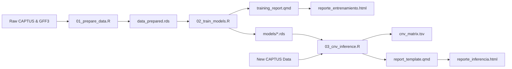

# TargetCNV-ML: Machine Learning & Spatial Inference for Copy Number Variations in Target Capture

[🇪🇸 Versión en Español](https://github.com/xyzdiego/TargetCNV-ML/blob/main/README_ES.md) | [📘 Execution Guide (EN)](https://github.com/xyzdiego/TargetCNV-ML/blob/main/EXECUTION_GUIDE.md) | [📗 Guía de Ejecución (ES)](https://github.com/xyzdiego/TargetCNV-ML/blob/main/GUIA_EJECUCION.md)

[](https://doi.org/10.5281/zenodo.23463987)
[](https://www.r-project.org/)
[](https://opensource.org/licenses/MIT)
[-brightgreen.svg)](#inicio-rápido-batería-de-pruebas)
[](https://rstudio.github.io/renv/)

A modular, reproducible, and CLI-driven bioinformatics software package designed to detect **Copy Number Variations (CNV)** and resolve **homologous gene expansions** from Target Capture high-throughput sequencing data.

> [!IMPORTANT]
> **Language Availability Notice:** Currently, the internal workflow of the scripts, CLI console messages, output table column names, and interactive Quarto HTML reports (`reporte_entrenamiento.html` and `reporte_inferencia.html`) are built in **Spanish**. Full English localization of the internal workflow and interactive reports will be available in upcoming updates.

---

## Overview

Target Capture is a cost-effective next-generation sequencing approach extensively used in phylogenomics, evolutionary genetics, and molecular breeding. However, extracting structural genomic variations such as **Copy Number Variations (CNV)** from target capture assemblies is hindered by two intertwined biological and technical bottlenecks:

1. **Homologous Asymmetry & Off-Target Cross-Hybridization:** Gene duplication events result in multi-copy gene families with divergent evolutionary trajectories. Assembled contigs frequently map across closely related homologous loci, generating ambiguous hit assignments and elevated False Discovery Rates (FDR).
2. **Assembly Fragmentation Artifacts:** *De novo* contig assemblies often break single long genes into multiple shorter fragments. Naive copy-counting heuristics misidentify technical fragmentation as biological gene duplications, leading to severe copy-number inflation.

**TargetCNV-ML** addresses these challenges through a hybrid architecture combining:
- **Spatial Genomic Overlaps:** Strict coordinate intersection via `GenomicRanges`, exact homology dictionary validation, and assembly-quality-based redundancy resolution (no tandem-rescue step: results follow the *Workflow_Central_Sin_Rescate* research workflow).
- **Supervised Machine Learning Tournament (24 Evaluated Methods):** Full multi-model benchmark comparing **18 supervised classifiers** (`RandomForest`, `GBM`, `XGBoost`, `SVM_Radial`, `SVM_Lineal`, `SVM_Polinomial`, `Red_Neuronal`, `Red_Neuronal_Bag`, `ElasticNet`, `KNN`, `CART`, `NaiveBayes`, `LDA`, `MLP`, `MLP_Regularizado`, `QDA`, `Bagging_Arboles`, `Stacked Autoencoder - DNN`), a **GLM Stacking Meta-Model (`Ensamble_Stacking`)**, a **Weighted Heuristic Ensemble (`Weighted_Heuristic`)**, and **4 univariate Youden's J-statistic cutoffs** under both balanced (*down-sampling*) and unbalanced cross-validation scenarios.
- **7-Model Consensus Voting System:** A robust ensemble combining 4 top ML voters (`ElasticNet`, `NaiveBayes`, `SVM_Polinomial`, `Red_Neuronal`), 2 univariate Youden cutoffs (`pct_recovered`, `pct_identity`), and 1 weighted heuristic model, requiring simple majority ($\ge 4/7$ positive votes) to confirm genuine functional homologs (`Homologo_Valido`) while filtering intergenic/intronic noise (`Ruido_Descartado`).
- **Single-Threshold Coverage Rule for Fragmentation Control:** Within each sample and locus, validated homologs (`Homologo_Valido`) are sorted from highest to lowest individual coverage (`pct_recovered`). The top-coverage sequence is always counted as the primary copy (`Copia_Principal`), additional sequences with individual coverage $\ge 50.0\%$ (`--cov_threshold 50.0`) are counted as confirmed additional copies (`Homologo_Confirmado`), and shorter secondary fragments ($< 50.0\%$) are classified as uncounted (`No_Contado`) to prevent split contigs from inflating the CNV matrix (`Copia_Principal + Homologo_Confirmado`).

---

## Repository Structure

```text
TargetCNV-ML/
├── .Rprofile                    # Automatic activation of the renv virtual environment
├── .gitignore                   # Excludes heavy binary files and raw data per Zenodo standards
├── renv.lock                    # Dependency lockfile recording exact R package versions
├── targetcnv.sh                 # Unified Bash CLI orchestrator for running 1-line workflows
├── run_test_pipeline.sh         # Bash runner for the end-to-end Minimal Working Example (MWE)
├── training_report.qmd          # Quarto template for the interactive HTML training report
├── report_template.qmd          # Quarto template for the interactive HTML CNV inference report
├── EXECUTION_GUIDE.md           # Step-by-step execution guide in English (all commands, flags, Zenodo, new data)
├── GUIA_EJECUCION.md            # Step-by-step execution guide in Spanish (all commands, flags, Zenodo, new data)
│
├── R/                           # Pure, modular, roxygen2-documented R library functions
│   ├── model_specs.R            # Unified 18-model tournament specifications, XGBoost adapter & name normalizer
│   ├── data_processing.R        # GFF intersection, dictionary classification, redundancy resolution, CNV extraction
│   ├── model_evaluation.R       # Confusion matrices, Youden optimization, 7-model consensus, inference
│   └── plotting.R               # ggplot2/plotly wrappers for confusion tiles, densities, benchmarks, heatmaps
│
├── scripts/                     # Production CLI executables using optparse
│   ├── 01_prepare_data.R        # Step 1: Spatial GFF overlap and feature engineering
│   ├── 02_train_models.R        # Step 2: 24-method tournament, k-fold CV, KernelSHAP & HTML training report
│   └── 03_cnv_inference.R       # Step 3: Production CNV inference via 7-model consensus & HTML inference report
│
├── data/
│   ├── reference/               # Genomic reference GFF3 annotations and homology dictionaries
│   ├── CAPTUS_Muestras/         # Multi-sample CAPTUS assembly statistics
│   └── test_data/               # Lightweight mock dataset (<25 KB) for automated testing
│
├── models/                      # Pre-trained ML models, benchmark tables, SHAP objects & thresholds (.rds/.tsv)
└── results/                     # Output CNV matrices, classification tables, and diagnostic plots
```

---

## Prerequisites & Setup

### System Requirements
- **Linux** (tested on Ubuntu 20.04+, Debian, Arch/CachyOS) or **macOS** (or Windows via WSL2).
- **R** $\ge 4.0.0$ (R 4.3+ or 4.6 recommended).
- **Quarto** $\ge 1.3+$ (for compiling interactive HTML reports).
- Standard command-line and build utilities (`bash`, `curl` or `wget`, `unzip`, `md5sum`, `gcc`, `g++`, `make`).

### Installation

1. **Clone the repository:**
   ```bash
   git clone https://github.com/xyzdiego/TargetCNV-ML.git
   cd TargetCNV-ML
   ```

2. **Make scripts executable and restore dependencies with `renv`:**
   Open an interactive R session or run via terminal to restore the exact package versions defined in `renv.lock`:
   ```bash
   chmod +x targetcnv.sh run_test_pipeline.sh scripts/*.R
   Rscript -e "renv::restore()"
   ```
   *(If you already have the required packages installed in your system R library, you can link them directly into `renv/library` by running `./targetcnv.sh snapshot`).*

3. **Verify your environment:**
   ```bash
   ./targetcnv.sh doctor
   ```

   > [!NOTE]
   > The environment includes key bioinformatics and machine learning libraries: `GenomicRanges`, `rtracklayer`, `caret`, `caretEnsemble`, `glmnet`, `klaR`, `kernlab`, `randomForest`, `gbm`, `xgboost`, `RSNNS`, `deepnet`, `ipred`, `pROC`, `optparse`, `readxl`, `kernelshap`, `shapviz`, `NeuralNetTools`, `plotly`, `DT`, `cowplot`, `knitr`, `rmarkdown`, and `tidyverse`.

---

## Quickstart (Test Suite)

TargetCNV-ML includes a self-contained **Minimal Working Example (MWE)** under `data/test_data/` containing simulated GFF3 reference coordinates, CAPTUS contigs, and statistical metrics across synthetic samples.

Validate your installation by running the end-to-end test suite:

```bash
./targetcnv.sh test
# Equivalent to: ./run_test_pipeline.sh
```

### What `run_test_pipeline.sh` (`./targetcnv.sh test`) does:
1. Executes `01_prepare_data.R` to compute coordinate intersections and clean sequence IDs inside `data/test_data/prepared/`.
2. Executes `02_train_models.R` to optimize Youden cutoffs, train the supervised classifiers using 3-fold cross-validation, and render `data/test_data/reporte_entrenamiento_test.html`.
3. Executes `03_cnv_inference.R` to apply the 7-model consensus, apply the 50% coverage rule, produce the final CNV matrix, and render `data/test_data/results/reporte_inferencia.html`.
4. Validates that all output tables and graphics (`cnv_matrix.tsv`, `consensus_verdicts.tsv`, `plot_cnv_heatmap.pdf`) are successfully generated without overwriting your root `models/` or `results/` directories.

---

## Production Usage

> [!WARNING]
> **Pre-trained Models & Zenodo Assets:**
> In accordance with open-science standards, serialized models (`models/*.rds`) are archived on **Zenodo** to prevent Git repository bloat. Before running Step 3 (`03_cnv_inference.R`) on production datasets without re-training:
> 1. Download and verify the pre-trained model bundle (`TargetCNV_Models.zip`) automatically with `./targetcnv.sh`:
>    ```bash
>    ./targetcnv.sh zenodo
>    ```
> 2. Or download and unzip it manually at the project root from Zenodo DOI [10.5281/zenodo.23463987](https://www.google.com/url?sa=E&source=gmail&q=https://doi.org/10.5281/zenodo.23463987):
>    ```bash
>    curl -L -o TargetCNV_Models.zip https://zenodo.org/api/records/23463987/files/TargetCNV_Models.zip/content
>    unzip -o TargetCNV_Models.zip
>    ```

> [!TIP]
> Complete step-by-step guides (covering every command, flag, cross-species transferability test, MWE, and Zenodo model usage) are available in English ([EXECUTION\_GUIDE.md](https://www.google.com/search?q=EXECUTION_GUIDE.md)) and Spanish ([GUIA\_EJECUCION.md](https://www.google.com/search?q=GUIA_EJECUCION.md)).

### Unified 1-Line Orchestrator (`./targetcnv.sh`)

| Subcommand | Example | Description |
| :--- | :--- | :--- |
| `doctor` | `./targetcnv.sh doctor` | Verifies R, `renv`, Quarto CLI, system tools, and required R packages. |
| `test` | `./targetcnv.sh test [--sync-root] [--no-report]` | Runs the end-to-end MWE test suite on synthetic data. |
| `zenodo` | `./targetcnv.sh zenodo [--out-dir .]` | Downloads `TargetCNV_Models.zip` from Zenodo, verifies its MD5 checksum, and extracts `models/`. |
| `infer` | `./targetcnv.sh infer -i stats.tsv --auto-zenodo` | Runs 7-model CNV inference on new samples (auto-downloading Zenodo models if `models/` is empty). |
| `reproduce-storvum` | `./targetcnv.sh reproduce-storvum --cores 4` | Reproduces the complete *Solanum torvum* reference experiment (Steps 01 $\rightarrow$ 02 $\rightarrow$ 03 + HTML reports). |
| `run-all` | `./targetcnv.sh run-all -g ref.gff3 -c cap.gff -s stats.tsv -d dict.xlsx -i pop.tsv` | Runs the complete pipeline (`01` $\rightarrow$ `02` $\rightarrow$ `03`) on a new species in a single command. |
| `prepare` | `./targetcnv.sh prepare [01 options]` | Executes Module 01 (`scripts/01_prepare_data.R`). |
| `train` | `./targetcnv.sh train [02 options]` | Executes Module 02 (`scripts/02_train_models.R`). |
| `report` | `./targetcnv.sh report [--models-dir models]` | Re-renders the interactive HTML training report (`reporte_entrenamiento.html`) via Quarto. |
| `snapshot` | `./targetcnv.sh snapshot` | Hydrates R packages from the system library into `renv/library` and updates `renv.lock`. |

### Modular CLI Workflow

The pipeline is split into three modular, scriptable CLI entrypoints plus two interactive Quarto report templates:



### Step 1: Data Preparation & Spatial Overlaps (`01_prepare_data.R`)

Computes strict spatial overlaps (`GenomicRanges`), matches contigs against the reference dictionary, removes redundancies, and computes local delta scores (`delta_wscore`, `delta_pct_identity`).

```bash
./scripts/01_prepare_data.R \
  --gff_ref data/reference/Storvum_genes.gff3 \
  --captus_gff data/reference/Storvum_hit_contigs.gff \
  --captus_stats data/reference/captus-extract_stats.tsv \
  --dict_ref data/reference/Genes_Capture_May_2026.xlsx \
  --sample Storvum \
  --target_mode overlap \
  --out_dir data/
```

**Parameters:**
| Flag | Name | Type | Description |
| :--- | :--- | :--- | :--- |
| `-g` | `--gff_ref` | File | Reference genome GFF3 annotation file `[Required in overlap mode]` |
| `-c` | `--captus_gff` | File | CAPTUS assembled contigs GFF file `[Required]` |
| `-s` | `--captus_stats` | File | CAPTUS statistics TSV (`captus-extract_stats.tsv`) `[Required]` |
| `-d` | `--dict_ref` | File | Homology reference dictionary (`.xlsx`, `.tsv`, `.csv`) `[Optional]` |
| `-p` | `--sample` | String | Specific sample name to filter within statistics `[Optional]` |
| | `--target_mode` | String | `'overlap'` (coordinate intersection) or `'target_attr'` (extracts gene ID from GFF `Target` attribute for fragmented genomes; default: `'overlap'`) |
| `-o` | `--out_dir` | Dir | Destination directory (default: `data/`) |

---

### Step 2: Model Training & Cross-Validation (`02_train_models.R`)

Computes optimal Youden univariate cutoffs, performs grid search for the weighted heuristic ensemble, trains the 18 supervised ML algorithms and the `Ensamble_Stacking` meta-model via `caret` under both balanced (`down-sampling`) and unbalanced scenarios, computes KernelSHAP explainability values, and renders `reporte_entrenamiento.html`.

```bash
./scripts/02_train_models.R \
  --data data/data_prepared.rds \
  --out_models models/ \
  --cv_folds 5 \
  --sampling down \
  --cores 4 \
  --seed 1234 \
  --report_file reporte_entrenamiento.html
```

**Parameters:**
| Flag | Name | Type | Description |
| :--- | :--- | :--- | :--- |
| `-d` | `--data` | File | Prepared data generated by Step 1 (`.rds` or `.tsv`) `[Required]` |
| `-m` | `--out_models` | Dir | Directory to save trained `.rds` models and `.tsv` tables (default: `models/`) |
| `-k` | `--cv_folds` | Integer| Number of partitions for k-fold cross-validation (default: `5`) |
| `-s` | `--sampling` | String | Class re-sampling method for the balanced scenario: `down`, `up`, or `none` (default: `down`) |
| `-c` | `--cores` | Integer| Number of parallel execution threads (default: `detectCores() - 1`) |
| | `--seed` | Integer| Random seed for exact stochastic reproducibility (default: `1234`) |
| | `--extended_tournament` / `--fast_tournament` | Flag | Train all 18 ML algorithms (default: `TRUE`) or only the 5 fast core models (`--fast_tournament`) |
| | `--train_stacking` / `--no_stacking` | Flag | Train (default: `TRUE`) or skip the GLM `caretStack` meta-model (`Ensamble_Stacking`) |
| | `--clean_models` | Flag | Remove previous `.rds`/`.tsv` files in `--out_models` before saving (default: `FALSE`) |
| | `--include_hit` | Flag | Include the CAPTUS integer hit rank as predictor (default: `FALSE`; not compatible with Step 3) |
| | `--render_report` / `--no_render_report` | Flag | Render (default: `TRUE`) or skip the HTML training report |
| `-r` | `--report_file` | File | Output path of the HTML training report (default: `reporte_entrenamiento.html`) |

---

### Step 3: Production CNV Inference & Consensus (`03_cnv_inference.R`)

Applies the **7-Model Consensus System** (Majority Rule $\ge 4/7$ positive votes), classifies valid homologs using the single-threshold coverage rule (`--cov_threshold 50.0`), exports the final CNV matrix and static plots, and compiles the interactive inference report (`results/reporte_inferencia.html`).

```bash
./scripts/03_cnv_inference.R \
  --input data/CAPTUS_Muestras/captus-extract_stats.tsv \
  --models_dir models/ \
  --out_dir results/ \
  --cov_threshold 50.0 \
  --min_votes 4 \
  --top_loci 30
```

**Parameters:**
| Flag | Name | Type | Description |
| :--- | :--- | :--- | :--- |
| `-i` | `--input` | File | TSV/CSV/RDS file containing target capture contig metrics `[Required]` |
| `-m` | `--models_dir` | Dir | Directory with serialized `.rds` models (default: `models/`) |
| `-o` | `--out_dir` | Dir | Destination directory for tables, plots, and HTML report (default: `results/`) |
| `-c` | `--cov_threshold`| Float | Minimum % individual coverage (`pct_recovered`) to count an additional sequence as `Homologo_Confirmado` (default: `50.0`) |
| `-v` | `--min_votes` | Integer| Minimum positive votes (out of 7) to validate homology as `Homologo_Valido` (default: `4`) |
| `-t` | `--top_loci` | Integer| Number of top abundant gene families for the CNV heatmap (default: `30`) |
| | `--render_report` / `--no_render_report` | Flag | Render (default: `TRUE`) or skip the interactive HTML inference report |
| `-r` | `--report_file` | File | Filename for the HTML inference report inside `--out_dir` (default: `reporte_inferencia.html`) |

---

### Step 4: Interactive Quarto Reports (Training & Inference)

- **Training Report (`training_report.qmd` $\rightarrow$ `reporte_entrenamiento.html`):** Compiled automatically in Step 2. Displays the default top-6 ROC-AUC benchmark view (`Top 2 Youden + Weighted_Heuristic + Top 3 ML`, excluding `Ensamble_Stacking`) alongside a button to expand all 24 evaluated models, collapsible exportable benchmark tables (marking with `*` when a model achieves a superior global/FDR-weighted score in its alternative balanced/unbalanced version), confusion matrices, neural topologies, and interactive per-sequence KernelSHAP waterfall plots. To re-render without re-training:
  ```bash
  ./targetcnv.sh report
  ```
- **Inference Report (`report_template.qmd` $\rightarrow$ `results/reporte_inferencia.html`):** Compiled automatically in Step 3. Displays the 7-model consensus vote breakdown, the single-threshold homolog classification (`Copia_Principal`, `Homologo_Confirmado`, `No_Contado`), interactive heatmaps, and exportable CNV matrices.

---

## Citation

If you use **TargetCNV-ML** in academic research or applied genomics pipelines, please cite the software and accompanying thesis:

```bibtex
@software{targetcnv_ml_2026,
  author       = {Benítez Duarte, Diego Andrés},
  title        = {{TargetCNV-ML: Machine Learning & Spatial Inference for Copy Number Variations in Target Capture}},
  month        = jul,
  year         = 2026,
  publisher    = {Zenodo},
  version      = {v1.0.0},
  doi          = {10.5281/zenodo.23463987},
  url          = {https://doi.org/10.5281/zenodo.23463987}
}

@mastersthesis{benitez_duarte_thesis_2026,
  author       = {Benítez Duarte, Diego Andrés},
  title        = {{Desarrollo de un flujo de trabajo bioinformático para la Detección de Variación en el Número de Copias (CNV) de genes a partir de secuencias genómicas de lectura corta}},
  school       = {Universidad Nacional de Colombia},
  year         = 2026,
  address      = {Colombia},
  note         = {Master Thesis - Bioinformatics}
}
```

---

## License

This project is licensed under the **MIT License** — see the [LICENSE](https://www.google.com/search?q=LICENSE) file for details.  
The datasets and pre-trained models hosted on Zenodo are licensed under the **Creative Commons Attribution 4.0 International License (CC BY 4.0)**.
