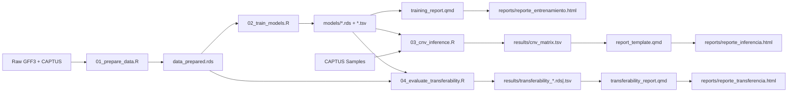

# TargetCNV-ML: Machine Learning and Spatial Inference for Copy Number Variations in Target Capture

[Versión en Español](README_ES.md) | [Execution Guide (EN)](EXECUTION_GUIDE.md) | [Guía de Ejecución (ES)](GUIA_EJECUCION.md)

[](https://doi.org/10.5281/zenodo.23463987)
[](https://www.r-project.org/)
[](https://opensource.org/licenses/MIT)
[](#quickstart-and-test-suite)
[](https://rstudio.github.io/renv/)

**TargetCNV-ML** is an R package and command-line pipeline for estimating **gene Copy Number Variations (CNV)** from *de novo* **Target Capture** (*Hyb-Seq*) assemblies produced by CAPTUS. It combines reference-guided spatial labeling, supervised classification, and coverage-based filtering to separate functional gene copies from off-target hits and fragmented contigs.

> [!NOTE]
> Console output messages, exported TSV column headers, and the compiled Quarto HTML reports inside `reports/` (`reporte_entrenamiento.html`, `reporte_inferencia.html`, and `reporte_transferencia.html`) are generated in Spanish, matching the accompanying Master's thesis.

---

## Methodological Overview

Target-capture sequencing recovers hundreds of nuclear loci at low cost, but inferring gene copy numbers directly from assembled contigs is complicated by two recurring artifacts:
- **Off-target and paralogous cross-hybridization:** Hybridization probes capture primary orthologs together with divergent paralogs and intronic/intergenic fragments, which inflates False Discovery Rates (FDR) when all recovered hits are treated as valid copies.
- **Technical contig fragmentation:** A single gene locus often assembles into multiple partial contigs in short-read assemblies. Counting raw contigs without coverage filtering mistakes split exons for gene duplications.

The workflow is organized into four R CLI scripts under `scripts/`:

1. **`01_prepare_data.R` (Spatial Ground-Truth Labeling):** Intersects CAPTUS nuclear contigs (`protein_match:NUC`) against reference GFF3 gene models by chromosome and strand (`GenomicRanges`). For fragmented contig-level assemblies without chromosome pseudomolecules, it extracts target gene IDs from the GFF `Target` attribute and maps hierarchical orthogroups (`HOG_ID`) to pan-genomic orthogroups (`OG_ID`) through the probe-design bridge table, then deduplicates intra-locus hits so only the primary contig per reference gene is retained as `TRUE_POSITIVE`.
2. **`02_train_models.R` (Collinearity and Deterministic CV Benchmark):** Computes pairwise Spearman rank correlations ($\rho$) across the four continuous CAPTUS alignment metrics (`pct_recovered`, `pct_identity`, `score`, `wscore`), calibrates 4 univariate Youden cutoffs and 1 grid-optimized weighted heuristic (`Weighted_Heuristic`), and trains **18 supervised classifiers** plus a GLM meta-learner (`Ensamble_Stacking`, 24 methods in total) under balanced and unbalanced regimes. Cross-validation uses deterministic fold indices and explicit per-resample `seeds` derived from `--seed`, ensuring identical results across CPU core counts, alongside KernelSHAP feature attributions.
3. **`03_cnv_inference.R` (7-Model Consensus and Coverage Calibration):** Applies majority voting ($\ge 4/7$ votes) across 4 ML classifiers (`ElasticNet`, `NaiveBayes`, `SVM_Polinomial`, `Red_Neuronal`), 2 Youden cutoffs (`pct_recovered`, `pct_identity`), and `Weighted_Heuristic`. Accepted sequences (`Homologo_Valido`) are sorted by descending `pct_recovered` within each sample and orthogroup: the top hit is assigned as `Copia_Principal`, secondary hits with `pct_recovered >= --cov_threshold` (default `50.0%`) are counted as `Homologo_Confirmado`, and shorter fragments are marked `No_Contado`. An empirical sensitivity sweep across `30%–80%` is exported alongside the CNV matrix.
4. **`04_evaluate_transferability.R` (Cross-Species Transferability):** Evaluates pre-trained donor models without parameter re-fitting on recipient species at chromosome scale (*Solanum citrullifolium*) and contig scale (*S. stellatiglandulosum*), reporting both binary classification performance and orthogroup-level copy-number concordance ($\widehat{\text{CNV}}_{\text{OG}}$ vs. $\text{CNV}^{\text{real}}_{\text{OG}}$ via Spearman's $\rho$, quadratic weighted Kappa $\kappa_w$, RMSE, and exact match rate).



All three Quarto templates (`training_report.qmd`, `report_template.qmd`, and `transferability_report.qmd`) are strictly **read-only**: they never train models or write files into `models/` or `results/`.

---

## Repository Layout

```text
TargetCNV-ML/
├── DESCRIPTION                  # R package metadata and dependencies (TargetCNVML)
├── NAMESPACE                    # Exported package functions
├── renv.lock                    # Pinned R package lockfile (R 4.6.2 / Bioconductor 3.23)
├── pixi.toml                    # Conda-forge/bioconda manifest (R 4.6 + Quarto 1.10.20)
├── Apptainer.def                # Apptainer/Singularity recipe (R 4.6.2 + Quarto 1.10.20)
├── targetcnv.sh                 # Bash CLI wrapper for all pipeline stages
├── run_test_pipeline.sh         # Runner for the Minimal Working Example (MWE)
├── assets/
│   ├── report.css               # Shared CSS styles for Quarto HTML reports
│   └── waterfall.js             # Interactive SHAP Waterfall explorer script
├── training_report.qmd          # Read-only Quarto template for training diagnostics
├── report_template.qmd          # Read-only Quarto template for CNV inference
├── transferability_report.qmd   # Read-only Quarto template for cross-species transfer
├── EXECUTION_GUIDE.md           # Full command reference and walkthroughs (English)
├── GUIA_EJECUCION.md            # Full command reference and walkthroughs (Spanish)
├── R/                           # Core package modules (model_specs, data_processing,
│                                # model_evaluation, plotting, report_helpers)
├── scripts/                     # CLI entrypoints (01_prepare_data.R .. 04_evaluate_transferability.R)
├── tests/                       # Automated testthat unit and integration suite
├── .github/workflows/ci.yml     # GitHub Actions CI workflow
├── data/                        # Reference annotations, CAPTUS tables, and MWE test_data/
├── models/                      # Serialized models (.rds), benchmarks (.tsv), and SHAP objects
├── results/                     # CNV matrices, sensitivity curves, and transferability tables
└── reports/                     # Compiled self-contained HTML reports
```

---

## Installation and Environment Setup

**Requirements:** Linux, macOS, or WSL2; **R** (`4.6.2` recommended for exact `renv.lock` parity, compatible with R $\ge 4.3$); **Quarto CLI** (`1.10.20` or $\ge 1.4$); and standard build/network tools (`bash`, `curl` or `wget`, `unzip`, `md5sum`, `gcc`, `g++`, `gfortran`, `cmake`, `make`).

```bash
git clone https://github.com/xyzdiego/TargetCNV-ML.git
cd TargetCNV-ML
chmod +x targetcnv.sh run_test_pipeline.sh scripts/*.R

# Restore exact package versions from renv.lock and verify the environment
./targetcnv.sh restore
./targetcnv.sh doctor
```

**Important note on `renv` reproducibility:** Do not run `renv::hydrate()` or `renv::snapshot()` to set up the environment, as hydrating links unpinned host packages and overwrites `renv.lock`. Always use `./targetcnv.sh restore` (or `./targetcnv.sh setup`), which runs `renv::restore(prompt = FALSE)`.

If you need a fully frozen software stack including R and Quarto CLI, you can also use **Pixi** (`pixi install && pixi run doctor`) or build the **Apptainer** container (`apptainer build targetcnv-ml.sif Apptainer.def`).

---

## Quickstart and Test Suite

```bash
# Run unit and integration tests (GFF overlap, deterministic CV seeds, XGBoost, Stacking, CNV matrix, MWE)
Rscript tests/testthat.R

# Run the self-contained MWE pipeline and render test HTML reports under reports/
./targetcnv.sh test
```

---

## Running the Pipeline (`./targetcnv.sh`)

Pre-trained *Solanum torvum* model binaries (`models/*.rds`) are hosted on Zenodo ([doi:10.5281/zenodo.23463987](https://doi.org/10.5281/zenodo.23463987)). To run inference (`03`) or cross-species transfer (`04`) without training from scratch, download and validate the archive first:

```bash
./targetcnv.sh zenodo
```

| Subcommand | Example | Purpose |
| :--- | :--- | :--- |
| `restore` / `setup` | `./targetcnv.sh restore` | Restores R packages strictly from `renv.lock`. |
| `doctor` | `./targetcnv.sh doctor` | Checks R, Quarto, CLI utilities, and required R packages. |
| `test` | `./targetcnv.sh test [--no-report]` | Runs the MWE inside `data/test_data/` without modifying root `models/` or `results/`. |
| `zenodo` | `./targetcnv.sh zenodo [--out-dir .]` | Downloads `TargetCNV_Models.zip`, checks MD5, and verifies all 18 ML models + `consensus_spec.rds`. |
| `prepare` | `./targetcnv.sh prepare [01 args]` | Runs `scripts/01_prepare_data.R`. |
| `train` | `./targetcnv.sh train [02 args]` | Runs `scripts/02_train_models.R`. |
| `infer` | `./targetcnv.sh infer -i stats.tsv --auto-zenodo` | Runs `scripts/03_cnv_inference.R` (fetches Zenodo models if `models/` is empty). |
| `transfer` | `./targetcnv.sh transfer [--sources ...]` | Runs `scripts/04_evaluate_transferability.R` and compiles `reports/reporte_transferencia.html`. |
| `report` | `./targetcnv.sh report [--models-dir models]` | Re-renders `reports/reporte_entrenamiento.html` in read-only mode. |
| `reproduce-storvum` | `./targetcnv.sh reproduce-storvum --cores 4` | Reproduces the *Solanum torvum* experiment (`01` $\rightarrow$ `02` $\rightarrow$ `03`). |
| `run-all` | `./targetcnv.sh run-all -g ref.gff3 -c cap.gff -s stats.tsv -d dict.xlsx -i pop.tsv` | Runs `01` $\rightarrow$ `02` $\rightarrow$ `03` on a new dataset, generating separate training and inference HTML reports. |

> [!CAUTION]
> **Flags that delete or overwrite existing outputs:**
> - `--clean_models` in `02_train_models.R` deletes all existing `.rds` and `.tsv` files in `--out_models` before saving new models. It is disabled by default (and is not used by `reproduce-storvum`); pass it only when performing a clean full re-train.
> - `--sync-root` in `./targetcnv.sh test` copies synthetic MWE outputs over the root `models/` and `results/` folders. Never pass `--sync-root` when `models/` contains real trained or Zenodo models.

See [EXECUTION_GUIDE.md](EXECUTION_GUIDE.md) for complete CLI parameter tables, Zenodo release instructions, and empirical benchmarks across *Solanum*.

---

## Reference Data Sources and Citation

- **Chromosome-scale genomes (*S. torvum* and *S. citrullifolium*):** Solanum Pan-Genomics (https://solpangenomics.com/dist/pages/downloads/index.php), SGN (https://solgenomics.net/ftp/genomes/Solanum_pangenomics/), and NCBI BioProject `PRJNA1073673` (https://www.ncbi.nlm.nih.gov/bioproject/PRJNA1073673). Gene and orthogroup (`OG_ID`) annotations from **Benoit, M. *et al.*** (2025), *Nature*, 640(8057): 135-145, [doi:10.1038/s41586-025-08619-6](https://doi.org/10.1038/s41586-025-08619-6).
- **Contig-scale genome (*S. stellatiglandulosum*):** NCBI BioProject `PRJNA1070281` (https://www.ncbi.nlm.nih.gov/bioproject/?term=txid3132602%5BOrganism:noexp%5D), Grupo de Genómica Evolutiva del Metabolismo Especializado, Universidad Nacional de Colombia. Gene and `HOG_ID` annotations from **Pérez-Mesa, P. A. & Roda, F.** (2025), *Current Opinion in Plant Biology*, 85: 102727, [doi:10.1016/j.pbi.2025.102727](https://doi.org/10.1016/j.pbi.2025.102727); and **Pérez-Mesa, P. A., Pardo, R. A., Alseekh, S. *et al.*** (2026), *Plant Molecular Biology*, 116: 67, [doi:10.1007/s11103-026-01718-6](https://doi.org/10.1007/s11103-026-01718-6).

```bibtex
@software{targetcnv_ml_2026,
  author       = {Benítez Duarte, Diego Andrés},
  title        = {{TargetCNV-ML: Machine Learning and Spatial Inference for Copy Number Variations in Target Capture}},
  month        = jul,
  year         = 2026,
  publisher    = {Zenodo},
  version      = {v1.1.0},
  doi          = {10.5281/zenodo.23463987},
  url          = {https://doi.org/10.5281/zenodo.23463987}
}

@mastersthesis{benitez_duarte_thesis_2026,
  author       = {Benítez Duarte, Diego Andrés},
  title        = {{Desarrollo de un flujo de trabajo bioinformático para la Detección de Variación en el Número de Copias (CNV) de genes a partir de secuencias genómicas de lectura corta}},
  school       = {Universidad Nacional de Colombia},
  year         = 2026,
  address      = {Colombia},
  note         = {Master's Thesis in Bioinformatics}
}
```

## License

Source code is licensed under the **MIT License** ([LICENSE](LICENSE)). Pre-trained models and derived datasets on Zenodo are released under **CC BY 4.0**.
