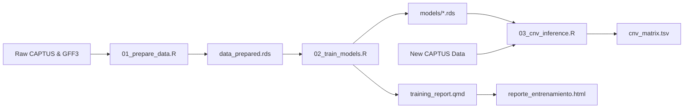

# TargetCNV-ML: Machine Learning & Spatial Inference for Copy Number Variations in Target Capture

[🇪🇸 Versión en Español](README_es.md)

[](https://doi.org/10.5281/zenodo.23463987)
[](https://www.r-project.org/)
[](https://opensource.org/licenses/MIT)
[-brightgreen.svg)](#quickstart-test-suite)
[](https://rstudio.github.io/renv/)

A modular, reproducible, and CLI-driven bioinformatics software package designed to detect **Copy Number Variations (CNV)** and resolve **homologous gene expansions** from Target Capture high-throughput sequencing data.

---

## Overview

Target Capture is a cost-effective next-generation sequencing approach extensively used in phylogenomics, evolutionary genetics, and molecular breeding. However, extracting structural genomic variations such as **Copy Number Variations (CNV)** from target capture assemblies is hindered by two intertwined biological and technical bottlenecks:

1. **Homologous Asymmetry & Off-Target Cross-Hybridization:** Gene duplication events result in multi-copy gene families with divergent evolutionary trajectories. Assembled contigs frequently map across closely related homologous loci, generating ambiguous hit assignments and elevated False Discovery Rates (FDR).
2. **Assembly Fragmentation Artifacts:** De novo contig assemblies often break single long genes into multiple shorter fragments. Naive copy-counting heuristics misidentify technical fragmentation as biological gene duplications, leading to severe copy-number inflation.

**TargetCNV-ML** addresses these challenges through a hybrid architecture combining:
- **Spatial Genomic Overlaps:** Strict coordinate intersection via `GenomicRanges`, exact homology dictionary validation, and assembly-quality-based redundancy resolution (no tandem-rescue step: results follow the *Workflow_Central_Sin_Rescate* research workflow).
- **Supervised Machine Learning Tournament:** Multi-model classification with class down-sampling (`ElasticNet`, `NaiveBayes`, `SVM`, `Deep Neural Networks`, `LDA`) alongside empirical **Youden's J-statistic** univariate cutoffs.
- **7-Model Consensus Voting System:** A weighted ensemble requiring simple majority (≥ 4/7 positive votes) to confirm genuine functional homologs while filtering intergenic/intronic noise.
- **Assembly Fragmentation Control Rules:** A two-tier coverage accumulation threshold rule (`pct_recovered` ≥ 50.0% and `Σ(pct_recovered)` ≤ 120.0%) that accurately separates technical fragmentation from real biological homologs.

---

## Repository Structure

```text
TargetCNV-ML/
├── .Rprofile                    # Automatic activation of the renv virtual environment
├── .gitignore                   # Excludes heavy binary files and raw data per Zenodo standards
├── renv.lock                    # Dependency lockfile recording exact R package versions
├── training_report.qmd          # Quarto template of the training report (rendered by 02_train_models.R)
├── run_test_pipeline.sh         # Bash runner for the end-to-end Minimal Working Example
├── GUIA_EJECUCION.md            # Step-by-step execution guide in Spanish (all commands, flags, Zenodo, new data)
│
├── R/                           # Pure, modular, roxygen2-documented R library functions
│   ├── data_processing.R        # GFF intersection, dictionary classification, redundancy resolution, CNV extraction
│   ├── model_evaluation.R       # Confusion matrices, Youden optimization, 7-model consensus, inference
│   └── plotting.R               # ggplot2/plotly wrappers for confusion tiles, densities, benchmarks, heatmaps
│
├── scripts/                     # Production CLI executables using optparse
│   ├── 01_prepare_data.R        # Step 1: Spatial GFF overlap and feature engineering
│   ├── 02_train_models.R        # Step 2: Model training, k-fold CV with downsampling, .rds serialization
│   └── 03_cnv_inference.R       # Step 3: Production CNV inference via 7-model consensus system
│
├── data/
│   ├── reference/               # Genomic reference GFF3 annotations and homology dictionaries
│   ├── CAPTUS_Muestras/         # Multi-sample CAPTUS assembly statistics (downloaded from Zenodo)
│   └── test_data/               # Lightweight mock dataset (<20 KB) for automated testing
│
├── models/                      # Pre-trained ML models and threshold objects (.rds)
└── results/                     # Output CNV matrices, classification tables, and diagnostic plots
```

---

## Prerequisites & Setup

### System Requirements
- **Linux** (tested on Ubuntu 20.04+, Debian, Arch/CachyOS) or **macOS**.
- **R** ≥ 4.0.0 (R 4.3+ or 4.6 recommended).
- **Quarto** ≥ 1.3+ (for compiling interactive HTML reports).
- Standard build utilities (`gcc`, `g++`, `make`, `libcurl`, `openssl`).

### Installation

1. **Clone the repository:**
   ```bash
   git clone https://github.com/xyzdiego/TargetCNV-ML.git
   cd TargetCNV-ML
   ```

2. **Restore dependencies with `renv`:**
   Open an interactive R session or run via terminal to restore the exact package versions defined in `renv.lock`:
   ```bash
   Rscript -e "renv::restore()"
   ```

   > [!NOTE]
   > The environment includes key bioinformatics and machine learning libraries: `GenomicRanges`, `rtracklayer`, `caret`, `glmnet`, `klaR`, `pROC`, `optparse`, `crosstalk`, `plotly`, `DT`, and `tidyverse`.

---

## Quickstart (Test Suite)

TargetCNV-ML includes a self-contained **Minimal Working Example (MWE)** under `data/test_data/` containing simulated GFF3 reference coordinates, CAPTUS contigs, and statistical metrics across synthetic samples.

Validate your installation by running the end-to-end test suite:

```bash
chmod +x run_test_pipeline.sh
./run_test_pipeline.sh
```

### What `run_test_pipeline.sh` does:
1. Executes `01_prepare_data.R` to compute coordinate intersections and clean IDs.
2. Executes `02_train_models.R` to optimize Youden cutoffs and train 5 classifiers using 3-fold cross-validation.
3. Executes `03_cnv_inference.R` to apply the 7-model consensus, filter fragmentation, and produce the final CNV matrix.
4. Validates that all output tables and graphics (`cnv_matrix.tsv`, `consensus_verdicts.tsv`, `plot_cnv_heatmap.pdf`) are successfully generated.

---

## Production Usage

> [!WARNING]
> **Pre-trained Models & Zenodo Assets:**
> In accordance with open-science standards, serialized models (`models/*.rds`) are archived on **Zenodo** to prevent Git repository bloat. Before running Step 3 (`03_cnv_inference.R`) on production datasets without re-training:
> 1. Download the pre-trained model bundle (`TargetCNV_Models.zip`, ~380 KB) from Zenodo DOI: [`10.5281/zenodo.23463987`](https://doi.org/10.5281/zenodo.23463987).
> 2. Unzip it at the project root (the archive already contains the `models/` folder):
>    ```bash
>    curl -L -o TargetCNV_Models.zip https://zenodo.org/api/records/23463987/files/TargetCNV_Models.zip/content
>    unzip -o TargetCNV_Models.zip
>    ```

> [!TIP]
> A complete step-by-step guide in Spanish (every command, flag and option, training with new data, MWE and Zenodo models) is available in [GUIA_EJECUCION.md](GUIA_EJECUCION.md).

The pipeline is split into three modular, scriptable CLI entrypoints:



### Step 1: Data Preparation & Spatial Overlaps

Computes strict spatial overlaps (`GenomicRanges`), matches contigs against the reference dictionary, removes redundancies, and computes local delta scores.

```bash
./scripts/01_prepare_data.R \
  --gff_ref data/reference/Storvum_genes.gff3 \
  --captus_gff data/reference/Storvum_hit_contigs.gff \
  --captus_stats data/reference/captus-extract_stats.tsv \
  --dict_ref data/reference/Genes_Capture_May_2026.xlsx \
  --sample Storvum \
  --out_dir data/
```

**Parameters:**
| Flag | Name | Type | Description |
| :--- | :--- | :--- | :--- |
| `-g` | `--gff_ref` | File | Reference genome GFF3 annotation file `[Required]` |
| `-c` | `--captus_gff` | File | CAPTUS assembled contigs GFF file `[Required]` |
| `-s` | `--captus_stats` | File | CAPTUS statistics TSV (`captus-extract_stats.tsv`) `[Required]` |
| `-d` | `--dict_ref` | File | Homology reference dictionary (.xlsx, .tsv, .csv) `[Optional]` |
| `-p` | `--sample` | String | Specific sample name to filter within statistics `[Optional]` |
| `-o` | `--out_dir` | Dir | Destination directory (default: `data/`) |

---

### Step 2: Model Training & Cross-Validation

Computes optimal Youden univariate cutoffs, performs grid search for the weighted heuristic ensemble, balances classes (`down-sampling`), and trains supervised models via `caret`.

```bash
./scripts/02_train_models.R \
  --data data/data_prepared.rds \
  --out_models models/ \
  --cv_folds 5 \
  --sampling down \
  --cores 4 \
  --seed 1234
```

**Parameters:**
| Flag | Name | Type | Description |
| :--- | :--- | :--- | :--- |
| `-d` | `--data` | File | Prepared data generated by Step 1 (.rds or .tsv) `[Required]` |
| `-m` | `--out_models` | Dir | Directory to save trained `.rds` models (default: `models/`) |
| `-k` | `--cv_folds` | Integer| Number of partitions for k-fold cross-validation (default: `5`) |
| `-s` | `--sampling` | String | Class re-sampling method: `down`, `up`, or `none` (default: `down`) |
| `-c` | `--cores` | Integer| Number of parallel execution threads (default: `detectCores() - 1`) |
| `--seed` | `--seed` | Integer| Random seed for exact stochastic reproducibility (default: `1234`) |
| | `--include_hit` | Flag | Include the CAPTUS integer hit rank as predictor (default: `FALSE`; not compatible with Step 3) |
| | `--render_report` / `--no_render_report` | Flag | Render (default) or skip the HTML training report |
| `-r` | `--report_file` | File | Output path of the HTML training report (default: `reporte_entrenamiento.html`) |

---

### Step 3: Production CNV Inference & Consensus

Applies the **7-Model Consensus System** (Majority Rule ≥ 4/7 positive votes), performs spatial fragmentation control, and exports the final CNV matrix and publication-ready graphics.

```bash
./scripts/03_cnv_inference.R \
  --input data/CAPTUS_Muestras/captus-extract_stats.tsv \
  --models_dir models/ \
  --out_dir results/ \
  --cov_threshold 50.0 \
  --frag_threshold 120.0 \
  --min_votes 4 \
  --top_loci 30
```

**Parameters:**
| Flag | Name | Type | Description |
| :--- | :--- | :--- | :--- |
| `-i` | `--input` | File | TSV/CSV file containing target capture contig metrics `[Required]` |
| `-m` | `--models_dir` | Dir | Directory with serialized `.rds` models (default: `models/`) |
| `-o` | `--out_dir` | Dir | Destination directory for tables and plots (default: `results/`) |
| `-c` | `--cov_threshold`| Float | Minimum % individual coverage for confirmed homolog (default: `50.0`) |
| `-f` | `--frag_threshold`| Float | Maximum % cumulative coverage for fragmentation (default: `120.0`) |
| `-v` | `--min_votes` | Integer| Minimum positive votes to validate homology (default: `4`) |
| `-t` | `--top_loci` | Integer| Number of top abundant gene families for heatmap (default: `30`) |

---

### Step 4: Training Report (Quarto)

Step 2 renders `training_report.qmd` automatically into `reporte_entrenamiento.html` (Youden cutoffs, weighted heuristic, balanced vs. unbalanced benchmarks with all metrics, confusion matrices, SHAP and separability plots). To re-render it without re-training:

```bash
quarto render training_report.qmd \
  -P models_dir:models \
  -P data_file:data/data_prepared.rds \
  --output reporte_entrenamiento.html
```

---

## Citation

If you use **TargetCNV-ML** in academic research or applied genomics pipelines, please cite the software and accompanying thesis:

```bibtex
@software{targetcnv_ml_2026,
  author       = {Benítez Duarte, Diego Andrés},
  title        = {{TargetCNV-ML: Machine Learning & Spatial Inference for Copy Number Variations in Target Capture}},
  month        = jul,
  year         = 2026,
  publisher    = {Zenodo},
  version      = {v1.0.0},
  doi          = {10.5281/zenodo.23463987},
  url          = {https://doi.org/10.5281/zenodo.23463987}
}

@mastersthesis{benitez_duarte_thesis_2026,
  author       = {Benítez Duarte, Diego Andrés},
  title        = {{Desarrollo de un flujo de trabajo bioinformático para la Detección de Variación en el Número de Copias (CNV) de genes a partir de secuencias genómicas de lectura corta}},
  school       = {Universidad Nacional de Colombia},
  year         = 2026,
  address      = {Colombia},
  note         = {Master Thesis - Bioinformatics}
}
```

---

## License

This project is licensed under the **MIT License** — see the [LICENSE](LICENSE) file for details. 
The datasets and pre-trained models hosted on Zenodo are licensed under the **Creative Commons Attribution 4.0 International License (CC BY 4.0)**.
