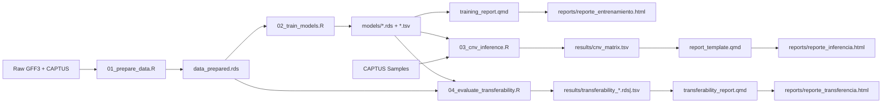

# TargetCNV-ML: Machine Learning and Spatial Inference for Copy Number Variations in Target Capture

[Versión en Español](README_ES.md) | [Execution Guide (EN)](EXECUTION_GUIDE.md) | [Guía de Ejecución (ES)](GUIA_EJECUCION.md)

[](https://doi.org/10.5281/zenodo.23463987)
[](https://www.r-project.org/)
[](https://opensource.org/licenses/MIT)
[](#quickstart-test-suite)
[](https://rstudio.github.io/renv/)

An R package and command-line workflow for estimating **gene Copy Number Variations (CNV)** and separating **functional homologs** from assembly and off-target artifacts in **Target Capture** high-throughput sequencing data.

> [!IMPORTANT]
> **Internal Workflow Language Notice:** Console log messages, output table column names, and the Quarto HTML reports compiled under `reports/` (`reporte_entrenamiento.html`, `reporte_inferencia.html`, and `reporte_transferencia.html`) are currently written in **Spanish**.

---

## Overview

Target Capture sequencing recovers hundreds of nuclear loci cost-effectively for phylogenomics and evolutionary genetics. However, estimating gene copy number from *de novo* target-capture contigs faces two persistent sources of error:

1. **Paralog Cross-Hybridization and Off-Target Capture:** Hybridization probes routinely pull down primary orthologs alongside divergent paralogs and intronic or intergenic fragments, inflating False Discovery Rates (FDR).
2. **Assembly Fragmentation:** A single gene locus may assemble into multiple shorter contigs. Counting all assembled contigs naively conflates technical fragmentation with biological gene duplication.

**TargetCNV-ML** addresses these issues across four modular stages:
- **Spatial Reference Labeling (`01_prepare_data.R`):** Strict chromosome- and strand-aware coordinate intersection (`GenomicRanges`) against reference GFF3 gene models (or `Target`-attribute extraction reconciled via an `OG_ID` / `HOG_ID` probe-design bridge table for contig-level assemblies), followed by intra-locus redundancy resolution so at most one primary contig per annotated gene locus is labeled as a true positive.
- **Collinearity Diagnosis and Supervised Model Training (`02_train_models.R`):** Non-parametric Spearman rank correlation ($\rho$) across the four continuous CAPTUS alignment metrics (`pct_recovered`, `pct_identity`, `score`, `wscore`), optimization of 4 univariate Youden's $J$ cutoffs, grid calibration of 1 weighted heuristic ensemble (`Weighted_Heuristic`), deterministic stratified cross-validation of **18 supervised classifiers** (`RandomForest`, `GBM`, `XGBoost`, `SVM_Radial`, `SVM_Lineal`, `SVM_Polinomial`, `Red_Neuronal`, `Red_Neuronal_Bag`, `ElasticNet`, `KNN`, `CART`, `NaiveBayes`, `LDA`, `MLP`, `MLP_Regularizado`, `QDA`, `Bagging_Arboles`, `Stacked Autoencoder - DNN`), and a GLM meta-learner (`Ensamble_Stacking`, 24 evaluated methods in total) under balanced and unbalanced regimes, paired with KernelSHAP feature attributions.
- **7-Model Consensus Voting and Coverage Calibration (`03_cnv_inference.R`):** Majority voting ($\ge 4/7$ votes) combining 4 supervised classifiers (`ElasticNet`, `NaiveBayes`, `SVM_Polinomial`, `Red_Neuronal`), 2 Youden cutoffs (`pct_recovered`, `pct_identity`), and the weighted heuristic model. Within each sample and orthogroup, the highest-coverage accepted sequence is recorded as `Copia_Principal`, secondary hits meeting `pct_recovered >= --cov_threshold` (default `50.0%`) are counted as `Homologo_Confirmado`, and shorter fragments are labeled `No_Contado`, accompanied by an empirical `30%–80%` threshold sensitivity curve.
- **Cross-Species Transferability and Orthogroup CNV Concordance (`04_evaluate_transferability.R`):** Out-of-sample evaluation without parameter re-fitting on recipient species at chromosome and contig assembly scales, quantifying both sequence-level classification metrics and orthogroup-level copy-number concordance ($\widehat{\text{CNV}}_{\text{OG}}$ vs. $\text{CNV}^{\text{real}}_{\text{OG}}$) via Spearman's $\rho$, quadratic weighted Kappa ($\kappa_w$), RMSE, and exact copy-number agreement rate.

---

## Repository Structure

```text
TargetCNV-ML/
├── DESCRIPTION                  # Formal R package metadata and dependencies (TargetCNVML)
├── NAMESPACE                    # Exported package functions
├── .Rprofile                    # Automatic activation of the isolated renv library
├── .gitignore                   # Exclusion rules for heavy binary artifacts and local outputs
├── renv.lock                    # Exact package lockfile validated on R 4.6.2 and Bioconductor 3.23
├── pixi.toml                    # Conda-forge/bioconda environment manifest (R 4.6 + Quarto 1.10.20)
├── Apptainer.def                # Apptainer/Singularity container definition (R 4.6.2 + Quarto 1.10.20)
├── targetcnv.sh                 # Pipeline wrapper script in Bash for command-line execution
├── run_test_pipeline.sh         # Automated runner for the Minimal Working Example (MWE)
├── assets/
│   └── report.css               # Shared stylesheet for Quarto HTML reports
├── training_report.qmd          # Read-only Quarto template for the training HTML report
├── report_template.qmd          # Read-only Quarto template for the CNV inference HTML report
├── transferability_report.qmd   # Read-only Quarto template for the cross-species transfer report
├── EXECUTION_GUIDE.md           # Detailed command reference and step-by-step guide in English
├── GUIA_EJECUCION.md            # Detailed command reference and step-by-step guide in Spanish
│
├── R/                           # Modular R package functions documented with roxygen2
│   ├── model_specs.R            # 18-model specifications, XGBoost adapter, and deterministic CV seeds
│   ├── data_processing.R        # GFF overlap, OG/HOG reconciliation, deduplication, and CNV matrix
│   ├── model_evaluation.R       # Youden, Spearman, 7-model consensus, CNV concordance, and transfer
│   ├── plotting.R               # ggplot2 functions for densities, Spearman, sensitivity, and heatmaps
│   └── report_helpers.R         # Read-only artifact loaders, DT tables, Plotly builders, and SHAP
│
├── scripts/                     # Command-line interface scripts (optparse)
│   ├── 01_prepare_data.R        # Module 01: Spatial GFF overlap and training dataset preparation
│   ├── 02_train_models.R        # Module 02: Collinearity, 24-method cross-validation, and SHAP
│   ├── 03_cnv_inference.R       # Module 03: CNV inference, 7-model consensus, and 30-80% sensitivity
│   └── 04_evaluate_transferability.R # Module 04: Cross-species transferability and CNV concordance
│
├── tests/                       # Automated unit and integration test suite (testthat)
│   ├── testthat.R
│   └── testthat/
│       ├── test-models-and-seeds.R
│       ├── test-spatial-and-cnv.R
│       └── test-mwe-pipeline.R
│
├── .github/workflows/ci.yml     # GitHub Actions Continuous Integration workflow
├── data/
│   ├── reference/               # Reference GFF3 annotations, probe dictionary, and sources_citations.tsv
│   ├── CAPTUS_Muestras/         # Multi-sample CAPTUS extraction statistics
│   └── test_data/               # Lightweight synthetic dataset for MWE and automated testing
│
├── models/                      # Serialized models (.rds), benchmarks (.tsv), Spearman, and SHAP
├── results/                     # CNV matrices, sensitivity curves, concordance, and transfer tables
└── reports/                     # Unified output directory for compiled Quarto HTML reports
```

---

## Prerequisites and Reproducible Setup

### System Requirements
- **Operating System:** Linux (tested on Ubuntu 22.04/24.04, Debian, Arch/CachyOS), macOS, or Windows via WSL2.
- **R:** version `4.6.2` recommended for exact binary/source parity with `renv.lock` and Bioconductor `3.23` (compatible with R $\ge 4.3$).
- **Quarto CLI:** version `1.10.20` (compatible with Quarto $\ge 1.4$) to render `.qmd` report templates.
- **System utilities:** `bash`, `curl` or `wget`, `unzip`, `md5sum`, `gcc`, `g++`, `gfortran`, `make`.

### Option A: Strict `renv` Lockfile Restore (Recommended)

```bash
git clone https://github.com/xyzdiego/TargetCNV-ML.git
cd TargetCNV-ML
chmod +x targetcnv.sh run_test_pipeline.sh scripts/*.R

# Restores the exact package versions pinned in renv.lock without modifying the lockfile
./targetcnv.sh restore
./targetcnv.sh doctor
```

> [!CAUTION]
> **Do not use `renv::hydrate()` or `renv::snapshot()` for user installation:** Hydrating from system-wide R libraries pulls unpinned host package versions and overwrites `renv.lock`. Always run `./targetcnv.sh restore` (or its alias `./targetcnv.sh setup`), which calls `renv::restore(prompt = FALSE)` in strict compliance with `renv.lock`.

### Option B: Pinned Environment via Pixi or Apptainer

To freeze R, compiled system dependencies, and Quarto CLI together:

```bash
# Using Pixi (pixi.toml)
pixi install
pixi run doctor

# Using Apptainer / Singularity (Apptainer.def)
apptainer build targetcnv-ml.sif Apptainer.def
apptainer exec targetcnv-ml.sif ./targetcnv.sh doctor
```

---

## Quickstart (Test Suite)

TargetCNV-ML ships with a self-contained **Minimal Working Example (MWE)** in `data/test_data/` and an automated `testthat` suite under `tests/testthat/`.

```bash
# 1. Run unit and integration tests (GFF overlap, deterministic seeds, XGBoost, Stacking, CNV edge cases, MWE)
Rscript tests/testthat.R

# 2. Run the full MWE workflow including Quarto HTML report compilation under reports/
./targetcnv.sh test
```

### What `./targetcnv.sh test` (`./run_test_pipeline.sh`) verifies:
1. Runs `01_prepare_data.R` on simulated GFF3 coordinates to build `data/test_data/prepared/data_prepared.rds`.
2. Runs `02_train_models.R` to compute the Spearman collinearity matrix, optimize Youden cutoffs, train classifiers with deterministic 3-fold CV, and compile `reports/reporte_entrenamiento_test.html`.
3. Runs `03_cnv_inference.R` to apply 7-model consensus voting, the 50% coverage filter, and the `30%–80%` sensitivity sweep, compiling `reports/reporte_inferencia_test.html` without touching `models/` or `results/` at the project root.

---

## Execution Workflow

> [!WARNING]
> **Pre-trained Models Archived on Zenodo:**
> Serialized binary models (`models/*.rds`) are archived outside Git on Zenodo ([10.5281/zenodo.23463987](https://doi.org/10.5281/zenodo.23463987)). Before running Module 03 (`03_cnv_inference.R`) or Module 04 (`04_evaluate_transferability.R`) without training from scratch, download and verify the model archive:
> ```bash
> ./targetcnv.sh zenodo
> ```
> This command checks the MD5 checksum, automatically deletes any incomplete or corrupted `.zip` file on failure, and verifies the presence of `consensus_spec.rds` and all 18 supervised models.

> [!TIP]
> Complete command-by-command walkthroughs, methodological notes, and empirical benchmarks on *Solanum* are documented in [EXECUTION_GUIDE.md](EXECUTION_GUIDE.md) and [GUIA_EJECUCION.md](GUIA_EJECUCION.md).

### Pipeline Wrapper Script (`./targetcnv.sh`)

| Subcommand | Example | Description |
| :--- | :--- | :--- |
| `restore` / `setup` | `./targetcnv.sh restore` | Restores the project library strictly from `renv.lock` (`renv::restore(prompt = FALSE)`). |
| `doctor` | `./targetcnv.sh doctor` | Checks R, `renv`, Quarto CLI, system utilities, and required R packages. |
| `test` | `./targetcnv.sh test [--no-report]` | Runs the isolated MWE workflow inside `data/test_data/`. |
| `zenodo` | `./targetcnv.sh zenodo [--out-dir .]` | Downloads `TargetCNV_Models.zip`, validates MD5, and checks extracted models in `models/`. |
| `prepare` | `./targetcnv.sh prepare [01 options]` | Runs Module 01 (`scripts/01_prepare_data.R`). |
| `train` | `./targetcnv.sh train [02 options]` | Runs Module 02 (`scripts/02_train_models.R`). |
| `infer` | `./targetcnv.sh infer -i stats.tsv --auto-zenodo` | Runs Module 03 (`scripts/03_cnv_inference.R`), fetching Zenodo models if `models/` is empty. |
| `transfer` | `./targetcnv.sh transfer [--sources ...]` | Runs Module 04 (`scripts/04_evaluate_transferability.R`) and renders `reports/reporte_transferencia.html`. |
| `report` | `./targetcnv.sh report [--models-dir models]` | Re-renders `reports/reporte_entrenamiento.html` in read-only mode. |
| `reproduce-storvum` | `./targetcnv.sh reproduce-storvum --cores 4` | Reproduces the *Solanum torvum* reference experiment (`01` $\rightarrow$ `02` $\rightarrow$ `03`). |
| `run-all` | `./targetcnv.sh run-all -g ref.gff3 -c cap.gff -s stats.tsv -d dict.xlsx -i pop.tsv` | Runs `01` $\rightarrow$ `02` $\rightarrow$ `03` end-to-end on a new species dataset. |

> [!CAUTION]
> **Destructive Flags (When to Use and When to Avoid):**
> - `--clean_models` (in `02_train_models.R`): deletes all existing `.rds` and `.tsv` files in `--out_models` prior to saving newly trained artifacts. Use it only during a clean full re-train so stale files from earlier runs do not persist.
> - `--sync-root` (in `./targetcnv.sh test` or `./run_test_pipeline.sh`): overwrites the root `models/` and `results/` directories with synthetic MWE outputs. Use only in disposable test sandboxes, never when preserving real trained models.

### Modular CLI Architecture and Read-Only Quarto Templates

All three Quarto templates (`training_report.qmd`, `report_template.qmd`, and `transferability_report.qmd`) are **strictly read-only**: they never call `caret::train()`, `caretStack()`, `saveRDS()`, or `write.table()` on `models/` or `results/`. If expected artifacts are missing, they display an explicit notice indicating which CLI command to run first.



### Module 01: Data Preparation and Spatial Labeling (`01_prepare_data.R`)

Intersects nuclear contigs (`protein_match:NUC`) against reference GFF3 gene coordinates (`--genome_scale chromosome`) or extracts target loci from the GFF `Target` attribute while reconciling `HOG_ID` and `OG_ID` groups (`--genome_scale contig`), merges continuous CAPTUS alignment metrics, and resolves intra-locus redundancies.

```bash
Rscript scripts/01_prepare_data.R \
  --gff_ref data/reference/Storvum_genes.gff3 \
  --captus_gff data/reference/Storvum_hit_contigs.gff \
  --captus_stats data/reference/captus-extract_stats.tsv \
  --dict_ref data/reference/Genes_Capture_May_2026.xlsx \
  --sample Storvum \
  --genome_scale chromosome \
  --out_dir data/
```

| Flag | Option | Type | Description |
| :--- | :--- | :--- | :--- |
| `-g` | `--gff_ref` | File | Reference genome GFF3 annotation (required when `--genome_scale chromosome`). |
| `-c` | `--captus_gff` | File | CAPTUS hit contigs GFF file (required). |
| `-s` | `--captus_stats` | File | CAPTUS `captus-extract_stats.tsv` table (required). |
| `-d` | `--dict_ref` | File | Homology dictionary (`.xlsx`, `.tsv`, or `.csv`). |
| `-p` | `--sample` | String | Sample identifier to filter within `captus-extract_stats.tsv`. |
| | `--genome_scale` | String | `'chromosome'` (spatial GFF3 overlap; default) or `'contig'` (`Target`-attribute extraction for fragmented assemblies). |
| | `--target_mode` | String | Explicit overlap mode alias: `'overlap'` or `'target_attr'`. |
| | `--allow_multi_sample` | Flag | Allows processing multi-sample tables simultaneously (e.g., synthetic MWE data). |
| `-o` | `--out_dir` | Dir | Output directory for `data_prepared.rds` and `data_prepared.tsv` (default: `data/`). |

---

### Module 02: Collinearity, Deterministic CV Training, and SHAP (`02_train_models.R`)

Computes pairwise Spearman rank correlations across `pct_recovered`, `pct_identity`, `score`, and `wscore`, optimizes Youden cutoffs and the weighted heuristic model, trains all 18 supervised classifiers plus `Ensamble_Stacking` using deterministic folds and explicit `trainControl(seeds = ...)` derived from `--seed` (bit-for-bit reproducible across `--cores`), computes KernelSHAP attributions, and compiles `reports/reporte_entrenamiento.html`.

```bash
Rscript scripts/02_train_models.R \
  --data data/data_prepared.rds \
  --out_models models/ \
  --cv_folds 5 \
  --sampling down \
  --cores 4 \
  --seed 1234 \
  --sources data/reference/sources_citations.tsv \
  --report_file reports/reporte_entrenamiento.html
```

| Flag | Option | Type | Description |
| :--- | :--- | :--- | :--- |
| `-d` | `--data` | File | Prepared dataset from Module 01 (`.rds` or `.tsv`, required). |
| `-m` | `--out_models` | Dir | Destination directory for `.rds` and `.tsv` artifacts (default: `models/`). |
| `-k` | `--cv_folds` | Integer | Number of stratified cross-validation folds (default: `5`). |
| `-s` | `--sampling` | String | Class balancing scheme for the balanced scenario: `down`, `up`, or `none` (default: `down`). |
| `-c` | `--cores` | Integer | Number of parallel PSOCK worker processes (default: `detectCores() - 1`). |
| | `--seed` | Integer | Master seed governing CV folds, tuning grids, and per-resample `seeds` (default: `1234`). |
| | `--extended_tournament` / `--fast_tournament` | Flag | Train all 18 ML algorithms (default) or the 5-model fast subset (`--fast_tournament`). |
| | `--train_stacking` / `--no_stacking` | Flag | Fit (default) or skip the `Ensamble_Stacking` GLM meta-learner. |
| | `--clean_models` | Flag | **Destructive option:** deletes existing `.rds`/`.tsv` files in `--out_models` before saving. |
| | `--include_hit` | Flag | Appends CAPTUS hit rank `hit` as a fifth predictor (`consensus_spec.rds` propagates active predictors to Module 03, though keeping it disabled is recommended across batches). |
| | `--render_report` / `--no_render_report` | Flag | Render (default) or skip the Quarto HTML training report. |
| `-r` | `--report_file` | File | Output path for the HTML training report (default: `reports/reporte_entrenamiento.html`). |
| | `--sources` | File | Optional TSV with genome and literature citations (`data/reference/sources_citations.tsv`). |

---

### Module 03: CNV Inference and Coverage Threshold Calibration (`03_cnv_inference.R`)

Applies 7-model consensus voting ($\ge 4/7$ votes), builds the `Locus x Sample` CNV matrix under the single-threshold coverage rule (`--cov_threshold 50.0`), exports the `30%–80%` empirical threshold sensitivity table (`cnv_threshold_sensitivity.tsv`), computes orthogroup copy-number concordance whenever reference labels or `--true_cnv` counts are available, and compiles `reports/reporte_inferencia.html`.

```bash
Rscript scripts/03_cnv_inference.R \
  --input data/CAPTUS_Muestras/captus-extract_stats.tsv \
  --models_dir models/ \
  --out_dir results/ \
  --cov_threshold 50.0 \
  --min_votes 4 \
  --top_loci 30 \
  --sources data/reference/sources_citations.tsv \
  --report_file reports/reporte_inferencia.html
```

| Flag | Option | Type | Description |
| :--- | :--- | :--- | :--- |
| `-i` | `--input` | File | TSV/CSV/RDS table with CAPTUS contig extraction metrics (required). |
| `-m` | `--models_dir` | Dir | Directory containing trained `.rds` models and `consensus_spec.rds` (default: `models/`). |
| `-o` | `--out_dir` | Dir | Destination directory for CNV matrices, sensitivity tables, and plots (default: `results/`). |
| `-c` | `--cov_threshold` | Float | Minimum `pct_recovered` (%) required to count secondary hits as `Homologo_Confirmado` (default: `50.0`). |
| `-v` | `--min_votes` | Integer | Minimum positive votes (out of 7) to classify a sequence as `Homologo_Valido` (default: `4`). |
| `-t` | `--top_loci` | Integer | Number of highest-copy orthogroups displayed in the CNV heatmap (default: `30`). |
| | `--true_cnv` | File | Optional reference CNV table ($\text{CNV}^{\text{real}}_{\text{OG}}$) for orthogroup concordance evaluation. |
| | `--render_report` / `--no_render_report` | Flag | Render (default) or skip `reports/reporte_inferencia.html`. |
| `-r` | `--report_file` | File | Output path for the HTML inference report (default: `reports/reporte_inferencia.html`). |
| | `--sources` | File | Optional TSV with genome and literature citations (`data/reference/sources_citations.tsv`). |

---

### Module 04: Cross-Species Transferability and Orthogroup Concordance (`04_evaluate_transferability.R`)

Evaluates all 24 pre-trained donor methods and the 7-model consensus without re-training on recipient species at chromosome scale (*S. citrullifolium*) and contig scale (*S. stellatiglandulosum*), computes orthogroup copy-number concordance (Spearman's $\rho$, quadratic weighted Kappa, RMSE, and exact concordance rate) plus the `30%–80%` `--cov_threshold` sensitivity curve, writes all tables to `results/transferability_*.tsv|.rds`, and renders `reports/reporte_transferencia.html`.

```bash
./targetcnv.sh transfer --sources data/reference/sources_citations.tsv
```

---

## Citation and Reference Data Sources

- **Chromosome-scale reference genomes (*Solanum torvum* and *Solanum citrullifolium*):** Available via **Solanum Pan-Genomics** (https://solpangenomics.com/dist/pages/downloads/index.php), **Solanaceae Genomics Network (SGN)** (https://solgenomics.net/ftp/genomes/Solanum_pangenomics/), and **NCBI BioProject `PRJNA1073673`** (https://www.ncbi.nlm.nih.gov/bioproject/PRJNA1073673). Gene and orthogroup (`OG_ID`) annotations from: **Benoit, M. *et al.*** (2025), *Solanum pan-genetics reveals paralogues as contingencies in crop engineering*, **Nature**, 640(8057): 135–145, [doi:10.1038/s41586-025-08619-6](https://doi.org/10.1038/s41586-025-08619-6).
- **Contig-scale reference genome (*Solanum stellatiglandulosum*):** Archived under **NCBI BioProject `PRJNA1070281`** (https://www.ncbi.nlm.nih.gov/bioproject/?term=txid3132602%5BOrganism:noexp%5D) by the **Grupo de Genómica Evolutiva del Metabolismo Especializado, Universidad Nacional de Colombia**. Gene and hierarchical orthogroup (`HOG_ID`) annotations from: **Pérez-Mesa, P. A. & Roda, F.** (2025), *Alkaloid evolution in the solanaceae*, **Current Opinion in Plant Biology**, 85: 102727, [doi:10.1016/j.pbi.2025.102727](https://doi.org/10.1016/j.pbi.2025.102727); and **Pérez-Mesa, P. A., Pardo, R. A., Alseekh, S. *et al.*** (2026), *Genetic basis of alkaloid divergence in the solanaceae*, **Plant Molecular Biology**, 116: 67, [doi:10.1007/s11103-026-01718-6](https://doi.org/10.1007/s11103-026-01718-6).

If you use **TargetCNV-ML** in academic research, please cite the software archive and Master's thesis:

```bibtex
@software{targetcnv_ml_2026,
  author       = {Benítez Duarte, Diego Andrés},
  title        = {{TargetCNV-ML: Machine Learning and Spatial Inference for Copy Number Variations in Target Capture}},
  month        = jul,
  year         = 2026,
  publisher    = {Zenodo},
  version      = {v1.1.0},
  doi          = {10.5281/zenodo.23463987},
  url          = {https://doi.org/10.5281/zenodo.23463987}
}

@mastersthesis{benitez_duarte_thesis_2026,
  author       = {Benítez Duarte, Diego Andrés},
  title        = {{Desarrollo de un flujo de trabajo bioinformático para la Detección de Variación en el Número de Copias (CNV) de genes a partir de secuencias genómicas de lectura corta}},
  school       = {Universidad Nacional de Colombia},
  year         = 2026,
  address      = {Colombia},
  note         = {Master's Thesis in Bioinformatics}
}
```

---

## License

Distributed under the **MIT License** — see [LICENSE](LICENSE) for details. Derived datasets and pre-trained models hosted on Zenodo are licensed under **Creative Commons Attribution 4.0 International (CC BY 4.0)**.
