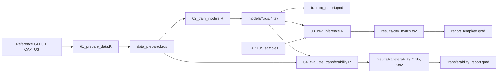

# TargetCNV-ML

[Versión en Español](README_ES.md) | [Execution Guide (EN)](EXECUTION_GUIDE.md) | [Guía de Ejecución (ES)](GUIA_EJECUCION.md)

[](https://doi.org/10.5281/zenodo.23463987)
[](https://www.r-project.org/)
[](https://opensource.org/licenses/MIT)

TargetCNV-ML is an R package (`TargetCNVML`) and command-line pipeline for estimating gene Copy Number Variations (CNV) from *de novo* target-capture (*Hyb-Seq*) assemblies generated by CAPTUS. It combines reference-guided spatial labeling, supervised classification, and coverage-based filtering to separate functional gene copies from off-target hits and split contigs.

**Language note:** Console messages, exported TSV column headers, and the compiled Quarto HTML reports (`reports/reporte_entrenamiento.html`, `reports/reporte_inferencia.html`, `reports/reporte_transferencia.html`; archived in `reports/reportes_html.zip`) are written in Spanish to match the accompanying Master's thesis.

## Why TargetCNV-ML

Counting assembled contigs directly from target-capture runs tends to overestimate copy numbers for two practical reasons:
- Hybridization probes capture primary orthologs along with divergent paralogs and intronic or intergenic fragments, raising the False Discovery Rate (FDR) when unfiltered hits are treated as functional copies.
- Short-read assemblers frequently split a single gene into two or more partial contigs; counting each contig separately mistakes technical fragmentation for gene duplication.

The pipeline addresses both issues across four CLI scripts in `scripts/`:

1. **`01_prepare_data.R`** intersects nuclear CAPTUS contigs (`protein_match:NUC`) against reference GFF3 gene models by chromosome and strand (`GenomicRanges`). When only a contig-scale reference assembly is available, it parses target gene IDs from the GFF `Target` attribute and reconciles hierarchical `HOG_ID` groups with pan-genomic `OG_ID` orthogroups using the probe-design bridge table, keeping only the primary contig per reference locus (`TRUE_POSITIVE`) after intra-locus deduplication.
2. **`02_train_models.R`** runs pairwise Spearman rank correlations across the four continuous CAPTUS alignment metrics (`pct_recovered`, `pct_identity`, `score`, `wscore`), calibrates four univariate Youden cutoffs and a grid-searched `Weighted_Heuristic` rule, and benchmarks 18 supervised classifiers plus a GLM stacking meta-learner (`Ensamble_Stacking`, 24 methods in total) under balanced (`down`-sampled) and unbalanced regimes. Fold indices and per-resample `seeds` are derived deterministically from `--seed`, making results identical across CPU core counts, alongside KernelSHAP attributions.
3. **`03_cnv_inference.R`** applies majority voting ($\ge 4/7$ votes) across four ML classifiers (`ElasticNet`, `NaiveBayes`, `SVM_Polinomial`, `Red_Neuronal`, or the voters stored in `consensus_spec.rds`), two Youden cutoffs (`pct_recovered`, `pct_identity`), and `Weighted_Heuristic`. Accepted hits (`Homologo_Valido`) are ranked by descending `pct_recovered` per sample and orthogroup: the top hit is counted as `Copia_Principal`, additional hits meeting `--cov_threshold` (default `50.0%`) count as `Homologo_Confirmado`, and shorter fragments are flagged `No_Contado`. A `30%` to `80%` threshold sensitivity sweep is exported alongside the CNV matrix.
4. **`04_evaluate_transferability.R`** evaluates pre-trained *Solanum torvum* models without re-fitting on recipient species at chromosome scale (*S. citrullifolium*) and contig scale (*S. stellatiglandulosum*), computing both binary classification benchmarks and orthogroup-level copy-number concordance (Spearman's $\rho$, quadratic weighted Kappa $\kappa_w$, RMSE, and exact match rate).



All three Quarto templates (`training_report.qmd`, `report_template.qmd`, `transferability_report.qmd`) operate strictly in **read-only** mode: they load precomputed artifacts and never fit models or modify `models/` or `results/`.

## Repository Layout

```text
TargetCNV-ML/
├── DESCRIPTION / NAMESPACE / man/   # Installable R package metadata, exports, and Rd docs
├── renv.lock                        # Pinned R 4.6.2 / Bioconductor 3.23 package versions
├── pixi.toml                        # Conda-forge / bioconda manifest (+ setup-cran task)
├── Apptainer.def                    # Self-contained Apptainer recipe (R 4.6.2 + Quarto 1.10.20)
├── targetcnv.sh                     # CLI wrapper script for all workflow stages
├── run_test_pipeline.sh             # Minimal Working Example (MWE) runner
├── assets/                          # Shared report.css and waterfall.js (SHAP explorer)
├── *.qmd                            # Read-only Quarto report templates
├── R/                               # Package modules (model_specs, data_processing,
│                                    # model_evaluation, plotting, report_helpers)
├── scripts/                         # CLI scripts (01_prepare_data.R .. 04_evaluate_transferability.R)
├── tests/                           # testthat unit and MWE integration suite
├── data/                            # Reference annotations, CAPTUS tables, and MWE test_data/
├── models/                          # Serialized models (.rds), benchmarks (.tsv), SHAP objects
├── results/                         # CNV matrices, sensitivity curves, transferability tables
└── reports/                         # Compiled HTML reports (archived in reportes_html.zip)
```

## Installation

TargetCNV-ML runs on Linux, macOS, and WSL2. Exact lockfile restoration expects **R 4.6.2** with **Bioconductor 3.23** (compatible with **R $\ge 4.5$ / Bioconductor $\ge 3.22$** due to `Seqinfo`), **Quarto CLI** ($\ge 1.4$; `1.10.20` in the container recipe), and standard build/CLI tools (`bash`, `curl` or `wget`, `unzip`, `md5sum`, `gcc`, `g++`, `gfortran`, `cmake`, `make`).

```bash
git clone https://github.com/xyzdiego/TargetCNV-ML.git
cd TargetCNV-ML
chmod +x targetcnv.sh run_test_pipeline.sh scripts/*.R

./targetcnv.sh restore
./targetcnv.sh doctor
```

**Note on `renv`:** Use `./targetcnv.sh restore` (or `setup`), which executes `renv::restore(prompt = FALSE)` strictly against `renv.lock`. Avoid `renv::hydrate()` or `renv::snapshot()` during installation, since hydrating links host packages and snapshots overwrite the lockfile.

Alternative isolated setups:
- **Pixi:** `pixi install && pixi run setup-cran && pixi run doctor`
- **Apptainer:** `apptainer build targetcnv-ml.sif Apptainer.def && apptainer run targetcnv-ml.sif doctor`

## Quick Verification

```bash
# Unit and integration tests (GFF overlap, deterministic CV seeds, XGBoost, Stacking, CNV edge cases, MWE)
Rscript tests/testthat.R

# End-to-end synthetic MWE (writes isolated outputs under data/test_data/ and reports/)
./targetcnv.sh test
```

## Basic Usage

Pre-trained *Solanum torvum* models (`models/*.rds`) are archived on Zenodo ([doi:10.5281/zenodo.23463987](https://doi.org/10.5281/zenodo.23463987)). To run inference (`03`) or cross-species transfer (`04`) without retraining from scratch:

```bash
./targetcnv.sh zenodo
./targetcnv.sh infer -i data/CAPTUS_Muestras/captus-extract_stats.tsv --auto-zenodo
./targetcnv.sh transfer --sources data/reference/sources_citations.tsv
```

| Subcommand | Example | Purpose |
| :--- | :--- | :--- |
| `restore` / `setup` | `./targetcnv.sh restore` | Restores R packages from `renv.lock`. |
| `doctor` | `./targetcnv.sh doctor` | Checks CLI tools, Quarto, and required R packages. |
| `test` | `./targetcnv.sh test [--no-report]` | Runs the synthetic MWE without touching root `models/` or `results/`. |
| `zenodo` | `./targetcnv.sh zenodo [--out-dir .]` | Downloads `TargetCNV_Models.zip`, checks MD5, and verifies extracted artifacts. |
| `prepare` | `./targetcnv.sh prepare [01 args]` | Runs `scripts/01_prepare_data.R`. |
| `train` | `./targetcnv.sh train [02 args]` | Runs `scripts/02_train_models.R`. |
| `infer` | `./targetcnv.sh infer -i stats.tsv --auto-zenodo` | Runs `scripts/03_cnv_inference.R` (downloads models if missing). |
| `transfer` | `./targetcnv.sh transfer [--sources ...]` | Runs `scripts/04_evaluate_transferability.R` and renders the transfer report. |
| `report` | `./targetcnv.sh report [--models-dir models]` | Re-renders `reports/reporte_entrenamiento.html` in read-only mode. |
| `reproduce-storvum` | `./targetcnv.sh reproduce-storvum --cores 4` | Runs `01` -> `02` -> `03` on the *S. torvum* reference dataset. |
| `run-all` | `./targetcnv.sh run-all -g ref.gff3 -c cap.gff -s stats.tsv -d dict.xlsx -i pop.tsv` | Runs `01` -> `02` -> `03` on a new dataset with separate training and inference reports. |

**Destructive flags to use with care:**
- `--clean_models` (`02_train_models.R`) deletes existing `.rds` and `.tsv` files in `--out_models` before writing new outputs. It is off by default (and not used by `reproduce-storvum`); pass it only when doing a clean full re-train.
- `--sync-root` (`./targetcnv.sh test`) overwrites root `models/` and `results/` with synthetic MWE files. Do not use it when `models/` holds real trained or Zenodo models.

Full parameter tables, Zenodo release steps, and benchmark tables are documented in [EXECUTION_GUIDE.md](EXECUTION_GUIDE.md).

## Reference Data Sources and Citation

- **Chromosome-scale genomes (*S. torvum*, *S. citrullifolium*):** Solanum Pan-Genomics (https://solpangenomics.com/dist/pages/downloads/index.php), SGN (https://solgenomics.net/ftp/genomes/Solanum_pangenomics/), and NCBI BioProject `PRJNA1073673` (https://www.ncbi.nlm.nih.gov/bioproject/PRJNA1073673). Gene and orthogroup (`OG_ID`) annotations from Benoit, M. *et al.* (2025), *Nature*, 640(8057): 135-145, [doi:10.1038/s41586-025-08619-6](https://doi.org/10.1038/s41586-025-08619-6).
- **Contig-scale genome (*S. stellatiglandulosum*):** NCBI BioProject `PRJNA1070281` (https://www.ncbi.nlm.nih.gov/bioproject/?term=txid3132602%5BOrganism:noexp%5D), Grupo de Genómica Evolutiva del Metabolismo Especializado, Universidad Nacional de Colombia. Gene and `HOG_ID` annotations from Pérez-Mesa, P. A. & Roda, F. (2025), *Current Opinion in Plant Biology*, 85: 102727, [doi:10.1016/j.pbi.2025.102727](https://doi.org/10.1016/j.pbi.2025.102727); and Pérez-Mesa, P. A., Pardo, R. A., Alseekh, S. *et al.* (2026), *Plant Molecular Biology*, 116: 67, [doi:10.1007/s11103-026-01718-6](https://doi.org/10.1007/s11103-026-01718-6).

```bibtex
@software{targetcnv_ml_2026,
  author       = {Benítez Duarte, Diego Andrés},
  title        = {{TargetCNV-ML: Machine Learning and Spatial Inference for Copy Number Variations in Target Capture}},
  month        = jul,
  year         = 2026,
  publisher    = {Zenodo},
  version      = {v1.1.0},
  doi          = {10.5281/zenodo.23463987},
  url          = {https://doi.org/10.5281/zenodo.23463987}
}

@mastersthesis{benitez_duarte_thesis_2026,
  author       = {Benítez Duarte, Diego Andrés},
  title        = {{Desarrollo de un flujo de trabajo bioinformático para la Detección de Variación en el Número de Copias (CNV) de genes a partir de secuencias genómicas de lectura corta}},
  school       = {Universidad Nacional de Colombia},
  year         = 2026,
  address      = {Colombia},
  note         = {Master's Thesis in Bioinformatics}
}
```

## License

Source code is released under the MIT License ([LICENSE](LICENSE)). Pre-trained models and derived datasets on Zenodo are distributed under CC BY 4.0.
