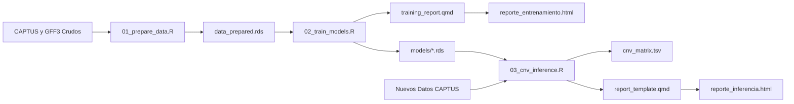

# TargetCNV-ML: Aprendizaje Automático e Inferencia Espacial para Variaciones en el Número de Copias en Captura de Genes

[🇬🇧 English Version](https://www.google.com/search?q=https://github.com/xyzdiego/TargetCNV-ML/blob/main/README.md) | [📗 Guía de Ejecución (ES)](https://www.google.com/search?q=https://github.com/xyzdiego/TargetCNV-ML/blob/main/GUIA_EJECUCION.md) | [📘 Execution Guide (EN)](https://www.google.com/search?q=https://github.com/xyzdiego/TargetCNV-ML/blob/main/EXECUTION_GUIDE.md)

[DOI](https://www.google.com/url?sa=E&source=gmail&q=https://doi.org/10.5281/zenodo.23463987)
[](https://www.r-project.org/)
[](https://opensource.org/licenses/MIT)
[](#inicio-rápido-batería-de-pruebas)
[](https://rstudio.github.io/renv/)

Un paquete de software bioinformático modular, reproducible y ejecutable por línea de comandos (CLI), diseñado para detectar **Variaciones en el Número de Copias (CNV)** y resolver **expansiones de genes homólogos** a partir de datos de secuenciación masiva por Captura de Genes (*Target Capture*).

> [!IMPORTANT]
> **Aviso sobre el idioma del flujo de trabajo:** De momento, el flujo de trabajo interno de los archivos, los mensajes por consola, los nombres de las columnas en las tablas de salida y los reportes interactivos en Quarto (`reporte_entrenamiento.html` y `reporte_inferencia.html`) están construidos en **español**. En próximas actualizaciones el flujo de trabajo interno y los reportes estarán disponibles también en **inglés**.

---

## Visión General

La Captura de Genes (*Target Capture*) es una técnica de secuenciación de última generación altamente costo-efectiva, ampliamente utilizada en filogenómica, genética evolutiva y mejoramiento molecular. No obstante, la extracción de variaciones genómicas estructurales como las **Variaciones en el Número de Copias (CNV)** a partir de ensamblajes de captura se enfrenta a dos cuellos de botella biológicos y técnicos interconectados:

1. **Asimetría Homóloga e Hibridación Cruzada Fuera de Objetivo:** Los eventos de duplicación génica generan familias multigénicas con trayectorias evolutivas divergentes. Los cóntigos ensamblados frecuentemente se alinean sobre loci homólogos estrechamente emparentados, produciendo asignaciones ambiguas y tasas elevadas de falsos descubrimientos (FDR).
2. **Artefactos de Fragmentación del Ensamblaje:** Los ensamblajes de cóntigos *de novo* a menudo fragmentan genes individuales de gran longitud en múltiples piezas cortas. Las heurísticas ingenuas de conteo de copias confunden esta fragmentación técnica con duplicaciones génicas biológicas, provocando una severa inflación artificial del número de copias.

**TargetCNV-ML** resuelve estos desafíos mediante una arquitectura híbrida que integra:
- **Intersección Genómica Espacial:** Cruce estricto de coordenadas mediante `GenomicRanges`, validación con diccionario de homología teórica y resolución de redundancias basada en métricas de calidad de ensamblaje (flujo fiel a *Workflow_Central_Sin_Rescate*).
- **Torneo de Aprendizaje Automático Supervisado (24 Métodos Evaluados):** Evaluación comparativa completa de **18 algoritmos supervisados** (`RandomForest`, `GBM`, `XGBoost`, `SVM_Radial`, `SVM_Lineal`, `SVM_Polinomial`, `Red_Neuronal`, `Red_Neuronal_Bag`, `ElasticNet`, `KNN`, `CART`, `NaiveBayes`, `LDA`, `MLP`, `MLP_Regularizado`, `QDA`, `Bagging_Arboles`, `Stacked Autoencoder - DNN`), el meta-modelo **GLM Stacking (`Ensamble_Stacking`)**, el **Ensamble Heurístico Ponderado (`Weighted_Heuristic`)** y los **4 puntos de corte univariados del estadístico J de Youden**, tanto en el escenario balanceado (*down-sampling*) como en el desbalanceado (proporción original).
- **Sistema de Consenso de 7 Modelos:** Un ensamble ponderado compuesto por 4 clasificadores ML (`ElasticNet`, `NaiveBayes`, `SVM_Polinomial`, `Red_Neuronal`), 2 cortes univariados de Youden (`pct_recovered`, `pct_identity`) y 1 modelo heurístico ponderado, que exige mayoría simple ($\ge 4/7$ votos favorables) para confirmar homólogos funcionales genuinos (`Homologo_Valido`), descartando el ruido intergénico o intrónico (`Ruido_Descartado`).
- **Regla de un Solo Umbral de Cobertura para el Control de Fragmentación:** Dentro de cada muestra y locus, las secuencias aceptadas como `Homologo_Valido` se ordenan de mayor a menor cobertura individual (`pct_recovered`). La primera secuencia se cuenta siempre como evidencia de presencia del locus (`Copia_Principal`), las secuencias adicionales con cobertura individual $\ge 50.0\%$ (`--cov_threshold 50.0`) se cuentan como copias adicionales (`Homologo_Confirmado`), y las secuencias adicionales con cobertura $< 50.0\%$ se clasifican como `No_Contado`, evitando que un gen partido en varios cóntigos infle artificialmente la matriz de CNV (`Copia_Principal + Homologo_Confirmado`).

---

## Estructura del Repositorio

```text
TargetCNV-ML/
├── .Rprofile                    # Activación automática del entorno virtual renv
├── .gitignore                   # Exclusión de archivos binarios pesados y datos crudos (estándar Zenodo)
├── renv.lock                    # Archivo de bloqueo que registra las versiones exactas de paquetes de R
├── targetcnv.sh                 # Orquestador CLI unificado en Bash para ejecutar flujos en 1 línea
├── run_test_pipeline.sh         # Script bash para ejecutar el Ejemplo Mínimo Funcional (MWE) de punta a punta
├── training_report.qmd          # Plantilla interactiva en Quarto para el reporte HTML de entrenamiento
├── report_template.qmd          # Plantilla interactiva en Quarto para el reporte HTML de inferencia de CNV
├── GUIA_EJECUCION.md            # Guía detallada paso a paso en español de todo el pipeline
├── EXECUTION_GUIDE.md           # Guía detallada paso a paso en inglés de todo el pipeline
│
├── R/                           # Funciones modulares puras de R documentadas con roxygen2
│   ├── model_specs.R            # Especificaciones unificadas del torneo de 18 modelos, adaptador XGBoost y nombres
│   ├── data_processing.R        # Cruce de GFF, clasificación con diccionario, resolución de redundancias, matriz CNV
│   ├── model_evaluation.R       # Matrices de confusión, optimización Youden, consenso de 7 modelos, inferencia
│   └── plotting.R               # Funciones ggplot2/plotly para densidades, benchmarks, curvas ROC y heatmaps
│
├── scripts/                     # Scripts ejecutables por CLI utilizando optparse
│   ├── 01_prepare_data.R        # Paso 1: Cruce espacial con GFF e ingeniería de características
│   ├── 02_train_models.R        # Paso 2: Torneo de 24 métodos, validación cruzada, SHAP y reporte de entrenamiento
│   └── 03_cnv_inference.R       # Paso 3: Inferencia de CNV mediante consenso de 7 modelos y reporte de inferencia
│
├── data/
│   ├── reference/               # Anotaciones GFF3 de referencia, diccionarios de homología y sources_citations.tsv
│   ├── CAPTUS_Muestras/         # Estadísticas de ensamblaje CAPTUS multimuestra
│   └── test_data/               # Conjunto de datos simulado y liviano (<25 KB) para pruebas automáticas
│
├── models/                      # Modelos de ML preentrenados, tablas de benchmark, objetos SHAP y umbrales (.rds/.tsv)
└── results/                     # Matrices CNV generadas, tablas de clasificación y gráficos diagnósticos
```

---

## Requisitos Previos e Instalación

### Requisitos del Sistema
- **Linux** (probado en Ubuntu 20.04+, Debian, Arch/CachyOS) o **macOS** (o Windows mediante WSL2).
- **R** $\ge 4.0.0$ (recomendado R 4.3+ o 4.6).
- **Quarto** $\ge 1.3+$ (para compilar los reportes HTML interactivos).
- Herramientas estándar de línea de comandos y compilación (`bash`, `curl` o `wget`, `unzip`, `md5sum`, `gcc`, `g++`, `make`).

### Instalación

1. **Clonar el repositorio:**
   ```bash
   git clone https://github.com/xyzdiego/TargetCNV-ML.git
   cd TargetCNV-ML
   ```

2. **Dar permisos de ejecución y restaurar dependencias con `renv`:**
   Abra una sesión interactiva de R o ejecute en la terminal para restaurar las versiones exactas de los paquetes fijadas en `renv.lock`:
   ```bash
   chmod +x targetcnv.sh run_test_pipeline.sh scripts/*.R
   Rscript -e "renv::restore()"
   ```
   *(Si ya cuenta con los paquetes instalados en la librería de R de su sistema, puede vincularlos directamente a `renv/library` ejecutando `./targetcnv.sh snapshot`).*

3. **Verificar el entorno:**
   ```bash
   ./targetcnv.sh doctor
   ```

   > [!NOTE]
   > El entorno incluye bibliotecas bioinformáticas y de aprendizaje automático esenciales: `GenomicRanges`, `rtracklayer`, `caret`, `caretEnsemble`, `glmnet`, `klaR`, `kernlab`, `randomForest`, `gbm`, `xgboost`, `RSNNS`, `deepnet`, `ipred`, `pROC`, `optparse`, `readxl`, `kernelshap`, `shapviz`, `NeuralNetTools`, `plotly`, `DT`, `cowplot`, `knitr`, `rmarkdown` y `tidyverse`.

---

## Inicio Rápido (Batería de Pruebas)

TargetCNV-ML incluye un **Ejemplo Mínimo Funcional (MWE)** autocontenido en el directorio `data/test_data/`, el cual contiene coordenadas de referencia simuladas en formato GFF3, cóntigos de CAPTUS y métricas numéricas entre muestras sintéticas.

Valide su instalación ejecutando la batería de pruebas automatizada de punta a punta:

```bash
./targetcnv.sh test
# Equivalente a: ./run_test_pipeline.sh
```

### Qué realiza `run_test_pipeline.sh` (`./targetcnv.sh test`):
1. Ejecuta `01_prepare_data.R` para calcular las intersecciones espaciales y limpiar identificadores en `data/test_data/prepared/`.
2. Ejecuta `02_train_models.R` para optimizar los cortes de Youden, entrenar los clasificadores supervisados con validación cruzada de 3 pliegues y compilar `data/test_data/reporte_entrenamiento_test.html`.
3. Ejecuta `03_cnv_inference.R` para aplicar el consenso de 7 modelos, filtrar copias adicionales con la regla de cobertura del 50%, generar la matriz de CNV final y compilar `data/test_data/results/reporte_inferencia.html`.
4. Valida que todas las tablas y gráficos de salida (`cnv_matrix.tsv`, `consensus_verdicts.tsv`, `plot_cnv_heatmap.pdf`) se hayan creado satisfactoriamente sin sobrescribir las carpetas `models/` ni `results/` de la raíz.

---

## Uso en Producción

> [!WARNING]
> **Modelos Preentrenados y Archivos en Zenodo:**
> Siguiendo las directrices de ciencia abierta, los modelos serializados (`models/*.rds`) se encuentran archivados en **Zenodo** para evitar el crecimiento excesivo del repositorio Git. Antes de ejecutar el Paso 3 (`03_cnv_inference.R`) sobre conjuntos de datos en producción sin reentrenar:
> 1. Descargue y verifique automáticamente el paquete de modelos preentrenados (`TargetCNV_Models.zip`) con `./targetcnv.sh`:
>    ```bash
>    ./targetcnv.sh zenodo
>    ```
> 2. O descárguelo y descomprímalo manualmente en la raíz del proyecto desde el DOI de Zenodo [10.5281/zenodo.23463987](https://www.google.com/search?q=https://www.google.com/url%3Fsa%3DE%26source%3Dgmail%26q%3Dhttps://doi.org/10.5281/zenodo.23463987):
>    ```bash
>    curl -L -o TargetCNV_Models.zip https://zenodo.org/api/records/23463987/files/TargetCNV_Models.zip/content
>    unzip -o TargetCNV_Models.zip
>    ```

> [!TIP]
> Para consultar una guía completa paso a paso con cada comando, flag, opción, pruebas de transferibilidad entre especies, entrenamiento con datos nuevos y actualización de modelos en Zenodo, consulte [GUIA\_EJECUCION.md](https://www.google.com/search?q=GUIA_EJECUCION.md) (o su versión en inglés [EXECUTION\_GUIDE.md](https://www.google.com/search?q=EXECUTION_GUIDE.md)).

### Ejecución Rápida en 1 Línea (`./targetcnv.sh`)

| Subcomando | Ejemplo | Descripción |
| :--- | :--- | :--- |
| `doctor` | `./targetcnv.sh doctor` | Verifica la instalación de R, `renv`, Quarto CLI, utilidades del sistema y paquetes de R. |
| `test` | `./targetcnv.sh test [--sync-root] [--no-report]` | Ejecuta la batería de pruebas MWE con datos simulados. |
| `zenodo` | `./targetcnv.sh zenodo [--out-dir .]` | Descarga `TargetCNV_Models.zip` desde Zenodo, verifica su hash MD5 y descomprime `models/`. |
| `infer` | `./targetcnv.sh infer -i stats.tsv --auto-zenodo` | Ejecuta la inferencia de CNV con consenso de 7 modelos (descargando de Zenodo si `models/` está vacío). |
| `reproduce-storvum` | `./targetcnv.sh reproduce-storvum --cores 4` | Reproduce en 1 comando el experimento completo de referencia con *Solanum torvum* (Pasos 01 $\rightarrow$ 02 $\rightarrow$ 03 + reportes HTML). |
| `run-all` | `./targetcnv.sh run-all -g ref.gff3 -c cap.gff -s stats.tsv -d dict.xlsx -i pop.tsv` | Ejecuta el pipeline completo (`01` $\rightarrow$ `02` $\rightarrow$ `03`) sobre una nueva especie en una sola orden. |
| `prepare` | `./targetcnv.sh prepare [opciones de 01]` | Ejecuta directamente el Módulo 01 (`scripts/01_prepare_data.R`). |
| `train` | `./targetcnv.sh train [opciones de 02]` | Ejecuta directamente el Módulo 02 (`scripts/02_train_models.R`). |
| `report` | `./targetcnv.sh report [--models-dir models]` | Recompila manualmente el reporte interactivo HTML de entrenamiento (`reporte_entrenamiento.html`) con Quarto. |
| `snapshot` | `./targetcnv.sh snapshot` | Vincula paquetes de la librería del sistema a `renv/library` y actualiza `renv.lock`. |

### Flujo de Trabajo Modular por CLI

El flujo de trabajo se divide en tres módulos ejecutables por CLI y dos plantillas interactivas de reporte en Quarto:



### Paso 1: Preparación de Datos y Cruces Espaciales (`01_prepare_data.R`)

Calcula las intersecciones espaciales exactas (`GenomicRanges`), contrasta los cóntigos contra el diccionario de homología de referencia, resuelve redundancias por calidad y calcula las puntuaciones locales delta (`delta_wscore`, `delta_pct_identity`).

```bash
./scripts/01_prepare_data.R \
  --gff_ref data/reference/Storvum_genes.gff3 \
  --captus_gff data/reference/Storvum_hit_contigs.gff \
  --captus_stats data/reference/captus-extract_stats.tsv \
  --dict_ref data/reference/Genes_Capture_May_2026.xlsx \
  --sample Storvum \
  --target_mode overlap \
  --out_dir data/
```

**Parámetros:**
| Parámetro | Argumento | Tipo | Descripción |
| :--- | :--- | :--- | :--- |
| `-g` | `--gff_ref` | Archivo | Archivo de anotación GFF3 del genoma de referencia `[Requerido en modo overlap]` |
| `-c` | `--captus_gff` | Archivo | Archivo GFF de cóntigos ensamblados por CAPTUS `[Requerido]` |
| `-s` | `--captus_stats` | Archivo | TSV de estadísticas de CAPTUS (`captus-extract_stats.tsv`) `[Requerido]` |
| `-d` | `--dict_ref` | Archivo | Diccionario de homología de referencia (`.xlsx`, `.tsv`, `.csv`) `[Opcional]` |
| `-p` | `--sample` | Texto | Nombre de la muestra para filtrar en las estadísticas `[Opcional]` |
| | `--target_mode` | Texto | `'overlap'` (intersección de coordenadas) o `'target_attr'` (extrae el gen del atributo `Target` del GFF para genomas fragmentados; por defecto: `'overlap'`) |
| `-o` | `--out_dir` | Carpeta | Directorio de destino (por defecto: `data/`) |

---

### Paso 2: Entrenamiento de Modelos y Validación Cruzada (`02_train_models.R`)

Calcula los umbrales univariados óptimos de Youden, ejecuta una búsqueda en cuadrícula para el ensamble heurístico ponderado, entrena los 18 algoritmos supervisados de ML y el meta-modelo `Ensamble_Stacking` mediante `caret` en los escenarios balanceado (`down-sampling`) y desbalanceado, calcula valores de explicabilidad KernelSHAP y compila `reporte_entrenamiento.html`.

```bash
./scripts/02_train_models.R \
  --data data/data_prepared.rds \
  --out_models models/ \
  --cv_folds 5 \
  --sampling down \
  --cores 4 \
  --seed 1234 \
  --report_file reporte_entrenamiento.html
```

**Parámetros:**
| Parámetro | Argumento | Tipo | Descripción |
| :--- | :--- | :--- | :--- |
| `-d` | `--data` | Archivo | Datos preparados generados en el Paso 1 (`.rds` o `.tsv`) `[Requerido]` |
| `-m` | `--out_models` | Carpeta | Directorio para guardar los modelos serializados `.rds` y tablas `.tsv` (por defecto: `models/`) |
| `-k` | `--cv_folds` | Entero | Número de pliegues para validación cruzada k-fold (por defecto: `5`) |
| `-s` | `--sampling` | Texto | Método de balanceo de clases para el escenario balanceado: `down`, `up`, o `none` (por defecto: `down`) |
| `-c` | `--cores` | Entero | Número de hilos para ejecución en paralelo (por defecto: `detectCores() - 1`) |
| | `--seed` | Entero | Semilla aleatoria para reproducibilidad estocástica exacta (por defecto: `1234`) |
| | `--extended_tournament` / `--fast_tournament` | Bandera | Entrenar el torneo completo de 18 algoritmos ML (por defecto: `TRUE`) o solo los 5 modelos base rápidos (`--fast_tournament`) |
| | `--train_stacking` / `--no_stacking` | Bandera | Entrenar (por defecto: `TRUE`) u omitir el meta-modelo GLM `caretStack` (`Ensamble_Stacking`) |
| | `--clean_models` | Bandera | Limpiar archivos `.rds`/`.tsv` previos en `--out_models` antes de guardar (por defecto: `FALSE`) |
| | `--include_hit` | Bandera | Incluir el rango ordinal de hit de CAPTUS como predictor (por defecto: `FALSE`; no compatible con Paso 3) |
| | `--render_report` / `--no_render_report` | Bandera | Compilar (por defecto: `TRUE`) u omitir el reporte interactivo HTML |
| `-r` | `--report_file` | Archivo | Ruta de destino del reporte HTML (por defecto: `reporte_entrenamiento.html`) |
| | `--sources` | Archivo | Archivo TSV opcional (`data/reference/sources_citations.tsv`) con las citas de las fuentes genómicas y publicaciones para el reporte HTML (si se omite, solo se muestra el archivo de origen) |

---

### Paso 3: Inferencia de CNV y Consenso en Producción (`03_cnv_inference.R`)

Aplica el **Sistema de Consenso de 7 Modelos** (Regla de Mayoría $\ge 4/7$ votos favorables), clasifica los homólogos válidos con la regla de un solo umbral de cobertura (`--cov_threshold 50.0`), exporta la matriz final de CNV junto con gráficos estáticos y compila el reporte interactivo de inferencia (`results/reporte_inferencia.html`).

```bash
./scripts/03_cnv_inference.R \
  --input data/CAPTUS_Muestras/captus-extract_stats.tsv \
  --models_dir models/ \
  --out_dir results/ \
  --cov_threshold 50.0 \
  --min_votes 4 \
  --top_loci 30
```

**Parámetros:**
| Parámetro | Argumento | Tipo | Descripción |
| :--- | :--- | :--- | :--- |
| `-i` | `--input` | Archivo | Archivo TSV/CSV/RDS con las métricas de cóntigos de captura `[Requerido]` |
| `-m` | `--models_dir` | Carpeta | Directorio con los modelos serializados `.rds` (por defecto: `models/`) |
| `-o` | `--out_dir` | Carpeta | Directorio de destino para tablas, figuras y reporte HTML (por defecto: `results/`) |
| `-c` | `--cov_threshold`| Decimal | % mínimo de cobertura individual (`pct_recovered`) para contar una secuencia adicional como `Homologo_Confirmado` (por defecto: `50.0`) |
| `-v` | `--min_votes` | Entero | Mínimo de votos positivos (de 7) para validar homología funcional como `Homologo_Valido` (por defecto: `4`) |
| `-t` | `--top_loci` | Entero | Número de familias génicas homólogas más abundantes en el heatmap (por defecto: `30`) |
| | `--render_report` / `--no_render_report` | Bandera | Compilar (por defecto: `TRUE`) u omitir el reporte HTML interactivo de inferencia |
| `-r` | `--report_file` | Archivo | Nombre del archivo HTML de inferencia dentro de `--out_dir` (por defecto: `reporte_inferencia.html`) |
| | `--sources` | Archivo | Archivo TSV opcional (`data/reference/sources_citations.tsv`) con las citas de las fuentes genómicas y publicaciones para el reporte HTML (si se omite, solo se muestra el archivo de origen) |

---

### Paso 4: Reportes Interactivos HTML en Quarto (Entrenamiento e Inferencia)

- **Reporte de Entrenamiento (`training_report.qmd` $\rightarrow$ `reporte_entrenamiento.html`):** El Paso 2 lo compila automáticamente. Muestra por defecto los 6 modelos clave ordenados de mayor a menor `ROC-AUC` (`Top 2 Youden + Weighted_Heuristic + Top 3 ML`, excluyendo `Ensamble_Stacking`), con botones desplegables para visualizar el benchmark de los 24 modelos evaluados y la tabla completa exportable (señalando con un asterisco `*` cuando un clasificador obtiene mejor desempeño global/FDR en su otra versión —balanceada vs. desbalanceada—), matrices de confusión, topologías neuronales y gráficos Waterfall SHAP por secuencia. Para recompilarlo sin reentrenar:
  ```bash
  ./targetcnv.sh report
  ```
- **Reporte de Inferencia (`report_template.qmd` $\rightarrow$ `results/reporte_inferencia.html`):** El Paso 3 lo compila automáticamente. Presenta la distribución del consenso de 7 modelos, el desglose de copias bajo la regla del 50% (`Copia_Principal`, `Homologo_Confirmado`, `No_Contado`), mapas de calor interactivos y tablas exportables.

---

## Citación y Fuentes de Datos de Referencia

- **Genomas de referencia a escala cromosómica (*Solanum torvum* y *Solanum citrullifolium*):** Reportados y publicados en el portal **Solanum Pan-Genomics** ([https://solpangenomics.com/dist/pages/downloads/index.php](https://solpangenomics.com/dist/pages/downloads/index.php)), en **Solanaceae Genomics Network (SGN)** ([https://solgenomics.net/ftp/genomes/Solanum_pangenomics/](https://solgenomics.net/ftp/genomes/Solanum_pangenomics/)) y en **NCBI BioProject `PRJNA1073673`** ([https://www.ncbi.nlm.nih.gov/bioproject/PRJNA1073673](https://www.google.com/search?q=https://www.ncbi.nlm.nih.gov/bioproject/PRJNA1073673)). Los datos de genes y ortogrupos (`OG_ID`) provienen de: **Benoit, M. *et al.*:**, 2025; *Solanum pan-genetics reveals paralogues as contingencies in crop engineering*; **Nature**; 640 (8057): 135--145; [doi:10.1038/s41586-025-08619-6](https://doi.org/10.1038/s41586-025-08619-6).
- **Genoma de referencia a escala de cóntigos (*Solanum stellatiglandulosum*):** El genoma fue reportado en **NCBI BioProject** ([https://www.ncbi.nlm.nih.gov/bioproject/?term=txid3132602%5BOrganism:noexp%5D](https://www.ncbi.nlm.nih.gov/bioproject/?term=txid3132602%5BOrganism:noexp%5D)) con **Accession: `PRJNA1070281` (ID: `1070281`)** por el **Grupo de Genómica evolutiva del metabolismo especializado de la Universidad Nacional de Colombia**. Los datos de genes y homología (`HOG_ID`) provienen de: **Pérez-Mesa, P. A. & Roda, F.:**, 2025; *Alkaloid evolution in the solanaceae*; **Current Opinion in Plant Biology**; 85: 102727; [doi:10.1016/j.pbi.2025.102727](https://www.google.com/search?q=https://doi.org/10.1016/j.pbi.2025.102727); y **Pérez-Mesa, P. A.; Pardo, R. A.; Alseekh, S. *et al.*:**, 2026; *Genetic basis of alkaloid divergence in the solanaceae*; **Plant Molecular Biology**; 116: 67; [doi:10.1007/s11103-026-01718-6](https://www.google.com/search?q=https://doi.org/10.1007/s11103-026-01718-6).
- *(Para insertar estas citas en los reportes interactivos HTML, suministre `--sources data/reference/sources_citations.tsv` o `-P sources_file:data/reference/sources_citations.tsv`; de lo contrario, los reportes mostrarán únicamente el archivo de origen).*

Si utiliza **TargetCNV-ML** en su investigación académica o en pipelines de genómica aplicada, por favor cite el software y el trabajo de tesis correspondiente:

```bibtex
@software{targetcnv_ml_2026,
  author       = {Benítez Duarte, Diego Andrés},
  title        = {{TargetCNV-ML: Machine Learning & Spatial Inference for Copy Number Variations in Target Capture}},
  month        = jul,
  year         = 2026,
  publisher    = {Zenodo},
  version      = {v1.0.0},
  doi          = {10.5281/zenodo.23463987},
  url          = {https://doi.org/10.5281/zenodo.23463987}
}

@mastersthesis{benitez_duarte_thesis_2026,
  author       = {Benítez Duarte, Diego Andrés},
  title        = {{Desarrollo de un flujo de trabajo bioinformático para la Detección de Variación en el Número de Copias (CNV) de genes a partir de secuencias genómicas de lectura corta}},
  school       = {Universidad Nacional de Colombia},
  year         = 2026,
  address      = {Colombia},
  note         = {Tesis de Maestría - Bioinformática}
}
```

---

## Licencia

Este proyecto está distribuido bajo la **Licencia MIT** — consulte el archivo [LICENSE](https://www.google.com/search?q=LICENSE) para más detalles.  
Los conjuntos de datos y los modelos preentrenados alojados en Zenodo están licenciados bajo la **Licencia Creative Commons Atribución 4.0 Internacional (CC BY 4.0)**.
