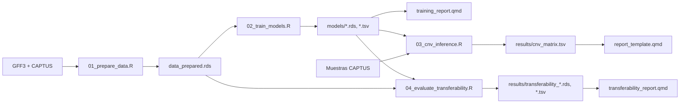

# TargetCNV-ML

[English Version](README.md) | [Guía de Ejecución (ES)](GUIA_EJECUCION.md) | [Execution Guide (EN)](EXECUTION_GUIDE.md)

[](https://doi.org/10.5281/zenodo.23463987)
[](https://www.r-project.org/)
[](https://opensource.org/licenses/MIT)

TargetCNV-ML es un paquete de R (`TargetCNVML`) y un flujo de línea de comandos para estimar variaciones en el número de copias génicas (CNV) a partir de ensamblajes de captura dirigida de genes (*Target Capture* / *Hyb-Seq*) generados con CAPTUS. Su objetivo es separar copias génicas funcionales (ortólogos principales y parálogos reales) de fragmentos intergénicos, hibridación cruzada y contigs partidos del ensamblaje *de novo*.

Los mensajes de consola, encabezados de tablas `.tsv` y reportes HTML compilados con Quarto en `reports/` (`reporte_entrenamiento.html`, `reporte_inferencia.html` y `reporte_transferencia.html`, archivados en el repositorio dentro de `reports/reportes_html.zip`) se generan en español en coherencia con el documento de tesis de maestría.

## Planteamiento Metodológico

En estudios filogenómicos de familias multigénicas en plantas, estimar el número de copias directamente a partir de los contigs ensamblados por CAPTUS y MEGAHIT enfrenta dos sesgos habituales:

1. **Captura fuera de objetivo e hibridación cruzada:** las sondas diseñadas sobre exones conservados recuperan tanto el gen blanco como parálogos divergentes o secuencias intrónicas e intergénicas; sin un filtro discriminativo, estos últimos disparan la tasa de falsos descubrimientos (FDR).
2. **Fragmentación técnica del ensamblaje:** un solo gen puede ensamblarse en dos o más contigs parciales. Contar cada contig recuperado como una copia distinta confunde fragmentación con duplicación génica.

El repositorio organiza la solución en cuatro scripts ejecutables dentro de `scripts/`:

- **`01_prepare_data.R` (etiquetado espacial):** cruza por cromosoma y hebra (`GenomicRanges`) los contigs nucleares de CAPTUS (`protein_match:NUC`) con la anotación GFF3 del genoma de referencia. En genomas ensamblados a escala de contigs, extrae el identificador génico desde el atributo `Target` y reconcilia los grupos jerárquicos `HOG_ID` con los ortogrupos pangenómicos `OG_ID` usando la tabla de diseño de sondas. Tras cruzar contra el diccionario, conserva únicamente el contig principal por gen de referencia (`TRUE_POSITIVE`) mediante deduplicación intra-locus.
- **`02_train_models.R` (colinealidad y entrenamiento determinista):** evalúa la colinealidad de Spearman ($\rho$) entre `pct_recovered`, `pct_identity`, `score` y `wscore`, calcula 4 cortes univariados de Youden y un ensamble heurístico por grilla (`Weighted_Heuristic`), y entrena 18 clasificadores supervisados más un meta-modelo GLM de apilamiento (`Ensamble_Stacking`, 24 métodos en total) bajo escenarios balanceado (`down`) y desbalanceado. Las particiones y la lista `seeds` de `caret::trainControl()` se derivan de `--seed` para garantizar resultados idénticos sin importar el número de núcleos, y se calculan atribuciones KernelSHAP.
- **`03_cnv_inference.R` (consenso e inferencia de copias):** clasifica nuevas muestras por mayoría ($\ge 4/7$ votos) combinando 4 clasificadores supervisados (`ElasticNet`, `NaiveBayes`, `SVM_Polinomial`, `Red_Neuronal`, o los registrados en `consensus_spec.rds`), 2 cortes de Youden (`pct_recovered`, `pct_identity`) y `Weighted_Heuristic`. Para cada muestra y ortogrupo, la secuencia válida con mayor cobertura se clasifica como `Copia_Principal`, los hits adicionales con `pct_recovered >= --cov_threshold` (`50.0%` por defecto) suman como `Homologo_Confirmado` y los fragmentos menores quedan como `No_Contado`. También se exporta un barrido de sensibilidad entre `30%` y `80%`.
- **`04_evaluate_transferability.R` (transferencia filogenética):** aplica sin reentrenamiento los modelos entrenados en *Solanum torvum* sobre *S. citrullifolium* (escala cromosómica) y *S. stellatiglandulosum* (escala de contigs), midiendo tanto la clasificación por secuencia como la concordancia de copias por ortogrupo (Spearman $\rho$, Kappa cuadrático ponderado $\kappa_w$, RMSE y concordancia exacta).



Las tres plantillas Quarto (`training_report.qmd`, `report_template.qmd` y `transferability_report.qmd`) operan en modo de **solo lectura**: leen únicamente los archivos `.rds` y `.tsv` ya generados y no ejecutan entrenamiento ni modifican `models/` o `results/`.

## Estructura del Repositorio

```text
TargetCNV-ML/
├── DESCRIPTION / NAMESPACE / man/   # Paquete R TargetCNVML (metadatos, exports y ayuda Rd)
├── renv.lock                        # Versiones fijadas en R 4.6.2 / Bioconductor 3.23
├── pixi.toml                        # Manifiesto conda-forge / bioconda (+ tarea setup-cran)
├── Apptainer.def                    # Receta de contenedor Apptainer (R 4.6.2 + Quarto 1.10.20)
├── targetcnv.sh                     # Script envoltorio en Bash para todos los módulos
├── run_test_pipeline.sh             # Ejecutor del Ejemplo Mínimo Funcional (MWE)
├── assets/                          # Estilos report.css y lógica waterfall.js (SHAP)
├── *.qmd                            # Plantillas Quarto de solo lectura
├── R/                               # Módulos del paquete (model_specs, data_processing,
│                                    # model_evaluation, plotting, report_helpers)
├── scripts/                         # Scripts CLI (01_prepare_data.R .. 04_evaluate_transferability.R)
├── tests/                           # Pruebas unitarias e integrales con testthat
├── data/                            # Referencias, tablas CAPTUS y conjunto sintético test_data/
├── models/                          # Modelos serializados (.rds), tablas benchmark y SHAP
├── results/                         # Matrices CNV, sensibilidad 30%-80% y transferencia
└── reports/                         # Reportes HTML compilados (empaquetados en reportes_html.zip)
```

## Instalación

Funciona en Linux (probado en Ubuntu 22.04/24.04, Debian y Arch/CachyOS), macOS o Windows con WSL2. Para coincidencia directa con `renv.lock` se recomienda **R 4.6.2** con **Bioconductor 3.23** (compatible con **R $\ge 4.5$ y Bioconductor $\ge 3.22$**, versión desde la cual `Seqinfo` se distribuye como paquete independiente), **Quarto CLI** ($\ge 1.4$; `1.10.20` en `Apptainer.def`) y utilidades estándar de compilación (`bash`, `curl` o `wget`, `unzip`, `md5sum`, `gcc`, `g++`, `gfortran`, `cmake`, `make`).

El repositorio se estructura además como paquete de R instalable (`TargetCNVML`, con `DESCRIPTION`, `NAMESPACE` y páginas de ayuda en `man/`), por lo que sus funciones pueden cargarse mediante `pkgload::load_all(".")` o `R CMD INSTALL .` además de invocarse desde `scripts/`.

```bash
git clone https://github.com/xyzdiego/TargetCNV-ML.git
cd TargetCNV-ML
chmod +x targetcnv.sh run_test_pipeline.sh scripts/*.R

./targetcnv.sh restore
./targetcnv.sh doctor
```

**Sobre `renv`:** ejecute siempre `./targetcnv.sh restore` (o `./targetcnv.sh setup`), que llama a `renv::restore(prompt = FALSE)` respetando `renv.lock`. Evite `renv::hydrate()` y `renv::snapshot()` al instalar, ya que incorporan paquetes del sistema y sobrescriben el archivo de bloqueo.

También puede correr el entorno aislado con **Pixi** (`pixi install && pixi run setup-cran && pixi run doctor`) o construir la imagen **Apptainer** (`apptainer build targetcnv-ml.sif Apptainer.def && apptainer run targetcnv-ml.sif doctor`).

## Verificación Rápida

```bash
# Pruebas unitarias e integrales (cruce GFF, semillas CV, XGBoost, Stacking, matriz CNV y MWE)
Rscript tests/testthat.R

# Corrida completa del MWE aislado en data/test_data/ y reportes de prueba en reports/
./targetcnv.sh test
```

## Uso Básico

Los modelos preentrenados sobre *Solanum torvum* (`models/*.rds`) están alojados en Zenodo ([doi:10.5281/zenodo.23463987](https://doi.org/10.5281/zenodo.23463987)). Para ejecutar inferencia o transferencia directamente sin reentrenar:

```bash
./targetcnv.sh zenodo
./targetcnv.sh infer -i data/CAPTUS_Muestras/captus-extract_stats.tsv --auto-zenodo
./targetcnv.sh transfer --sources data/reference/sources_citations.tsv
```

| Subcomando | Ejemplo | Función |
| :--- | :--- | :--- |
| `restore` / `setup` | `./targetcnv.sh restore` | Restaura la librería local desde `renv.lock`. |
| `doctor` | `./targetcnv.sh doctor` | Verifica R, Quarto, utilidades CLI y paquetes requeridos. |
| `test` | `./targetcnv.sh test [--no-report]` | Corre el MWE en `data/test_data/` sin tocar `models/` ni `results/`. |
| `zenodo` | `./targetcnv.sh zenodo [--out-dir .]` | Descarga `TargetCNV_Models.zip`, verifica MD5 y valida los modelos extraídos. |
| `prepare` | `./targetcnv.sh prepare [opciones]` | Ejecuta `scripts/01_prepare_data.R`. |
| `train` | `./targetcnv.sh train [opciones]` | Ejecuta `scripts/02_train_models.R`. |
| `infer` | `./targetcnv.sh infer -i stats.tsv --auto-zenodo` | Ejecuta `scripts/03_cnv_inference.R`. |
| `transfer` | `./targetcnv.sh transfer [--sources ...]` | Ejecuta `scripts/04_evaluate_transferability.R` y su reporte HTML. |
| `report` | `./targetcnv.sh report [--models-dir models]` | Recompila `reports/reporte_entrenamiento.html` en solo lectura. |
| `reproduce-storvum` | `./targetcnv.sh reproduce-storvum --cores 4` | Reproduce los pasos `01` -> `02` -> `03` en *S. torvum*. |
| `run-all` | `./targetcnv.sh run-all -g ref.gff3 -c cap.gff -s stats.tsv -d dict.xlsx -i pop.tsv` | Corre `01` -> `02` -> `03` sobre una especie nueva con reportes separados. |

**Opciones que borran o sobrescriben archivos previos:**
- `--clean_models` (en `02_train_models.R`) elimina todos los `.rds` y `.tsv` previos en `--out_models` antes de escribir los nuevos. No está activa por defecto ni dentro de `reproduce-storvum`; úsela solo al reentrenar desde cero.
- `--sync-root` (en `./targetcnv.sh test`) copia las salidas sintéticas del MWE sobre `models/` y `results/` en la raíz. No la emplee si en `models/` tiene modelos reales o descargados de Zenodo.

Para la referencia completa de banderas, resultados en *Solanum* y actualización de versiones en Zenodo, consulte [GUIA_EJECUCION.md](GUIA_EJECUCION.md).

## Fuentes Genómicas y Citación

- **Genomas a escala cromosómica (*Solanum torvum* y *Solanum citrullifolium*):** Solanum Pan-Genomics (https://solpangenomics.com/dist/pages/downloads/index.php), Solanaceae Genomics Network (https://solgenomics.net/ftp/genomes/Solanum_pangenomics/) y NCBI BioProject `PRJNA1073673` (https://www.ncbi.nlm.nih.gov/bioproject/PRJNA1073673). Anotaciones de genes y ortogrupos (`OG_ID`) tomadas de Benoit, M. *et al.* (2025), *Nature*, 640(8057): 135-145, [doi:10.1038/s41586-025-08619-6](https://doi.org/10.1038/s41586-025-08619-6).
- **Genoma a escala de contigs (*Solanum stellatiglandulosum*):** NCBI BioProject `PRJNA1070281` (https://www.ncbi.nlm.nih.gov/bioproject/?term=txid3132602%5BOrganism:noexp%5D), Grupo de Genómica Evolutiva del Metabolismo Especializado, Universidad Nacional de Colombia. Anotaciones de genes y `HOG_ID` en Pérez-Mesa, P. A. & Roda, F. (2025), *Current Opinion in Plant Biology*, 85: 102727, [doi:10.1016/j.pbi.2025.102727](https://doi.org/10.1016/j.pbi.2025.102727); y Pérez-Mesa, P. A., Pardo, R. A., Alseekh, S. *et al.* (2026), *Plant Molecular Biology*, 116: 67, [doi:10.1007/s11103-026-01718-6](https://doi.org/10.1007/s11103-026-01718-6).

```bibtex
@software{targetcnv_ml_2026,
  author       = {Benítez Duarte, Diego Andrés},
  title        = {{TargetCNV-ML: Machine Learning and Spatial Inference for Copy Number Variations in Target Capture}},
  month        = jul,
  year         = 2026,
  publisher    = {Zenodo},
  version      = {v1.1.0},
  doi          = {10.5281/zenodo.23463987},
  url          = {https://doi.org/10.5281/zenodo.23463987}
}

@mastersthesis{benitez_duarte_thesis_2026,
  author       = {Benítez Duarte, Diego Andrés},
  title        = {{Desarrollo de un flujo de trabajo bioinformático para la Detección de Variación en el Número de Copias (CNV) de genes a partir de secuencias genómicas de lectura corta}},
  school       = {Universidad Nacional de Colombia},
  year         = 2026,
  address      = {Colombia},
  note         = {Tesis de Maestría en Bioinformática}
}
```

## Licencia

El código fuente se distribuye bajo la Licencia MIT ([LICENSE](LICENSE)). Los modelos entrenados y conjuntos derivados en Zenodo se publican bajo licencia Creative Commons Atribución 4.0 Internacional (CC BY 4.0).
