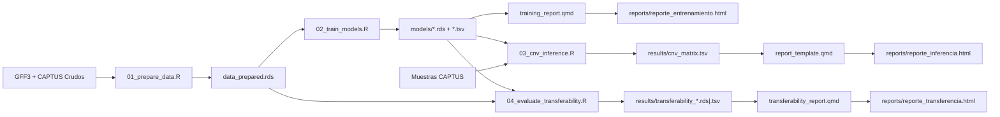

# TargetCNV-ML: Aprendizaje Automático e Inferencia Espacial para Variaciones en el Número de Copias en Captura de Genes

[English Version](README.md) | [Guía de Ejecución (ES)](GUIA_EJECUCION.md) | [Execution Guide (EN)](EXECUTION_GUIDE.md)

[](https://doi.org/10.5281/zenodo.23463987)
[](https://www.r-project.org/)
[](https://opensource.org/licenses/MIT)
[](#inicio-rápido-batería-de-pruebas)
[](https://rstudio.github.io/renv/)

**TargetCNV-ML** es una herramienta bioinformática desarrollada en R y ejecutable desde la línea de comandos para estimar **variaciones en el número de copias génicas (CNV)** a partir de ensamblajes obtenidos por captura dirigida de genes (*Target Capture* / *Hyb-Seq*). Su propósito principal es discriminar entre **homólogos funcionales** (ortólogos principales y parálogos reales) y artefactos técnicos del ensamblaje *de novo*.

*Nota sobre el idioma del flujo interno:* Los mensajes de registro en consola, los nombres de las columnas en las tablas exportadas y los tres reportes HTML compilados con Quarto dentro de `reports/` (`reporte_entrenamiento.html`, `reporte_inferencia.html` y `reporte_transferencia.html`) se generan en español.

---

## Contexto Biológico y Enfoque Metodológico

En estudios filogenómicos y de evolución del metabolismo especializado en plantas, la captura de genes mediante sondas de hibridación permite recuperar cientos de loci nucleares a bajo costo. No obstante, cuando se intenta estimar el número de copias de cada familia génica directamente a partir de los contigs ensamblados por herramientas como CAPTUS y MEGAHIT, aparecen dos fuentes sistemáticas de error:

1. **Hibridación cruzada y captura fuera de objetivo:** Las sondas diseñadas sobre exones conservados suelen hibridar simultáneamente con el ortólogo principal, con parálogos divergentes y con fragmentos intrónicos o intergénicos no codificantes. Si estos últimos no se filtran, incrementan sustancialmente la tasa de falsos descubrimientos (FDR).
2. **Fragmentación técnica del ensamblaje:** Un mismo locus génico puede quedar dividido en dos o más contigs parciales durante el ensamblaje de lecturas cortas. Contabilizar cada contig recuperado como una copia independiente confunde fragmentación técnica con duplicación génica real.

Para resolver ambos problemas, el flujo de trabajo de **TargetCNV-ML** se divide en cuatro módulos secuenciales:

### 1. Etiquetado espacial de referencia (`01_prepare_data.R`)
Cruza por cromosoma y hebra (`GenomicRanges`) los contigs nucleares ensamblados por CAPTUS (`protein_match:NUC`) frente a la anotación GFF3 del genoma de referencia. En especies cuyo ensamblaje de referencia se encuentra fragmentado a nivel de contigs, extrae el locus desde el atributo `Target` y reconcilia los grupos jerárquicos `HOG_ID` con los ortogrupos pangenómicos `OG_ID` empleando la tabla de diseño de sondas. Posteriormente aplica deduplicación intra-locus para conservar como verdadero positivo (`TRUE_POSITIVE`) únicamente el contig principal de cada gen anotado.

### 2. Colinealidad y entrenamiento supervisado determinista (`02_train_models.R`)
Evalúa la correlación por rangos de Spearman ($\rho$) entre las cuatro métricas continuas de alineamiento de CAPTUS (`pct_recovered`, `pct_identity`, `score` y `wscore`), calcula 4 umbrales univariados óptimos según el índice $J$ de Youden y calibra un ensamble heurístico ponderado (`Weighted_Heuristic`). Sobre la misma partición entrena **18 clasificadores supervisados** (`RandomForest`, `GBM`, `XGBoost`, `SVM_Radial`, `SVM_Lineal`, `SVM_Polinomial`, `Red_Neuronal`, `Red_Neuronal_Bag`, `ElasticNet`, `KNN`, `CART`, `NaiveBayes`, `LDA`, `MLP`, `MLP_Regularizado`, `QDA`, `Bagging_Arboles` y `Stacked Autoencoder - DNN`) junto con un meta-modelo GLM de apilamiento (`Ensamble_Stacking`, completando 24 métodos en total) bajo esquemas balanceado y desbalanceado, acompañados de análisis de explicabilidad aditiva con KernelSHAP.

### 3. Consenso de 7 modelos e inferencia de copias (`03_cnv_inference.R`)
Clasifica nuevas muestras mediante votación por mayoría ($\ge 4/7$ votos) combinando 4 modelos supervisados (`ElasticNet`, `NaiveBayes`, `SVM_Polinomial`, `Red_Neuronal`), 2 puntos de corte de Youden (`pct_recovered`, `pct_identity`) y el modelo `Weighted_Heuristic`. Dentro de cada muestra y ortogrupo, la secuencia válida de mayor cobertura se registra como `Copia_Principal`, los hits secundarios con `pct_recovered >= --cov_threshold` (por defecto `50.0%`) se suman como `Homologo_Confirmado` y los fragmentos más cortos se marcan como `No_Contado`. Además, el módulo genera una curva empírica de sensibilidad barriendo el umbral de cobertura entre `30%` y `80%`.

### 4. Transferibilidad inter-especie y concordancia por ortogrupo (`04_evaluate_transferability.R`)
Aplica sin reentrenamiento los modelos calibrados en la especie donante (*Solanum torvum*) sobre especies receptoras con genoma a escala cromosómica (*S. citrullifolium*) o a escala de contigs (*S. stellatiglandulosum*). Evalúa tanto el desempeño de clasificación binaria como la concordancia del número de copias por ortogrupo ($\widehat{\text{CNV}}_{\text{OG}}$ frente a $\text{CNV}^{\text{real}}_{\text{OG}}$) mediante correlación de Spearman ($\rho$), coeficiente Kappa cuadrático ponderado ($\kappa_w$), RMSE y porcentaje de concordancia exacta.

---

## Organización del Repositorio

```text
TargetCNV-ML/
├── DESCRIPTION                  # Metadatos y dependencias del paquete R TargetCNVML
├── NAMESPACE                    # Funciones exportadas del paquete
├── .Rprofile                    # Activación automática de la librería aislada renv
├── .gitignore                   # Reglas de exclusión para binarios pesados y salidas locales
├── renv.lock                    # Versiones exactas de paquetes fijadas en R 4.6.2 / Bioconductor 3.23
├── pixi.toml                    # Definición de entorno reproducible con Pixi (R 4.6 + Quarto 1.10.20)
├── Apptainer.def                # Receta de contenedor Apptainer/Singularity (R 4.6.2 + Quarto 1.10.20)
├── targetcnv.sh                 # Script envoltorio en Bash para ejecutar el flujo desde terminal
├── run_test_pipeline.sh         # Ejecución automatizada del Ejemplo Mínimo Funcional (MWE)
├── assets/
│   ├── report.css               # Hoja de estilos CSS para los reportes HTML
│   └── waterfall.js             # Lógica JavaScript del explorador interactivo SHAP Waterfall
├── training_report.qmd          # Plantilla Quarto (solo lectura) del reporte de entrenamiento
├── report_template.qmd          # Plantilla Quarto (solo lectura) del reporte de inferencia CNV
├── transferability_report.qmd   # Plantilla Quarto (solo lectura) del reporte de transferencia
├── GUIA_EJECUCION.md            # Manual detallado de ejecución y parámetros en español
├── EXECUTION_GUIDE.md           # Manual de ejecución en inglés
│
├── R/                           # Funciones modulares documentadas con roxygen2
│   ├── model_specs.R            # Especificación de los 18 clasificadores, XGBoost y semillas CV
│   ├── data_processing.R        # Cruce espacial GFF, puente OG/HOG, deduplicación y matriz CNV
│   ├── model_evaluation.R       # Cortes de Youden, Spearman, consenso, concordancia CNV y transferencia
│   ├── plotting.R               # Funciones gráficas en ggplot2 y cowplot
│   └── report_helpers.R         # Lectura de artefactos, tablas DT y visualizaciones Plotly/SHAP
│
├── scripts/                     # Scripts CLI basados en optparse
│   ├── 01_prepare_data.R        # Módulo 01: Cruce espacial GFF y preparación del conjunto de datos
│   ├── 02_train_models.R        # Módulo 02: Colinealidad, validación cruzada de 24 métodos y SHAP
│   ├── 03_cnv_inference.R       # Módulo 03: Inferencia de CNV, consenso y curva de cobertura 30-80%
│   └── 04_evaluate_transferability.R # Módulo 04: Transferencia filogenética y concordancia por ortogrupo
│
├── tests/                       # Pruebas unitarias e integrales con testthat
│   ├── testthat.R
│   └── testthat/
│       ├── test-models-and-seeds.R
│       ├── test-spatial-and-cnv.R
│       └── test-mwe-pipeline.R
│
├── .github/workflows/ci.yml     # Flujo de integración continua para GitHub Actions
├── data/
│   ├── reference/               # GFF3 de referencia, diccionario de sondas y sources_citations.tsv
│   ├── CAPTUS_Muestras/         # Tablas de extracción de CAPTUS para muestras poblacionales
│   └── test_data/               # Datos sintéticos livianos para el MWE y las pruebas unitarias
│
├── models/                      # Modelos serializados (.rds), tablas benchmark (.tsv), Spearman y SHAP
├── results/                     # Matrices CNV, curvas de sensibilidad y resultados de transferencia
└── reports/                     # Carpeta donde se agrupan todos los reportes HTML compilados
```

---

## Instalación y Configuración del Entorno

### Requisitos de software
El flujo está diseñado para ejecutarse en sistemas Linux (probado en Ubuntu 22.04/24.04, Debian y Arch/CachyOS), macOS o Windows mediante WSL2. Se recomienda contar con **R 4.6.2** y **Bioconductor 3.23** para coincidencia directa con `renv.lock` (aunque el código es compatible con R $\ge 4.3$), **Quarto CLI 1.10.20** (o $\ge 1.4$) para renderizar las plantillas `.qmd`, y las herramientas estándar de compilación y descarga (`bash`, `curl` o `wget`, `unzip`, `md5sum`, `gcc`, `g++`, `gfortran`, `cmake` y `make`).

### Restauración de paquetes con `renv` (opción recomendada)

```bash
git clone https://github.com/xyzdiego/TargetCNV-ML.git
cd TargetCNV-ML
chmod +x targetcnv.sh run_test_pipeline.sh scripts/*.R

# Instala exactamente las versiones registradas en renv.lock sin alterar el lockfile
./targetcnv.sh restore
./targetcnv.sh doctor
```

> [!CAUTION]
> **Evite usar `renv::hydrate()` o `renv::snapshot()` durante la instalación:** La hidratación vincula paquetes instalados globalmente en el sistema anfitrión sin respetar las versiones congeladas y un `snapshot` posterior sobrescribiría `renv.lock`. Utilice siempre `./targetcnv.sh restore` (o `./targetcnv.sh setup`), que invoca `renv::restore(prompt = FALSE)` de forma segura.

### Uso mediante Pixi o contenedor Apptainer
Si prefiere congelar tanto la versión de R como las librerías de sistema y Quarto CLI en un entorno aislado:

```bash
# Con Pixi (lee pixi.toml)
pixi install
pixi run doctor

# Con Apptainer / Singularity (construye la imagen a partir de Apptainer.def)
apptainer build targetcnv-ml.sif Apptainer.def
apptainer exec targetcnv-ml.sif ./targetcnv.sh doctor
```

---

## Inicio Rápido (Batería de Pruebas)

Antes de trabajar con datos genómicos propios, puede comprobar el funcionamiento del código mediante la suite de pruebas `testthat` y el **Ejemplo Mínimo Funcional (MWE)** incluido en `data/test_data/`:

```bash
# 1. Pruebas unitarias e integrales (intersección GFF, semillas CV, XGBoost, Stacking, matriz CNV y MWE)
Rscript tests/testthat.R

# 2. Ejecución completa del MWE generando los reportes HTML de prueba en reports/
./targetcnv.sh test
```

Al correr `./targetcnv.sh test` (que invoca `./run_test_pipeline.sh`), el flujo prepara los datos simulados en `data/test_data/prepared/`, entrena los clasificadores en validación cruzada dentro de `data/test_data/models/`, estima la matriz de copias en `data/test_data/results/` y compila `reports/reporte_entrenamiento_test.html` y `reports/reporte_inferencia_test.html`, dejando intactas las carpetas `models/` y `results/` de la raíz del repositorio.

---

## Ejecución del Flujo de Trabajo

Los modelos preentrenados sobre *Solanum torvum* (`models/*.rds`) no se almacenan directamente en Git por su tamaño binario, sino en Zenodo bajo el DOI [10.5281/zenodo.23463987](https://doi.org/10.5281/zenodo.23463987). Si desea ejecutar directamente la inferencia (`03_cnv_inference.R`) o la evaluación de transferencia (`04_evaluate_transferability.R`) sin reentrenar los modelos localmente, descárguelos primero con:

```bash
./targetcnv.sh zenodo
```

Este subcomando descarga el archivo comprimido con reintentos automáticos, comprueba su suma MD5 (eliminando el `.zip` si está corrupto) y verifica que se hayan extraído `consensus_spec.rds` y los 18 modelos supervisados dentro de `models/`.

### Subcomandos disponibles en `./targetcnv.sh`

| Subcomando | Ejemplo de invocación | Función principal |
| :--- | :--- | :--- |
| `restore` / `setup` | `./targetcnv.sh restore` | Restaura la librería R local siguiendo estrictamente `renv.lock`. |
| `doctor` | `./targetcnv.sh doctor` | Verifica R, Quarto, herramientas del sistema y disponibilidad de paquetes. |
| `test` | `./targetcnv.sh test [--no-report]` | Ejecuta el flujo MWE aislado sobre los datos sintéticos de `data/test_data/`. |
| `zenodo` | `./targetcnv.sh zenodo [--out-dir .]` | Descarga y valida los modelos preentrenados desde Zenodo hacia `models/`. |
| `prepare` | `./targetcnv.sh prepare [opciones]` | Ejecuta el Módulo 01 (`scripts/01_prepare_data.R`). |
| `train` | `./targetcnv.sh train [opciones]` | Ejecuta el Módulo 02 (`scripts/02_train_models.R`). |
| `infer` | `./targetcnv.sh infer -i stats.tsv --auto-zenodo` | Ejecuta el Módulo 03 (`scripts/03_cnv_inference.R`). |
| `transfer` | `./targetcnv.sh transfer [--sources ...]` | Ejecuta el Módulo 04 (`scripts/04_evaluate_transferability.R`) y su reporte HTML. |
| `report` | `./targetcnv.sh report [--models-dir models]` | Recompila `reports/reporte_entrenamiento.html` en modo de solo lectura. |
| `reproduce-storvum` | `./targetcnv.sh reproduce-storvum --cores 4` | Reproduce secuencialmente los módulos `01` $\rightarrow$ `02` $\rightarrow$ `03` en *S. torvum*. |
| `run-all` | `./targetcnv.sh run-all -g ref.gff3 -c cap.gff -s stats.tsv -d dict.xlsx -i pop.tsv` | Ejecuta `01` $\rightarrow$ `02` $\rightarrow$ `03` sobre los datos de una especie nueva. |

**Precaución con banderas que eliminan o sobrescriben archivos previos:**
- `--clean_models` (en `02_train_models.R`): borra todos los archivos `.rds` y `.tsv` previos dentro de la carpeta `--out_models` antes de guardar el nuevo entrenamiento. Esta bandera es opcional (no se activa por defecto ni dentro de `reproduce-storvum`); utilícela únicamente cuando quiera limpiar por completo una carpeta de modelos antes de reentrenar desde cero.
- `--sync-root` (en `./targetcnv.sh test` o `./run_test_pipeline.sh`): copia las salidas sintéticas del MWE sobre las carpetas `models/` y `results/` principales del proyecto. No la utilice si tiene modelos reales entrenados o descargados en `models/`.

### Flujo de datos y plantillas Quarto de solo lectura

Las tres plantillas Quarto (`training_report.qmd`, `report_template.qmd` y `transferability_report.qmd`) funcionan exclusivamente como capas de visualización de **solo lectura**: no ajustan modelos ni sobrescriben archivos en `models/` o `results/`.



### Resumen de ejecución de los cuatro módulos en R

#### Módulo 01 (`01_prepare_data.R`)
```bash
Rscript scripts/01_prepare_data.R \
  --gff_ref data/reference/Storvum_genes.gff3 \
  --captus_gff data/reference/Storvum_hit_contigs.gff \
  --captus_stats data/reference/captus-extract_stats.tsv \
  --dict_ref data/reference/Genes_Capture_May_2026.xlsx \
  --sample Storvum \
  --genome_scale chromosome \
  --out_dir data/
```
Parámetros principales: `-g/--gff_ref` (GFF3 del genoma de referencia, requerido en escala `chromosome`), `-c/--captus_gff` (GFF de contigs de CAPTUS), `-s/--captus_stats` (`captus-extract_stats.tsv`), `-d/--dict_ref` (diccionario `.xlsx`/`.tsv`), `-p/--sample` (muestra a filtrar), `--genome_scale` (`chromosome` o `contig`), `--allow_multi_sample` (solo para datos sintéticos MWE) y `-o/--out_dir` (carpeta de salida, por defecto `data/`).

#### Módulo 02 (`02_train_models.R`)
```bash
Rscript scripts/02_train_models.R \
  --data data/data_prepared.rds \
  --out_models models/ \
  --cv_folds 5 \
  --sampling down \
  --cores 4 \
  --seed 1234 \
  --sources data/reference/sources_citations.tsv \
  --report_file reports/reporte_entrenamiento.html
```
Parámetros principales: `-d/--data` (`data_prepared.rds`), `-m/--out_models` (`models/`), `-k/--cv_folds` (`5`), `-s/--sampling` (`down`, `up` o `none`), `-c/--cores` (núcleos PSOCK), `--seed` (semilla maestra que fija particiones y `seeds` de `trainControl`), `--fast_tournament` (subconjunto rápido de 5 modelos), `--no_stacking`, `--clean_models` (borrado previo de `--out_models`), `--include_hit` y `-r/--report_file`.

#### Módulo 03 (`03_cnv_inference.R`)
```bash
Rscript scripts/03_cnv_inference.R \
  --input data/CAPTUS_Muestras/captus-extract_stats.tsv \
  --models_dir models/ \
  --out_dir results/ \
  --cov_threshold 50.0 \
  --min_votes 4 \
  --top_loci 30 \
  --sources data/reference/sources_citations.tsv \
  --report_file reports/reporte_inferencia.html
```
Parámetros principales: `-i/--input` (estadísticas de extracción CAPTUS), `-m/--models_dir` (`models/`), `-o/--out_dir` (`results/`), `-c/--cov_threshold` (`50.0`), `-v/--min_votes` (`4` de 7 votos), `-t/--top_loci` (`30`), `--true_cnv` (conteos reales opcionales para concordancia) y `-r/--report_file`.

#### Módulo 04 (`04_evaluate_transferability.R`)
```bash
./targetcnv.sh transfer --sources data/reference/sources_citations.tsv
```
Para una explicación detallada de cada opción, tablas de benchmark en *Solanum* y flujos paso a paso, consulte [GUIA_EJECUCION.md](GUIA_EJECUCION.md) (o [EXECUTION_GUIDE.md](EXECUTION_GUIDE.md) en inglés).

---

## Fuentes Genómicas y Citación

- **Genomas a escala cromosómica (*Solanum torvum* y *Solanum citrullifolium*):** Disponibles en **Solanum Pan-Genomics** (https://solpangenomics.com/dist/pages/downloads/index.php), **Solanaceae Genomics Network (SGN)** (https://solgenomics.net/ftp/genomes/Solanum_pangenomics/) y **NCBI BioProject `PRJNA1073673`** (https://www.ncbi.nlm.nih.gov/bioproject/PRJNA1073673). Anotaciones de genes y ortogrupos (`OG_ID`) tomadas de **Benoit, M. *et al.*** (2025), *Solanum pan-genetics reveals paralogues as contingencies in crop engineering*, **Nature**, 640(8057): 135-145, [doi:10.1038/s41586-025-08619-6](https://doi.org/10.1038/s41586-025-08619-6).
- **Genoma a escala de contigs (*Solanum stellatiglandulosum*):** Depositado en **NCBI BioProject `PRJNA1070281`** (https://www.ncbi.nlm.nih.gov/bioproject/?term=txid3132602%5BOrganism:noexp%5D) por el **Grupo de Genómica Evolutiva del Metabolismo Especializado de la Universidad Nacional de Colombia**. Anotaciones de genes y grupos jerárquicos de ortólogos (`HOG_ID`) descritas en **Pérez-Mesa, P. A. & Roda, F.** (2025), *Alkaloid evolution in the solanaceae*, **Current Opinion in Plant Biology**, 85: 102727, [doi:10.1016/j.pbi.2025.102727](https://doi.org/10.1016/j.pbi.2025.102727); y **Pérez-Mesa, P. A., Pardo, R. A., Alseekh, S. *et al.*** (2026), *Genetic basis of alkaloid divergence in the solanaceae*, **Plant Molecular Biology**, 116: 67, [doi:10.1007/s11103-026-01718-6](https://doi.org/10.1007/s11103-026-01718-6).

Si utiliza este repositorio o sus modelos en un trabajo académico, por favor cite el paquete y el documento de tesis de maestría:

```bibtex
@software{targetcnv_ml_2026,
  author       = {Benítez Duarte, Diego Andrés},
  title        = {{TargetCNV-ML: Machine Learning and Spatial Inference for Copy Number Variations in Target Capture}},
  month        = jul,
  year         = 2026,
  publisher    = {Zenodo},
  version      = {v1.1.0},
  doi          = {10.5281/zenodo.23463987},
  url          = {https://doi.org/10.5281/zenodo.23463987}
}

@mastersthesis{benitez_duarte_thesis_2026,
  author       = {Benítez Duarte, Diego Andrés},
  title        = {{Desarrollo de un flujo de trabajo bioinformático para la Detección de Variación en el Número de Copias (CNV) de genes a partir de secuencias genómicas de lectura corta}},
  school       = {Universidad Nacional de Colombia},
  year         = 2026,
  address      = {Colombia},
  note         = {Tesis de Maestría en Bioinformática}
}
```

---

## Licencia

El código fuente se distribuye bajo la **Licencia MIT** (véase el archivo [LICENSE](LICENSE)). Los datos procesados y los modelos entrenados alojados en Zenodo se publican bajo licencia **Creative Commons Atribución 4.0 Internacional (CC BY 4.0)**.
