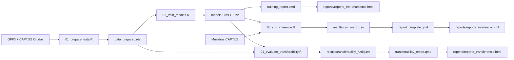

# TargetCNV-ML: Aprendizaje Automático e Inferencia Espacial para Variaciones en el Número de Copias en Captura de Genes

[English Version](README.md) | [Guía de Ejecución (ES)](GUIA_EJECUCION.md) | [Execution Guide (EN)](EXECUTION_GUIDE.md)

[](https://doi.org/10.5281/zenodo.23463987)
[](https://www.r-project.org/)
[](https://opensource.org/licenses/MIT)
[](#inicio-rápido-batería-de-pruebas)
[](https://rstudio.github.io/renv/)

Paquete bioinformático en R con interfaz de línea de comandos para estimar **variaciones en el número de copias (CNV)** y distinguir **homólogos funcionales** frente a artefactos técnicos en ensamblajes de secuenciación por captura de genes (*Target Capture*).

> [!IMPORTANT]
> **Idioma del flujo interno:** Los mensajes de consola, los nombres de columnas en las tablas de salida y los reportes HTML generados con Quarto dentro de `reports/` (`reporte_entrenamiento.html`, `reporte_inferencia.html` y `reporte_transferencia.html`) están redactados en **español**.

---

## Visión General

La captura dirigida de genes (*Target Capture*) permite recuperar cientos de loci nucleares a bajo costo en estudios filogenómicos y de genética evolutiva. Sin embargo, cuantificar el número de copias génicas a partir de contigs ensamblados *de novo* presenta dos dificultades recurrentes:

1. **Hibridación cruzada y asimetría entre parálogos:** Las sondas suelen capturar simultáneamente ortólogos principales, parálogos divergentes y fragmentos fuera de objetivo en regiones intrónicas o intergénicas, elevando la tasa de falsos descubrimientos (FDR).
2. **Fragmentación técnica del ensamblaje:** Un único gen puede ensamblarse en dos o más contigs parciales. Contar todos los contigs recuperados como copias independientes sobreestima artificialmente el número de copias.

**TargetCNV-ML** aborda ambos problemas en cuatro etapas acopladas:
- **Etiquetado espacial de referencia (`01_prepare_data.R`):** Intersección estricta por cromosoma y hebra (`GenomicRanges`) frente a la anotación GFF3 de referencia (o reconciliación de identificadores `Target` mediante tabla puente `HOG_ID` / `OG_ID` en ensamblajes a escala de contigs), seguida de deduplicación intra-locus para retener un único verdadero positivo por gen anotado.
- **Diagnóstico de colinealidad y entrenamiento supervisado (`02_train_models.R`):** Prueba de correlación por rangos de Spearman ($\rho$) entre las cuatro métricas continuas de CAPTUS (`pct_recovered`, `pct_identity`, `score`, `wscore`), optimización de 4 puntos de corte univariados de Youden, ajuste de 1 ensamble heurístico ponderado (`Weighted_Heuristic`), validación cruzada estratificada determinista sobre **18 algoritmos supervisados** (`RandomForest`, `GBM`, `XGBoost`, `SVM_Radial`, `SVM_Lineal`, `SVM_Polinomial`, `Red_Neuronal`, `Red_Neuronal_Bag`, `ElasticNet`, `KNN`, `CART`, `NaiveBayes`, `LDA`, `MLP`, `MLP_Regularizado`, `QDA`, `Bagging_Arboles`, `Stacked Autoencoder - DNN`) y ajuste del meta-modelo `Ensamble_Stacking` (24 métodos en total), en regímenes balanceado y desbalanceado, junto con explicabilidad KernelSHAP.
- **Consenso multimodelo y calibración de cobertura (`03_cnv_inference.R`):** Votación por mayoría ($\ge 4/7$ votos) integrando 4 clasificadores supervisados (`ElasticNet`, `NaiveBayes`, `SVM_Polinomial`, `Red_Neuronal`), 2 umbrales de Youden (`pct_recovered`, `pct_identity`) y el modelo heurístico ponderado. Dentro de cada muestra y ortogrupo, la secuencia aceptada de mayor cobertura se asigna como `Copia_Principal`, los hits adicionales con `pct_recovered >= --cov_threshold` (por defecto `50.0%`) se contabilizan como `Homologo_Confirmado` y los fragmentos menores quedan como `No_Contado`, generando además una curva empírica de sensibilidad entre `30%` y `80%`.
- **Transferencia filogenética y concordancia de copias por ortogrupo (`04_evaluate_transferability.R`):** Evaluación sin reentrenamiento sobre especies receptoras a escala cromosómica y de contigs, cuantificando tanto las métricas binarias de clasificación como la concordancia del número de copias por ortogrupo ($\widehat{\text{CNV}}_{\text{OG}}$ vs. $\text{CNV}^{\text{real}}_{\text{OG}}$) mediante $\rho$ de Spearman, Kappa cuadrático ponderado ($\kappa_w$), RMSE y tasa de concordancia exacta.

---

## Estructura del Repositorio

```text
TargetCNV-ML/
├── DESCRIPTION                  # Metadatos formales y dependencias del paquete R TargetCNVML
├── NAMESPACE                    # Funciones exportadas del paquete TargetCNVML
├── .Rprofile                    # Activación automática del entorno aislado renv
├── .gitignore                   # Reglas de exclusión de binarios pesados y artefactos locales
├── renv.lock                    # Versiones exactas fijadas sobre R 4.6.2 y Bioconductor 3.23
├── pixi.toml                    # Entorno reproducible conda-forge/bioconda (R 4.6 + Quarto 1.10.20)
├── Apptainer.def                # Receta de contenedor Apptainer/Singularity (R 4.6.2 + Quarto 1.10.20)
├── targetcnv.sh                 # Script auxiliar en Bash para ejecutar los módulos desde terminal
├── run_test_pipeline.sh         # Ejecución automatizada del Ejemplo Mínimo Funcional (MWE)
├── assets/
│   └── report.css               # Hoja de estilos compartida por los reportes HTML de Quarto
├── training_report.qmd          # Plantilla Quarto (solo lectura) para el reporte de entrenamiento
├── report_template.qmd          # Plantilla Quarto (solo lectura) para el reporte de inferencia CNV
├── transferability_report.qmd   # Plantilla Quarto (solo lectura) para el reporte de transferencia
├── GUIA_EJECUCION.md            # Guía detallada de uso y referencia de comandos en español
├── EXECUTION_GUIDE.md           # Guía detallada de uso y referencia de comandos en inglés
│
├── R/                           # Funciones modulares del paquete documentadas con roxygen2
│   ├── model_specs.R            # Especificación de 18 modelos ML, adaptador XGBoost y semillas CV
│   ├── data_processing.R        # Cruce espacial GFF, puente OG/HOG, deduplicación y matriz CNV
│   ├── model_evaluation.R       # Youden, Spearman, consenso de 7 modelos, concordancia CNV y transferencia
│   ├── plotting.R               # Gráficos ggplot2 de densidades, Spearman, sensibilidad y heatmaps
│   └── report_helpers.R         # Cargadores de solo lectura, tablas DT, gráficos Plotly y SHAP
│
├── scripts/                     # Scripts de interfaz de línea de comandos (optparse)
│   ├── 01_prepare_data.R        # Módulo 01: Etiquetado espacial GFF y preparación de datos
│   ├── 02_train_models.R        # Módulo 02: Colinealidad, validación cruzada de 24 métodos y SHAP
│   ├── 03_cnv_inference.R       # Módulo 03: Inferencia de CNV, consenso 7 modelos y sensibilidad 30-80%
│   └── 04_evaluate_transferability.R # Módulo 04: Evaluación de transferencia inter-especie y concordancia CNV
│
├── tests/                       # Suite de pruebas unitarias e integración (testthat)
│   ├── testthat.R
│   └── testthat/
│       ├── test-models-and-seeds.R
│       ├── test-spatial-and-cnv.R
│       └── test-mwe-pipeline.R
│
├── .github/workflows/ci.yml     # Integración continua en GitHub Actions
├── data/
│   ├── reference/               # GFF3 de referencia, diccionario de sondas y sources_citations.tsv
│   ├── CAPTUS_Muestras/         # Estadísticas de extracción CAPTUS multimuestra
│   └── test_data/               # Conjunto sintético liviano para el MWE y pruebas automatizadas
│
├── models/                      # Modelos serializados (.rds), benchmarks (.tsv), Spearman y SHAP
├── results/                     # Matrices CNV, tablas de sensibilidad, concordancia y transferencia
└── reports/                     # Directorio unificado de reportes HTML compilados con Quarto
```

---

## Requisitos e Instalación Reproducible

### Requisitos del Sistema
- **Sistema operativo:** Linux (probado en Ubuntu 22.04/24.04, Debian y Arch/CachyOS), macOS o Windows vía WSL2.
- **R:** versión `4.6.2` recomendada para coincidencia exacta con `renv.lock` y Bioconductor `3.23` (compatible con R $\ge 4.3$).
- **Quarto CLI:** versión `1.10.20` (compatible con Quarto $\ge 1.4$) para renderizar las plantillas `.qmd`.
- **Herramientas del sistema:** `bash`, `curl` o `wget`, `unzip`, `md5sum`, `gcc`, `g++`, `gfortran`, `make`.

### Opción A: Restauración estricta con `renv` (recomendada)

```bash
git clone https://github.com/xyzdiego/TargetCNV-ML.git
cd TargetCNV-ML
chmod +x targetcnv.sh run_test_pipeline.sh scripts/*.R

# Restaura exactamente las versiones declaradas en renv.lock (sin alterar el lockfile)
./targetcnv.sh restore
./targetcnv.sh doctor
```

> [!CAUTION]
> **Separación entre `restore` e hidratación de desarrollo:** Para instalar el entorno nunca utilice `renv::hydrate()` ni `renv::snapshot()`, ya que vinculan paquetes no fijados del sistema anfitrión y sobrescriben `renv.lock`. Utilice siempre `./targetcnv.sh restore` (o su alias `./targetcnv.sh setup`), que ejecuta `renv::restore(prompt = FALSE)` respetando estrictamente `renv.lock`.

### Opción B: Entorno congelado con Pixi o Apptainer

Si desea fijar simultáneamente R, las bibliotecas compiladas del sistema y Quarto CLI:

```bash
# Mediante Pixi (pixi.toml)
pixi install
pixi run doctor

# Mediante contenedor Apptainer / Singularity (Apptainer.def)
apptainer build targetcnv-ml.sif Apptainer.def
apptainer exec targetcnv-ml.sif ./targetcnv.sh doctor
```

---

## Inicio Rápido (Batería de Pruebas)

El repositorio incluye un **Ejemplo Mínimo Funcional (MWE)** en `data/test_data/` y una suite formal `testthat` en `tests/testthat/`.

```bash
# 1. Ejecutar la suite de pruebas unitarias e integración (cruce GFF, semillas, XGBoost, Stacking, CNV y MWE)
Rscript tests/testthat.R

# 2. Ejecutar el MWE completo con compilación de reportes HTML en reports/
./targetcnv.sh test
```

### Etapas verificadas por `./targetcnv.sh test` (`./run_test_pipeline.sh`):
1. Ejecuta `01_prepare_data.R` sobre las coordenadas simuladas y genera `data/test_data/prepared/data_prepared.rds`.
2. Ejecuta `02_train_models.R` calculando la matriz de Spearman, los cortes de Youden y la validación cruzada determinista, compilando `reports/reporte_entrenamiento_test.html`.
3. Ejecuta `03_cnv_inference.R` aplicando el consenso multimodelo, la regla del 50% y el barrido de sensibilidad (`30%`–`80%`), compilando `reports/reporte_inferencia_test.html` sin modificar `models/` ni `results/` en la raíz del proyecto.

---

## Flujo de Ejecución

> [!WARNING]
> **Descarga de modelos preentrenados desde Zenodo:**
> Los archivos binarios `models/*.rds` no se almacenan en Git. Si desea ejecutar directamente la inferencia (`03_cnv_inference.R`) o la evaluación de transferencia (`04_evaluate_transferability.R`) sin entrenar desde cero, descargue y verifique el paquete de modelos desde el registro DOI [10.5281/zenodo.23463987](https://doi.org/10.5281/zenodo.23463987):
> ```bash
> ./targetcnv.sh zenodo
> ```
> El subcomando verifica la suma MD5, elimina automáticamente cualquier archivo `.zip` incompleto o corrupto si la verificación falla y comprueba la presencia de `consensus_spec.rds` y de los 18 clasificadores supervisados.

> [!TIP]
> La referencia completa de opciones, interpretación estadística y resultados sobre *Solanum* se encuentra en [GUIA_EJECUCION.md](GUIA_EJECUCION.md) y [EXECUTION_GUIDE.md](EXECUTION_GUIDE.md).

### Script Auxiliar de Ejecución (`./targetcnv.sh`)

| Subcomando | Ejemplo | Descripción |
| :--- | :--- | :--- |
| `restore` / `setup` | `./targetcnv.sh restore` | Restaura la librería local desde `renv.lock` (`renv::restore(prompt = FALSE)`). |
| `doctor` | `./targetcnv.sh doctor` | Verifica R, `renv`, Quarto CLI, herramientas del sistema y los paquetes requeridos. |
| `test` | `./targetcnv.sh test [--no-report]` | Ejecuta el MWE sobre datos sintéticos aislados en `data/test_data/`. |
| `zenodo` | `./targetcnv.sh zenodo [--out-dir .]` | Descarga `TargetCNV_Models.zip`, valida MD5 y verifica los artefactos extraídos en `models/`. |
| `prepare` | `./targetcnv.sh prepare [opciones de 01]` | Ejecuta el Módulo 01 (`scripts/01_prepare_data.R`). |
| `train` | `./targetcnv.sh train [opciones de 02]` | Ejecuta el Módulo 02 (`scripts/02_train_models.R`). |
| `infer` | `./targetcnv.sh infer -i stats.tsv --auto-zenodo` | Ejecuta el Módulo 03 (`scripts/03_cnv_inference.R`), descargando modelos si `models/` está vacío. |
| `transfer` | `./targetcnv.sh transfer [--sources ...]` | Ejecuta el Módulo 04 (`scripts/04_evaluate_transferability.R`) y compila `reports/reporte_transferencia.html`. |
| `report` | `./targetcnv.sh report [--models-dir models]` | Recompila `reports/reporte_entrenamiento.html` en modo de solo lectura. |
| `reproduce-storvum` | `./targetcnv.sh reproduce-storvum --cores 4` | Ejecuta secuencialmente los módulos `01` $\rightarrow$ `02` $\rightarrow$ `03` sobre *Solanum torvum*. |
| `run-all` | `./targetcnv.sh run-all -g ref.gff3 -c cap.gff -s stats.tsv -d dict.xlsx -i pop.tsv` | Ejecuta `01` $\rightarrow$ `02` $\rightarrow$ `03` para calibrar e inferir sobre una especie nueva. |

> [!CAUTION]
> **Opciones que sobrescriben o eliminan artefactos previos:**
> - `--clean_models` (en `02_train_models.R`): elimina todos los archivos `.rds` y `.tsv` previos dentro de `--out_models` antes de guardar el nuevo entrenamiento. Úselo únicamente cuando realice un reentrenamiento completo y desee evitar que queden modelos antiguos en la misma carpeta.
> - `--sync-root` (en `./targetcnv.sh test` o `./run_test_pipeline.sh`): copia los modelos sintéticos del MWE sobre las carpetas `models/` y `results/` de la raíz, reemplazando cualquier entrenamiento real existente. Úselo solo en entornos desechables de prueba, nunca sobre resultados reales.

### Arquitectura Modular de Scripts y Reportes de Solo Lectura

Las tres plantillas Quarto (`training_report.qmd`, `report_template.qmd` y `transferability_report.qmd`) operan exclusivamente en **modo de solo lectura**: no entrenan modelos ni escriben en `models/` o `results/`. Si faltan artefactos precomputados, muestran un aviso indicando el comando exacto a ejecutar.



### Módulo 01: Preparación de Datos y Etiquetado Espacial (`01_prepare_data.R`)

Cruza los contigs nucleares (`protein_match:NUC`) contra el GFF3 del genoma de referencia (`--genome_scale chromosome`) o extrae el locus desde el atributo `Target` reconciliando grupos `HOG_ID` y `OG_ID` (`--genome_scale contig`), integra las cuatro métricas continuas de CAPTUS y resuelve redundancias intra-locus.

```bash
Rscript scripts/01_prepare_data.R \
  --gff_ref data/reference/Storvum_genes.gff3 \
  --captus_gff data/reference/Storvum_hit_contigs.gff \
  --captus_stats data/reference/captus-extract_stats.tsv \
  --dict_ref data/reference/Genes_Capture_May_2026.xlsx \
  --sample Storvum \
  --genome_scale chromosome \
  --out_dir data/
```

| Opción | Argumento | Tipo | Descripción |
| :--- | :--- | :--- | :--- |
| `-g` | `--gff_ref` | Archivo | Anotación GFF3 del genoma de referencia (obligatorio en escala `chromosome`). |
| `-c` | `--captus_gff` | Archivo | Archivo GFF de contigs ensamblados por CAPTUS (obligatorio). |
| `-s` | `--captus_stats` | Archivo | Tabla `captus-extract_stats.tsv` generada por CAPTUS (obligatorio). |
| `-d` | `--dict_ref` | Archivo | Diccionario de homología (`.xlsx`, `.tsv` o `.csv`). |
| `-p` | `--sample` | Texto | Identificador de muestra a filtrar dentro de `captus-extract_stats.tsv`. |
| | `--genome_scale` | Texto | `'chromosome'` (intersección espacial GFF3; por defecto) o `'contig'` (extracción desde `Target` para ensamblajes fragmentados). |
| | `--target_mode` | Texto | Alias explícito del método de cruce: `'overlap'` o `'target_attr'`. |
| | `--allow_multi_sample` | Bandera | Permite procesar múltiples muestras en un mismo cruce (por ejemplo, en el MWE). |
| `-o` | `--out_dir` | Carpeta | Directorio de salida para `data_prepared.rds` y `data_prepared.tsv` (por defecto: `data/`). |

---

### Módulo 02: Colinealidad, Entrenamiento Determinista y SHAP (`02_train_models.R`)

Evalúa la colinealidad por rangos de Spearman entre `pct_recovered`, `pct_identity`, `score` y `wscore`, calcula los umbrales de Youden y el modelo heurístico ponderado, entrena los 18 clasificadores supervisados y `Ensamble_Stacking` con particiones y lista `seeds` deterministas derivadas de `--seed` (reproducibilidad idéntica con independencia de `--cores`), calcula valores KernelSHAP y compila `reports/reporte_entrenamiento.html`.

```bash
Rscript scripts/02_train_models.R \
  --data data/data_prepared.rds \
  --out_models models/ \
  --cv_folds 5 \
  --sampling down \
  --cores 4 \
  --seed 1234 \
  --sources data/reference/sources_citations.tsv \
  --report_file reports/reporte_entrenamiento.html
```

| Opción | Argumento | Tipo | Descripción |
| :--- | :--- | :--- | :--- |
| `-d` | `--data` | Archivo | Archivo `data_prepared.rds` o `.tsv` generado en el Módulo 01 (obligatorio). |
| `-m` | `--out_models` | Carpeta | Directorio de salida para artefactos `.rds` y `.tsv` (por defecto: `models/`). |
| `-k` | `--cv_folds` | Entero | Número de pliegues de validación cruzada estratificada (por defecto: `5`). |
| `-s` | `--sampling` | Texto | Esquema de balanceo para el escenario balanceado: `down`, `up` o `none` (por defecto: `down`). |
| `-c` | `--cores` | Entero | Número de núcleos paralelos PSOCK (por defecto: `detectCores() - 1`). |
| | `--seed` | Entero | Semilla maestra para particiones, rejillas y `seeds` de `trainControl` (por defecto: `1234`). |
| | `--extended_tournament` / `--fast_tournament` | Bandera | Evalúa los 18 algoritmos ML (por defecto) o el subconjunto rápido de 5 modelos (`--fast_tournament`). |
| | `--train_stacking` / `--no_stacking` | Bandera | Ajusta (por defecto) u omite el meta-modelo `Ensamble_Stacking`. |
| | `--clean_models` | Bandera | **Operación destructiva:** borra `.rds`/`.tsv` existentes en `--out_models` antes de guardar. |
| | `--include_hit` | Bandera | Añade el índice ordinal `hit` como quinto predictor (`consensus_spec.rds` lo propaga al Módulo 03, aunque se recomienda mantenerlo desactivado para generalizar entre lotes). |
| | `--render_report` / `--no_render_report` | Bandera | Compila (por defecto) u omite el reporte HTML en Quarto. |
| `-r` | `--report_file` | Archivo | Ruta del reporte HTML compilado (por defecto: `reports/reporte_entrenamiento.html`). |
| | `--sources` | Archivo | Tabla TSV opcional con metadatos y citas bibliográficas (`data/reference/sources_citations.tsv`). |

---

### Módulo 03: Inferencia de CNV y Calibración del Umbral de Cobertura (`03_cnv_inference.R`)

Aplica el consenso de 7 modelos ($\ge 4/7$ votos), estima la matriz `Locus x Muestra` con la regla de cobertura individual (`--cov_threshold 50.0`), exporta la curva de sensibilidad del umbral entre `30%` y `80%` (`cnv_threshold_sensitivity.tsv`), calcula la concordancia de copias por ortogrupo cuando el archivo de entrada posee etiquetas de referencia o se proporciona `--true_cnv`, y compila `reports/reporte_inferencia.html`.

```bash
Rscript scripts/03_cnv_inference.R \
  --input data/CAPTUS_Muestras/captus-extract_stats.tsv \
  --models_dir models/ \
  --out_dir results/ \
  --cov_threshold 50.0 \
  --min_votes 4 \
  --top_loci 30 \
  --sources data/reference/sources_citations.tsv \
  --report_file reports/reporte_inferencia.html
```

| Opción | Argumento | Tipo | Descripción |
| :--- | :--- | :--- | :--- |
| `-i` | `--input` | Archivo | Archivo TSV/CSV/RDS con estadísticas de extracción CAPTUS (obligatorio). |
| `-m` | `--models_dir` | Carpeta | Directorio con los modelos entrenados y `consensus_spec.rds` (por defecto: `models/`). |
| `-o` | `--out_dir` | Carpeta | Carpeta de salida para matrices, tablas de sensibilidad y figuras (por defecto: `results/`). |
| `-c` | `--cov_threshold` | Decimal | Cobertura mínima (`pct_recovered`, en %) para contabilizar copias adicionales (por defecto: `50.0`). |
| `-v` | `--min_votes` | Entero | Votos mínimos (sobre 7) para aceptar una secuencia como `Homologo_Valido` (por defecto: `4`). |
| `-t` | `--top_loci` | Entero | Número de ortogrupos con mayor número de copias mostrados en el mapa de calor (por defecto: `30`). |
| | `--true_cnv` | Archivo | Matriz o tabla opcional con conteos reales de referencia ($\text{CNV}^{\text{real}}_{\text{OG}}$) para evaluar concordancia. |
| | `--render_report` / `--no_render_report` | Bandera | Compila (por defecto) u omite `reports/reporte_inferencia.html`. |
| `-r` | `--report_file` | Archivo | Ruta del reporte HTML de inferencia (por defecto: `reports/reporte_inferencia.html`). |
| | `--sources` | Archivo | Archivo TSV opcional con citas de las fuentes genómicas (`data/reference/sources_citations.tsv`). |

---

### Módulo 04: Transferencia Filogenética y Concordancia por Ortogrupo (`04_evaluate_transferability.R`)

Evalúa sin reajuste los 24 métodos entrenados y el consenso de 7 modelos sobre especies receptoras con genoma a escala cromosómica (*S. citrullifolium*) o a escala de contigs (*S. stellatiglandulosum*), calcula la concordancia de número de copias por ortogrupo ($\rho$ de Spearman, Kappa cuadrático ponderado, RMSE y concordancia exacta) junto con la curva de calibración de `--cov_threshold` (`30%`–`80%`), exporta todos los resultados a `results/transferability_*.tsv|.rds` y compila `reports/reporte_transferencia.html`.

```bash
./targetcnv.sh transfer --sources data/reference/sources_citations.tsv
```

---

## Citación y Fuentes de Datos de Referencia

- **Genomas de referencia a escala cromosómica (*Solanum torvum* y *Solanum citrullifolium*):** Disponibles en **Solanum Pan-Genomics** (https://solpangenomics.com/dist/pages/downloads/index.php), **Solanaceae Genomics Network (SGN)** (https://solgenomics.net/ftp/genomes/Solanum_pangenomics/) y **NCBI BioProject `PRJNA1073673`** (https://www.ncbi.nlm.nih.gov/bioproject/PRJNA1073673). Datos de genes y ortogrupos (`OG_ID`): **Benoit, M. *et al.*** (2025), *Solanum pan-genetics reveals paralogues as contingencies in crop engineering*, **Nature**, 640(8057): 135–145, [doi:10.1038/s41586-025-08619-6](https://doi.org/10.1038/s41586-025-08619-6).
- **Genoma de referencia a escala de contigs (*Solanum stellatiglandulosum*):** Registrado en **NCBI BioProject `PRJNA1070281`** (https://www.ncbi.nlm.nih.gov/bioproject/?term=txid3132602%5BOrganism:noexp%5D) por el **Grupo de Genómica Evolutiva del Metabolismo Especializado de la Universidad Nacional de Colombia**. Datos de genes y homología jerárquica (`HOG_ID`): **Pérez-Mesa, P. A. & Roda, F.** (2025), *Alkaloid evolution in the solanaceae*, **Current Opinion in Plant Biology**, 85: 102727, [doi:10.1016/j.pbi.2025.102727](https://doi.org/10.1016/j.pbi.2025.102727); y **Pérez-Mesa, P. A., Pardo, R. A., Alseekh, S. *et al.*** (2026), *Genetic basis of alkaloid divergence in the solanaceae*, **Plant Molecular Biology**, 116: 67, [doi:10.1007/s11103-026-01718-6](https://doi.org/10.1007/s11103-026-01718-6).

Si emplea **TargetCNV-ML** en su investigación, por favor cite el software y la tesis asociada:

```bibtex
@software{targetcnv_ml_2026,
  author       = {Benítez Duarte, Diego Andrés},
  title        = {{TargetCNV-ML: Machine Learning and Spatial Inference for Copy Number Variations in Target Capture}},
  month        = jul,
  year         = 2026,
  publisher    = {Zenodo},
  version      = {v1.1.0},
  doi          = {10.5281/zenodo.23463987},
  url          = {https://doi.org/10.5281/zenodo.23463987}
}

@mastersthesis{benitez_duarte_thesis_2026,
  author       = {Benítez Duarte, Diego Andrés},
  title        = {{Desarrollo de un flujo de trabajo bioinformático para la Detección de Variación en el Número de Copias (CNV) de genes a partir de secuencias genómicas de lectura corta}},
  school       = {Universidad Nacional de Colombia},
  year         = 2026,
  address      = {Colombia},
  note         = {Tesis de Maestría en Bioinformática}
}
```

---

## Licencia

Distribuido bajo la **Licencia MIT** — véase [LICENSE](LICENSE). Los conjuntos de datos derivados y los modelos serializados depositados en Zenodo se distribuyen bajo **Creative Commons Atribución 4.0 Internacional (CC BY 4.0)**.
