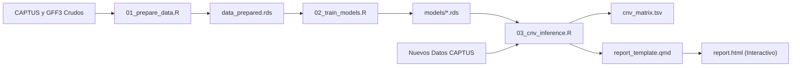

# TargetCNV-ML: Aprendizaje Automático e Inferencia Espacial para Variaciones en el Número de Copias en Captura de Genes

[🇬🇧 English Version](README.md)

[](https://doi.org/10.5281/zenodo.XXXXXXX)
[](https://www.r-project.org/)
[](https://opensource.org/licenses/MIT)
[-brightgreen.svg)](#inicio-rápido-batería-de-pruebas)
[](https://rstudio.github.io/renv/)

Un paquete de software bioinformático modular, reproducible y ejecutable por línea de comandos (CLI), diseñado para detectar **Variaciones en el Número de Copias (CNV)** y resolver **expansiones de genes homólogos** a partir de datos de secuenciación masiva por Captura de Genes (Target Capture / Hyb-Seq).

---

## Visión General

La Captura de Genes (Target Capture / Hyb-Seq) es una técnica de secuenciación de última generación altamente costo-efectiva, ampliamente utilizada en filogenómica, genética evolutiva y mejoramiento molecular. No obstante, la extracción de variaciones genómicas estructurales como las **Variaciones en el Número de Copias (CNV)** a partir de ensamblajes de captura se enfrenta a dos cuellos de botella biológicos y técnicos interconectados:

1. **Asimetría Homóloga e Hibridación Cruzada Fuera de Objetivo:** Los eventos de duplicación génica generan familias multigénicas con trayectorias evolutivas divergentes. Los cóntigos ensamblados frecuentemente se alinean sobre loci homólogos estrechamente emparentados, produciendo asignaciones ambiguas y tasas elevadas de falsos descubrimientos (FDR).
2. **Artefactos de Fragmentación del Ensamblaje:** Los ensamblajes de cóntigos *de novo* a menudo fragmentan genes individuales de gran longitud en múltiples piezas cortas. Las heurísticas ingenuas de conteo de copias confunden esta fragmentación técnica con duplicaciones génicas biológicas, provocando una severa inflación artificial del número de copias.

**TargetCNV-ML** resuelve estos desafíos mediante una arquitectura híbrida que integra:
- **Intersección Genómica Espacial y Rescate en Tándem:** Cruce estricto de coordenadas mediante `GenomicRanges`, validación con diccionario de homología teórica, rescate de vecinos sinténicos y resolución de redundancias basada en métricas de calidad de ensamblaje.
- **Torneo de Aprendizaje Automático Supervisado:** Clasificación multimodelo con submuestreo de clases balanceado (`ElasticNet`, `NaiveBayes`, `SVM`, `Redes Neuronales Artificiales`, `LDA`) junto con puntos de corte univariados basados en el **estadístico J de Youden**.
- **Sistema de Consenso de 7 Modelos:** Un ensamble ponderado que exige mayoría simple (≥ 4/7 votos favorables) para confirmar homólogos funcionales genuinos, descartando el ruido intergénico o intrónico.
- **Reglas de Control de Fragmentación del Ensamblaje:** Criterio de umbral de cobertura acumulada en dos niveles (`pct_recovered` ≥ 50.0% y `Σ(pct_recovered)` ≤ 120.0%) que discrimina de forma precisa la fragmentación técnica de las duplicaciones homólogas biológicas reales.

---

## Estructura del Repositorio

```text
TargetCNV-ML/
├── .Rprofile                    # Activación automática del entorno virtual renv
├── .gitignore                   # Exclusión de archivos binarios pesados y datos crudos (estándar Zenodo)
├── renv.lock                    # Archivo de bloqueo que registra las versiones exactas de paquetes de R
├── report_template.qmd          # Plantilla interactiva de reporte en Quarto (crosstalk + plotly + DT)
├── run_test_pipeline.sh         # Script bash para ejecutar el Ejemplo Mínimo Funcional de punta a punta
├── Workflow_Central.R           # Script monolítico de investigación original (mantenido por trazabilidad)
│
├── R/                           # Funciones modulares puras de R documentadas con roxygen2
│   ├── data_processing.R        # Cruce de GFF, rescate en tándem, resolución de redundancias, matriz CNV
│   ├── model_evaluation.R       # Matrices de confusión, optimización Youden, consenso de 7 modelos, inferencia
│   └── plotting.R               # Funciones ggplot2/plotly para densidades, benchmarks, curvas ROC y heatmaps
│
├── scripts/                     # Scripts ejecutables por CLI utilizando optparse
│   ├── 01_prepare_data.R        # Paso 1: Cruce espacial con GFF e ingeniería de características
│   ├── 02_train_models.R        # Paso 2: Entrenamiento, validación cruzada con submuestreo y serialización .rds
│   └── 03_cnv_inference.R       # Paso 3: Inferencia de CNV en producción mediante consenso de 7 modelos
│
├── data/
│   ├── reference/               # Anotaciones genómicas GFF3 de referencia y diccionarios de homología
│   ├── CAPTUS_Muestras/         # Estadísticas de ensamblaje CAPTUS multmuestra (descargables de Zenodo)
│   └── test_data/               # Conjunto de datos simulado y liviano (<20 KB) para pruebas automáticas
│
├── models/                      # Modelos de ML preentrenados y objetos de umbrales (.rds)
└── results/                     # Matrices CNV generadas, tablas de clasificación y gráficos diagnósticos
```

---

## Requisitos Previos e Instalación

### Requisitos del Sistema
- **Linux** (probado en Ubuntu 20.04+, Debian, Arch/CachyOS) o **macOS**.
- **R** ≥ 4.0.0 (recomendado R 4.3+ o 4.6).
- **Quarto** ≥ 1.3+ (para compilar los reportes HTML interactivos).
- Herramientas estándar de desarrollo (`gcc`, `g++`, `make`, `libcurl`, `openssl`).

### Instalación

1. **Clonar el repositorio:**
   ```bash
   git clone https://github.com/xyzdiego/TargetCNV-ML.git
   cd TargetCNV-ML
   ```

2. **Restaurar dependencias con `renv`:**
   Abra una sesión interactiva de R o ejecute en la terminal para restaurar las versiones exactas de los paquetes fijadas en `renv.lock`:
   ```bash
   Rscript -e "renv::restore()"
   ```

   > [!NOTE]
   > El entorno incluye bibliotecas bioinformáticas y de aprendizaje automático esenciales: `GenomicRanges`, `rtracklayer`, `caret`, `glmnet`, `klaR`, `pROC`, `optparse`, `crosstalk`, `plotly`, `DT` y `tidyverse`.

---

## Inicio Rápido (Batería de Pruebas)

TargetCNV-ML incluye un **Ejemplo Mínimo Funcional (MWE)** autocontenido en el directorio `data/test_data/`, el cual contiene coordenadas de referencia simuladas en formato GFF3, cóntigos de CAPTUS y métricas numéricas entre muestras sintéticas.

Valide su instalación ejecutando la batería de pruebas automatizada de punta a punta:

```bash
chmod +x run_test_pipeline.sh
./run_test_pipeline.sh
```

### Qué realiza `run_test_pipeline.sh`:
1. Ejecuta `01_prepare_data.R` para calcular las intersecciones espaciales y limpiar identificadores.
2. Ejecuta `02_train_models.R` para optimizar los cortes de Youden y entrenar 5 clasificadores con validación cruzada de 3 pliegues.
3. Ejecuta `03_cnv_inference.R` para aplicar el consenso de 7 modelos, filtrar la fragmentación y generar la matriz de CNV final.
4. Valida que todas las tablas y gráficos de salida (`cnv_matrix.tsv`, `consensus_verdicts.tsv`, `plot_cnv_heatmap.pdf`) se hayan creado satisfactoriamente.

---

## Uso en Producción

> [!WARNING]
> **Modelos Preentrenados y Archivos en Zenodo:**
> Siguiendo las directrices de ciencia abierta, los genomas de referencia de gran volumen y los modelos serializados (`models/*.rds`) se encuentran archivados en **Zenodo** para evitar el crecimiento excesivo del repositorio Git. Antes de ejecutar el Paso 3 (`03_cnv_inference.R`) sobre conjuntos de datos en producción sin reentrenar:
> 1. Descargue el paquete de modelos preentrenados desde el DOI de Zenodo: [`10.5281/zenodo.XXXXXXX`](https://doi.org/10.5281/zenodo.XXXXXXX).
> 2. Extraiga los archivos `.rds` en el directorio local `models/`:
>    ```bash
>    tar -xzf targetcnv_pretrained_models.tar.gz -C models/
>    ```

El flujo de trabajo se divide en tres módulos ejecutables por CLI:



### Paso 1: Preparación de Datos y Cruces Espaciales

Calcula las intersecciones espaciales exactas (`GenomicRanges`), contrasta los cóntigos contra el diccionario de homología de referencia, resuelve redundancias por calidad y calcula las puntuaciones locales delta.

```bash
./scripts/01_prepare_data.R \
  --gff_ref data/reference/Storvum_genes.gff3 \
  --captus_gff data/reference/Storvum_hit_contigs.gff \
  --captus_stats data/reference/captus-extract_stats.tsv \
  --dict_ref data/reference/Genes_Capture_May_2026.xlsx \
  --sample Storvum \
  --out_dir data/
```

**Parámetros:**
| Parámetro | Argumento | Tipo | Descripción |
| :--- | :--- | :--- | :--- |
| `-g` | `--gff_ref` | Archivo | Archivo de anotación GFF3 del genoma de referencia `[Requerido]` |
| `-c` | `--captus_gff` | Archivo | Archivo GFF de cóntigos ensamblados por CAPTUS `[Requerido]` |
| `-s` | `--captus_stats` | Archivo | TSV de estadísticas de CAPTUS (`captus-extract_stats.tsv`) `[Requerido]` |
| `-d` | `--dict_ref` | Archivo | Diccionario de homología de referencia (.xlsx, .tsv, .csv) `[Opcional]` |
| `-p` | `--sample` | Texto | Nombre de la muestra para filtrar en las estadísticas `[Opcional]` |
| `-o` | `--out_dir` | Carpeta | Directorio de destino (por defecto: `data/`) |
| `-m` | `--max_distance`| Entero | Distancia sinténica máxima (número de genes) para rescate en tándem (por defecto: `50`) |

---

### Paso 2: Entrenamiento de Modelos y Validación Cruzada

Calcula los umbrales univariados óptimos de Youden, ejecuta una búsqueda en cuadrícula para el ensamble heurístico ponderado, balancea las clases (`down-sampling`) y entrena modelos supervisados mediante `caret`.

```bash
./scripts/02_train_models.R \
  --data data/data_prepared.rds \
  --out_models models/ \
  --cv_folds 5 \
  --sampling down \
  --cores 4 \
  --seed 1234
```

**Parámetros:**
| Parámetro | Argumento | Tipo | Descripción |
| :--- | :--- | :--- | :--- |
| `-d` | `--data` | Archivo | Datos preparados generados en el Paso 1 (.rds o .tsv) `[Requerido]` |
| `-m` | `--out_models` | Carpeta | Directorio para guardar los modelos serializados `.rds` (por defecto: `models/`) |
| `-k` | `--cv_folds` | Entero | Número de pliegues para validación cruzada k-fold (por defecto: `5`) |
| `-s` | `--sampling` | Texto | Método de balanceo de clases: `down`, `up`, o `none` (por defecto: `down`) |
| `-c` | `--cores` | Entero | Número de hilos para ejecución en paralelo (por defecto: `detectCores() - 1`) |
| `--seed` | `--seed` | Entero | Semilla aleatoria para reproducibilidad estocástica exacta (por defecto: `1234`) |
| | `--include_hit` | Bandera | Incluir el rango ordinal de hit de CAPTUS como predictor (por defecto: `FALSE`) |

---

### Paso 3: Inferencia de CNV y Consenso en Producción

Aplica el **Sistema de Consenso de 7 Modelos** (Regla de Mayoría ≥ 4/7 votos favorables), efectúa el control espacial de fragmentación técnica y exporta la matriz final de CNV junto con gráficos listos para publicación.

```bash
./scripts/03_cnv_inference.R \
  --input data/CAPTUS_Muestras/captus-extract_stats.tsv \
  --models_dir models/ \
  --out_dir results/ \
  --cov_threshold 50.0 \
  --frag_threshold 120.0 \
  --min_votes 4 \
  --top_loci 30
```

**Parámetros:**
| Parámetro | Argumento | Tipo | Descripción |
| :--- | :--- | :--- | :--- |
| `-i` | `--input` | Archivo | Archivo TSV/CSV con las métricas de cóntigos de captura `[Requerido]` |
| `-m` | `--models_dir` | Carpeta | Directorio con los modelos serializados `.rds` (por defecto: `models/`) |
| `-o` | `--out_dir` | Carpeta | Directorio de destino para tablas y figuras (por defecto: `results/`) |
| `-c` | `--cov_threshold`| Decimal | % mínimo de cobertura individual para confirmar copia homóloga (por defecto: `50.0`) |
| `-f` | `--frag_threshold`| Decimal | % máximo de cobertura acumulada para atribuir a fragmentación (por defecto: `120.0`) |
| `-v` | `--min_votes` | Entero | Mínimo de votos positivos para validar homología funcional (por defecto: `4`) |
| `-t` | `--top_loci` | Entero | Número de familias génicas homólogas más abundantes en el heatmap (por defecto: `30`) |

---

### Paso 4: Generación de Reportes Web Interactivos (Quarto)

TargetCNV-ML incluye una plantilla de panel interactivo independiente (`report_template.qmd`) potenciada por `crosstalk`, `plotly` y `DT`. Se ejecuta íntegramente del lado del cliente sin requerir un servidor Shiny:

```bash
quarto render report_template.qmd \
  -P consensus_verdicts:results/consensus_verdicts.tsv \
  -P cnv_matrix:results/cnv_matrix.tsv \
  -P cnv_annotated:results/cnv_annotated_sequences.tsv \
  -P top_loci:30 \
  --output targetcnv_report.html
```

---

## Citación

Si utiliza **TargetCNV-ML** en su investigación académica o en pipelines de genómica aplicada, por favor cite el software y el trabajo de tesis correspondiente:

```bibtex
@software{targetcnv_ml_2026,
  author       = {Benítez Duarte, Diego Andrés},
  title        = {{TargetCNV-ML: Machine Learning & Spatial Inference for Copy Number Variations in Target Capture}},
  month        = jul,
  year         = 2026,
  publisher    = {Zenodo},
  version      = {v1.0.0},
  doi          = {10.5281/zenodo.XXXXXXX},
  url          = {https://doi.org/10.5281/zenodo.XXXXXXX}
}

@mastersthesis{benitez_duarte_thesis_2026,
  author       = {Benítez Duarte, Diego Andrés},
  title        = {{Desarrollo de un flujo de trabajo bioinformático para la Detección de Variación en el Número de Copias (CNV) de genes a partir de secuencias genómicas de lectura corta}},
  school       = {Universidad Nacional de Colombia},
  year         = 2026,
  address      = {Colombia},
  note         = {Tesis de Maestría - Bioinformática}
}
```

---

## Licencia

Este proyecto está distribuido bajo la **Licencia MIT** — consulte el archivo [LICENSE](LICENSE) para más detalles.
